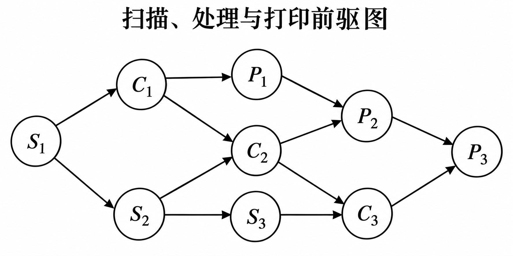
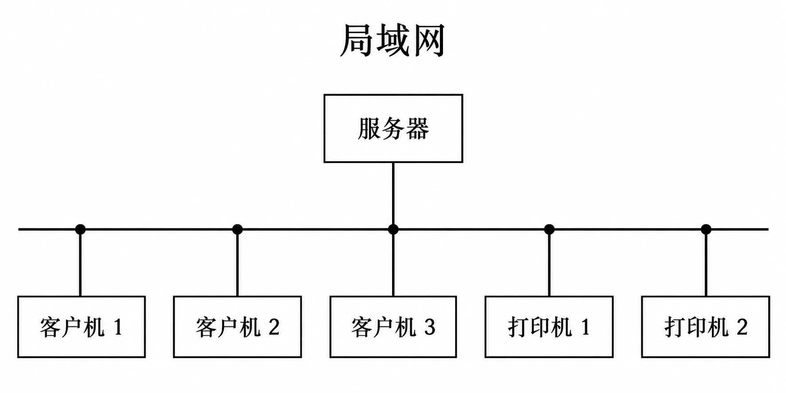
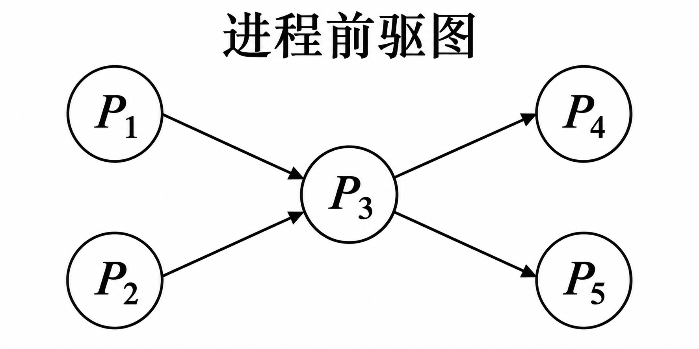
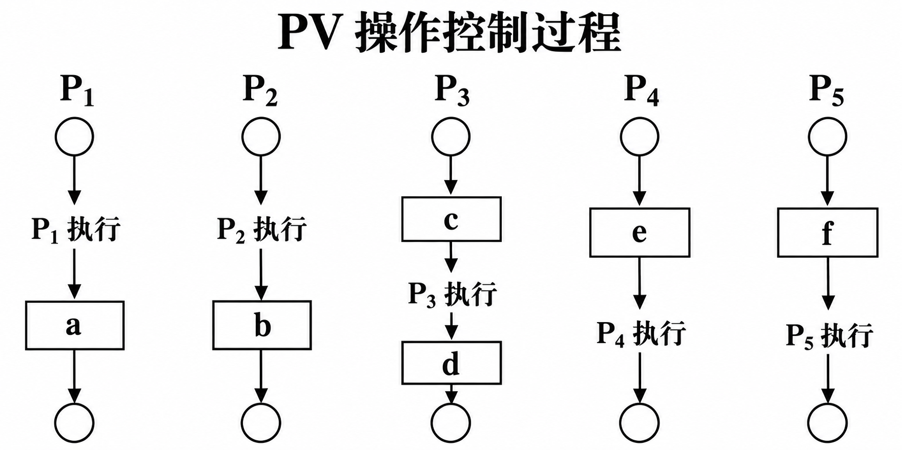
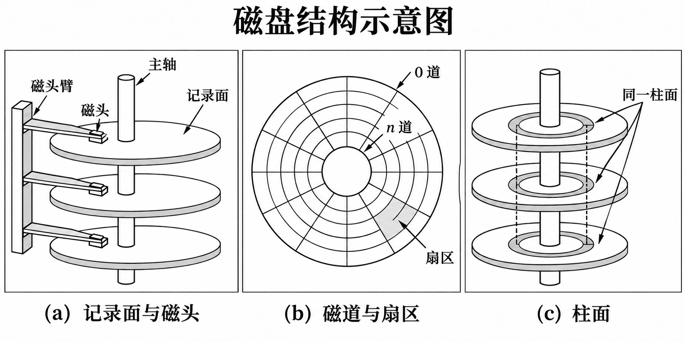
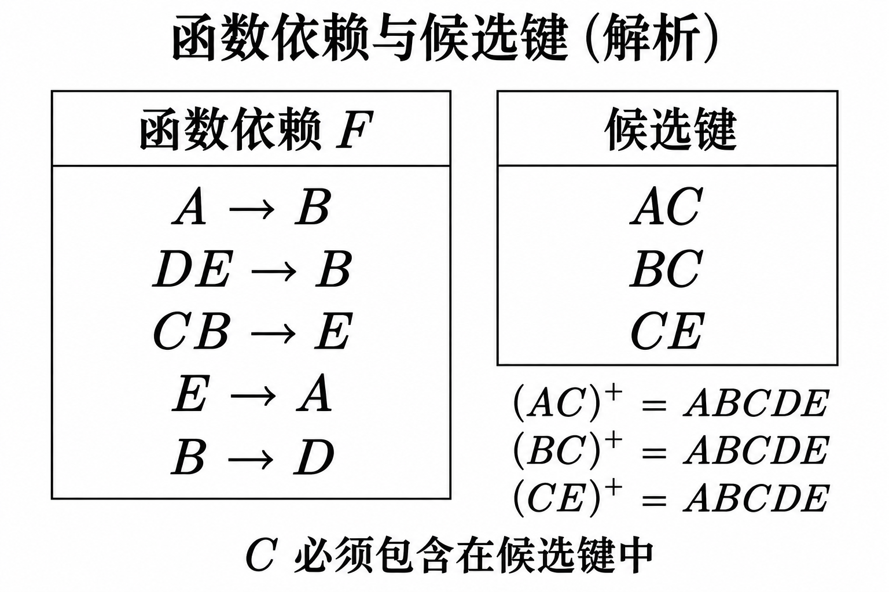

# 高级系统架构设计师上午押题密卷2

原件：[PDF](../../assets/d8dab49bffc01ecc.pdf)。已勾选推荐正确选项并在每题后附带冲刺速记解析；卷末保留参考答案与原完整解析。

排印修订和原卷歧义见 转换记录。

## 题目

### 第 1 题

SPEC 计算机性能测试有不同的方法，吞吐率测试是指对 （　） 的测试。

- A. 计算机完成单个任务要用多少时间
- B. 计算机在一定时间内能完成多少任务
- C. 计算机在一定时间内能输出多少数据
- D. 计算机在一段时间内能并行执行多少个程序

> **【答案】** B
> **【速记解析】**
> - **为什么选 B**：SPEC 性能测试基准包含两种测试方法：**速度测试**测试计算机完成单个任务所需时间（越短越好）；**吞吐率测试（Rate/Throughput）**测试计算机在**一定时间内能完成的任务数量**（越多越好）。
> - **为什么不选其他**：**A 选项**是“速度测试（Speed）”的定义；**C、D 选项**为概念混淆干扰项，吞吐率衡量的是完成的标准工作负载任务数，而非单纯的数据吞吐量或并行程序数。
### 第 2 题

操作系统通常将 I/O 软件分成4个层次：用户应用层软件、中断处理程序、独立于设备的软件和设备驱动程序，分层的主要目的是 （　）

- A. 提高处理速度
- B. 减少系统占用的空间
- C. 便于即插即用
- D. 便于系统修改、扩充和移植

> **【答案】** D
> **【速记解析】**
> - **为什么选 D**：I/O 软件采用分层架构（应用层→独立于设备的软件→设备驱动→中断处理）的核心目的是**解耦硬件相关与无关逻辑**，实现设备独立性，从而**便于系统修改、扩充和移植**（更换设备仅需增改驱动程序）。
> - **为什么不选其他**：**A 选项**分层调用引入层间切换开销，通常不会提高处理速度；**B 选项**多层抽象并不会减少系统内存开销；**C 选项**即插即用主要依赖硬件总线协议与即插即用管理器，并非 I/O 4 层分层的首要目的。
### 第 3～4 题共同题干

特定领域软件架构(DSSA) 是在一个特定应用领域为一组应用提供组织结构参考的标准软件架构。实施 DSSA 的过程中包括一系列基本的活动，其中 （3） 活动的主要目的是为了获得 DSSA。 该活动参加人员中， （4） 的主要任务是提供关于领域中系统的需求规约和实现的知识。

### 第 3 题

- A. 领域需求
- B. 领域分析
- C. 领域设计
- D. 领域实现

> **【答案】** C
> **【速记解析】**
> - **为什么选 C**：特定领域软件架构（DSSA）包括三大基本活动：**领域分析**（产出**领域模型**）、**领域设计**（主要目的即**获取 DSSA**）、**领域实现**（基于架构和模型开发**构件及应用系统**）。
> - **为什么不选其他**：**A 选项**“领域需求”是领域分析阶段的组成步骤（确定领域边界与需求），非独立活动阶段；**B 选项**“领域分析”的核心产物是**领域模型**；**D 选项**“领域实现”的核心产物是**可复用构件与具体应用系统**。
### 第 4 题

- A. 领域专家
- B. 领域分析者
- C. 领域设计者
- D. 领域实现者

> **【答案】** A
> **【速记解析】**
> - **为什么选 A**：DSSA 实施人员中，**领域专家**是有丰富行业应用经验的资深人员，其核心任务是**提供领域内系统需求规约和实现的专业知识**，协助分析员定义领域边界与演化方向。
> - **为什么不选其他**：**B 选项**“领域分析者”负责控制分析过程并组织形式化领域模型；**C 选项**“领域设计者”负责根据领域模型设计出通用的 DSSA 架构；**D 选项**“领域实现者”负责根据设计开发构件并装配具体系统。
### 第 5 题

对实际应用问题建立数学模型并求得结果后，还需要根据建模的目的和要求，利用相关知识，结合研究对象的特点，进行模型分析。模型分析工作一般不包括_

- A. 模型的合理性分析
- B. 模型的误差分析
- C. 模型的先进性分析
- D. 参数的灵敏性分析

> **【答案】** C
> **【速记解析】**
> - **为什么选 C**：数学建模完成后需进行模型分析，主要评估其客观有效性与工程可用性，包括：**合理性分析**（物理意义与假设是否合理）、**误差分析**（精度与数值稳定性）、**参数灵敏性分析**（参数扰动对输出的影响），一般不包含主观性的“**先进性分析**”。
> - **为什么不选其他**：**A、B、D 选项**均属于数学建模后检验评价的法定标准内容，模型讲求的是适用、稳定与精确，而非片面追求技术上的“先进性”。
### 第 6 题

（　） 是一种信息分析工具，能自动地找出数据仓库中的模式及关系。

- A. 数据集市
- B. 数据挖掘
- C. 预测分析
- D. 数据统计

> **【答案】** B
> **【速记解析】**
> - **为什么选 B**：**数据挖掘（Data Mining）**是一种信息分析工具，利用算法从海量数据（数据仓库）中**自动发现和提取隐藏的模式、未知规则与关联关系**。
> - **为什么不选其他**：**A 选项**“数据集市”是面向部门级的微型数据仓库存储组织，不是分析工具；**C 选项**“预测分析”偏向特定业务场景目标，非通用自动模式发现工具；**D 选项**“数据统计”基于已知假设和统计公式计算均值、方差等指标，无法自动挖掘未知深层模式。
### 第 7 题

软件需求分析产生软件操作特征的规格说明，指明软件和其他系统元素的接口，建立软件必须满足的约束。下面对于软件需求分析的描述，不正确的是 （　）

- A. 分析员研究系统规约和软件项目计划，并在系统语境内理解软件和复审，从而生成计划软件范围的估算
- B. 需求分析使得系统工程师能够刻画出软件的功能和性能、指明软件和其他系统元素的接口、并建立软件必须满足的约束
- C. 经过仔细的需求分析活动，分析员能够得到详细的系统规约
- D. 需求分析能够为软件设计者提供可被翻译成数据、体系结构、界面和过程设计的模型

> **【答案】** C
> **【速记解析】**
> - **为什么选 C**：软件需求分析的最终产物是**软件需求规格说明书（SRS / 软件规约）**；而“**系统规约**（System Specification）”是在更早的**系统工程/系统设计**阶段由系统工程师编写的软硬件整体顶层规范，需求分析阶段是输入它而非产出它。
> - **为什么不选其他**：**A 选项**正确，分析员需基于系统规约在系统语境下框定软件估算范围；**B 选项**正确，准确概括了需求分析在功能、接口、约束层面的职责；**D 选项**正确，需求分析建立的分析模型是后续架构与过程设计的直接输入。
### 第 8～10 题共同题干

某计算机系统中有一个 CPU、 一台扫描仪和一台打印机。现有三个图像任务，每个任务有三个程序段：扫描 Si, 图像处理 C₁ 和打印 Pi(i=1,2,3)。 图为三个任务各程序段并发执行的前趋图，其中，

（　） 可并行执行， （　） 的直接制约， （　） 的间接制约。

前趋图

### 第 8 题

- A. "C₁S₂","P₁C₂S₃","P₂C₃"
- B. "C₁S₁","S₂C₂P₂","C₃P₃"
- C. "S₁C₁P₁","S₂C₂P₂","S₃C₃P₃"
- D. "S₁S₂S₃","C₁C₂C3","P₁P₂P₃"

> **【答案】** A
> **【速记解析】**
> - **为什么选 A**：系统有 1 台扫描仪、1 个 CPU、1 台打印机，每个任务需经历 $S_i \to C_i \to P_i$。在三级流水线中，各阶段无冲突可并行执行的组合为：$S_1$ 完成后 **$C_1$ 与 $S_2$** 并行；二者完成后 **$P_1, C_2, S_3$** 三级流水并行；三者完成后 **$P_2, C_3$** 并行。
> - **为什么不选其他**：**B、C 选项**包含了同一任务内部前后有严格因果关系的工序（如 $C_1$ 与 $S_1$、$S_1$ 与 $P_1$），因数据依赖绝不可并行；**D 选项**组合争用同一硬件独占资源（如只有一台扫描仪，$S_1, S_2, S_3$ 无法并发）。
### 第 9 题

- A. S₁ 受到 S2和 S₃、C₁ 受到 C₂ 和 C₃、P₁ 受到 P₂ 和 P₃
- B. S2 和 S₃ 受到 S₁、C2 和 C₃ 受到 C₁、P₂ 和 P₃ 受到 P₁
- C. C1 和 P₁ 受到 S1、C₂和 P₂ 受到 S₂、C₃ 和 P₃ 受到 S₃
- D. C₁ 和 S₁ 受到 P₁、C₂ 和 S₂ 受到 P₂、C₃ 和 S₃ 受到 P₃

> **【答案】** C
> **【速记解析】**
> - **为什么选 C**：**直接制约（同步制约/数据依赖）**源于任务内部工序的先后因果关系：每个图像任务必须先扫描完成才能进行计算处理和打印输出，因此 **$C_1$ 和 $P_1$ 受到 $S_1$ 的直接制约**，$C_2$ 和 $P_2$ 受到 $S_2$ 的直接制约，$C_3$ 和 $P_3$ 受到 $S_3$ 的直接制约。
> - **为什么不选其他**：**A、D 选项**逻辑时序颠倒（后执行的工序不能制约先执行的工序）；**B 选项**是同类独占设备竞争所导致的**间接制约（互斥关系）**，而非任务内部的直接制约。
### 第 10 题

- A. S1 受到 S2和 S₃、C1 受到 C₂ 和 C₃、P1 受到 P₂ 和 P₃
- B. S2 和 S₃ 受到 S₁、C2 和 C₃ 受到 C₁、P₂ 和 P₃ 受到 P₁
- C. C₁ 和 P₁ 受到 S₁、C₂ 和 P₂ 受到 S₂、C₃ 和 P₃ 受到 S₃
- D. C₁ 和 S1, 受到 P₁、C2和 S₂ 受到 P₂、C₃ 和 S₃ 到 P₃

> **【答案】** B
> **【速记解析】**
> - **为什么选 B**：**间接制约（互斥制约/资源依赖）**源于对**共享独占硬件资源**的竞争：系统仅有 1 台扫描仪、1 个 CPU 和 1 台打印机，先进入的任务占用设备会阻塞后续任务使用同一设备，故 **$S_2, S_3$ 受到 $S_1$ 间接制约，$C_2, C_3$ 受到 $C_1$ 间接制约，$P_2, P_3$ 受到 $P_1$ 间接制约**。
> - **为什么不选其他**：**A 选项**前后时序颠倒；**C 选项**是任务内部因果数据流引起的**直接制约（同步）**；**D 选项**因果顺序倒置且逻辑混乱。
### 第 11 题

某磁盘磁头从一个磁道移至另一个磁道需要10ms。文件在磁盘上非连续存放，逻辑上相邻数据块的平均移动距离为10个磁道，每块的旋转延迟时间及传输时间分别为100ms 和2ms, 则读取一个100块的文件需要 （　） ms 的时间。

- A. 10200
- B. 11000
- C. 11200
- D. 20200

> **【答案】** D
> **【速记解析】**
> - **为什么选 D**：读取单个数据块耗时 = 寻道时间 + 旋转延迟时间 + 传输时间。每跨越 1 磁道需 10ms，平均移动 10 磁道，寻道时间 $= 10 \times 10 = 100\text{ms}$。读取单块总时间 $= 100\text{ms} + 100\text{ms} + 2\text{ms} = 202\text{ms}$。读取 100 块文件总时间 $= 100 \times 202 = \mathbf{20200}\text{ms}$。
> - **为什么不选其他**：**A 选项 (10200)** 漏算了寻道时间（按 $(100+2)\times 100$ 计算）；**B 选项 (11000)** 算错寻道或延迟时间；**C 选项 (11200)** 仅按移动 1 个磁道计算寻道时间（$(10+100+2)\times 100$），忽略了题干“平均移动距离为 10 个磁道”。
### 第 12～13 题共同题干

某磁盘盘组共有10个盘面，每个盘面上有100个磁道，每个磁道有32个扇区，假定物理块的大小为2个扇区，分配以物理块为单位。若使用位示图(Bitmap) 管理磁盘空间，则位图需要占用（12）字节空间。若采用空白文件管理磁盘空间，且空白文件目录的每个表项占用5个字节，则当空白文件数目大于（13）时，空白文件目录占用的字节数大于位图占用的字节数。

### 第 12 题

- A. 32000
- B. 3200
- C. 2000
- D. 1600

> **【答案】** C
> **【速记解析】**
> - **为什么选 C**：磁盘总扇区数 $= 10 \times 100 \times 32 = 32000$ 个。物理块大小为 2 个扇区，故物理块总数 $= 32000 / 2 = 16000$ 块。位示图用 1 位（bit）标识 1 个物理块，共需 16000 位。换算为字节 $= 16000 / 8 = \mathbf{2000}\text{ 字节}$。
> - **为什么不选其他**：**A 选项 (32000)** 误将每个扇区分配 1 字节；**B 选项 (3200)** 误将 32000 个扇区除以 10；**D 选项 (1600)** 误将 16000 块除以 10，均未按“8 bit = 1 字节”及“2 扇区/块”正确折算。
### 第 13 题

- A. 400
- B. 360
- C. 320
- D. 160

> **【答案】** A
> **【速记解析】**
> - **为什么选 A**：由上问可知位示图占用 **2000 字节**。每个空白文件目录表项占用 **5 字节**。设空白文件数目为 $N$，当空白文件目录空间大于位示图时：$5 \times N > 2000$，解得 $N > 2000 / 5 = \mathbf{400}$。
> - **为什么不选其他**：**B、C、D 选项**均为基于前问算错的干扰项（若前问误算出 1600 字节，则 $1600/5=320$ 对应 C；若误算出其它数值则对应 B 或 D）。
### 第 14 题

甲公司的某个注册商标是乙画家创作的绘画作品，甲申请该商标注册时未经乙的许可，乙认为其著作权受到侵害。在乙可采取的以下做法中，错误的是 （　）

- A. 向甲公司所在地人民法院提起著作权侵权诉讼
- B. 请求商标评审委员会裁定撤销甲的注册商标
- C. 首先提起诉讼，如对法院判决不服再请求商标评审委员会进行裁定
- D. 与甲交涉，采取许可方式让甲继续使用该注册商标

> **【答案】** C
> **【速记解析】**
> - **为什么选 C**：司法审判具有**终局裁判效力**。对法院判决不服的，当事人**只能依法向上级人民法院提起上诉或申请再审**，绝对**不能反过来请求行政性质的商标评审委员会进行裁定**（司法权力高于行政裁决，不可逆向撤销审判）。
> - **为什么不选其他**：**A 选项**合法，著作权人有权直接以侵犯在先合法权利为由向法院提起民事侵权诉讼；**B 选项**合法，可依据《商标法》以在先权利受损为由向商标评审委员会申请宣告注册商标无效/撤销；**D 选项**合法，双方可民事和解达成授权许可协议。
### 第 15 题

项目时间管理包括使项目按时完成所必需的管理过程，活动定义是其中的一个重要过程。通常可以使用 （　） 来进行活动定义。

- A. 鱼骨图
- B. 工作分解结构(WBS)
- C. 层次分解结构
- D. 功能分解图

> **【答案】** B
> **【速记解析】**
> - **为什么选 B**：项目时间管理中，**活动定义（Activity Definition）**的核心输入是**工作分解结构（WBS）**，通过将 WBS 最底层的**工作包（Work Package）**进一步分解为可直接分派、估算和控制的具体进度活动。
> - **为什么不选其他**：**A 选项**“鱼骨图（因果图/石川图）”用于质量管理中的根本原因分析；**C 选项**“层次分解结构”并非项目时间管理的标准规范方法；**D 选项**“功能分解图”用于需求工程中对软件功能的层次划分，不用于时间管理活动定义。
### 第 16～19 题共同题干

某公司的商品(商品号，商品名称，生产商，单价)和仓库(仓库号，地址，电话，商品号，库存量)两个实体之间的关系如表1和表2所示。

**表1商品表**

| 商品号 | 商品名称 | 生产商 | 单价 |
| --- | --- | --- | --- |
| 10023 | 笔记本 | 联想 | 4800 |
| 10024 | 激光打印机 | 联想 | 1650 |
| 10025 | 台式电脑 | 联想 | 3860 |
| 20003 | 激光打印机 | HP | 1280 |
| 20004 | 笔记本 | HP | 3900 |
| 20005 | 电冰箱 | 海尔 | 3860 |
| ··· | ··· | ··· | ··· |

**表2仓库表**

| 仓库号 | 地址 | 电话 | 商品号 | 库存量 |
| --- | --- | --- | --- | --- |
| 01 | 高新路1号 | 8601 | 10024 | 26 |

**仓库表（续）**

| 仓库号 | 地址 | 电话 | 商品号 | 库存量 |
| --- | --- | --- | --- | --- |
| 01 | 高新路1号 | 8601 | 10025 | 89 |
| 01 | 高新路1号 | 8601 | 20003 | 10 |
| 02 | 友谊路6号 | 8602 | 10023 | 39 |
| 02 | 友谊路6号 | 8602 | 20004 | 26 |
| 03 | 高新路1号 | 8603 | 20005 | 18 |
| ____ | ____ | ____ | ··· | ··· |

商品关系的主键是16 ;仓库关系的主键是17;仓库关系18,为了解决这一问题，需要将仓库关系分解为19 （　）

### 第 16 题

- A. 商品号
- B. 商品名称
- C. 生产商
- D. 单价

> **【答案】** A
> **【速记解析】**
> - **为什么选 A**：在商品关系（商品号，商品名称，生产商，单价）中，**商品号**能够唯一确定商品名称、生产商及单价，不存在重复，是该关系的**主键**。
> - **为什么不选其他**：**B 选项（商品名称）**不同厂商可生产同名商品（如联想和 HP 都生产“激光打印机”）；**C 选项（生产商）**一个厂商生产多种商品；**D 选项（单价）**不同商品单价可以相同，均无法作为唯一标识码。
### 第 17 题

- A. 仓库号，地址
- B. 仓库号，电话
- C. 仓库号，商品号
- D. 地址，电话

> **【答案】** C
> **【速记解析】**
> - **为什么选 C**：在仓库关系中，一个仓库可以存放多种商品，一种商品也可以存放在多个仓库中，仅凭仓库号或商品号均无法唯一确定一条记录，只有组合属性 **（仓库号，商品号）** 才能唯一确定其库存量，故主键为 **（仓库号，商品号）**。
> - **为什么不选其他**：**A、B、D 选项**中，每个仓库有多行记录，加入地址或电话仍属于仓库实体的描述属性，无法唯一区分同一仓库下存放的不同商品项。
### 第 18 题

- A. 无冗余、无插入异常，但存在删除异常
- B. 无冗余，但存在插入异常和删除异常
- C. 存在冗余，但不存在修改操作的不一致
- D. 存在冗余、修改操作的不一致，以及插入异常和删除异常

> **【答案】** D
> **【速记解析】**
> - **为什么选 D**：仓库关系的主键为（仓库号，商品号），但存在函数依赖：仓库号 $\to$（地址，电话），即**非主属性对码存在部分函数依赖**（仅达 1NF）。部分依赖必然导致四大弊病：**数据冗余**（同仓库多行重复记录地址电话）、**修改不一致**（修改电话需改动多行）、**插入异常**（无商品存入时无法登记仓库）、**删除异常**（清空商品时仓库记录被一并删除）。
> - **为什么不选其他**：**A、B、C 选项**声称“无冗余”或“不存在修改不一致”，与 1NF 关系因部分函数依赖必然导致冗余和修改不一致的数据库理论矛盾。
### 第 19 题

- A. 仓库1(仓库号，地址)和仓库2(仓库号，电话，商品号，库存量)
- B. 仓库1(仓库号，地址，电话)和仓库2(商品号，库存量)
- C. 仓库1(仓库号，电话)和仓库2(仓库号，地址，商品号，库存量)
- D. 仓库1(仓库号，地址，电话)和仓库2(仓库号，商品号，库存量)

> **【答案】** D
> **【速记解析】**
> - **为什么选 D**：为了消除部分函数依赖、达到 3NF/BCNF，应将仓库自身信息与库存分配信息解耦分解为：**仓库1（仓库号，地址，电话）**（主键为仓库号）与 **仓库2（仓库号，商品号，库存量）**（主键为仓库号+商品号）。该分解满足**无损连接**且**保持函数依赖**。
> - **为什么不选其他**：**A、C 选项**将电话或地址仍留在仓库2中，仓库2依然存在部分依赖，未消除冗余；**B 选项**仓库2缺少了“仓库号”，变成有损连接，无法查询各仓库中某商品的实际库存。
### 第 20 题

网络设计方案中应重点体现安全性原则，但是不计成本的安全性设计也是不可取的，安全方案应该满足应用需求。下述选项中， （　） 安全性需求相对较弱。

- A. 政府网
- B. 校园网
- C. 企业网
- D. 金融网

> **【答案】** B
> **【速记解析】**
> - **为什么选 B**：网络安全设计遵循“满足需求与成本权衡”原则：**校园网**主要面向师生教学科研与广泛的互联网访问，侧重资源共享、接入便捷与高吞吐，相较于政企和金融系统，其**安全性需求相对较弱**。
> - **为什么不选其他**：**A 选项（政府网）**涉及政务数据与公共安全；**C 选项（企业网）**涉及核心商业机密与知识产权；**D 选项（金融网）**直接涉及资金往来与金融交易安全，对安全防护和合规有着近乎严苛的要求。
### 第 21～22 题共同题干

嵌入式系统中采用中断方式实现输入/输出的主要原因是 （　）。在中断时， CPU 断点信息一般保存到 （　） 中。

### 第 21 题

- A. 速度最快
- B. CPU 不参与操作
- C. 实现起来比较容易
- D. 能对突发事件做出快速响应

> **【答案】** D
> **【速记解析】**
> - **为什么选 D**：嵌入式系统中采用中断 I/O 方式的核心原因是**能对突发事件做出快速响应**。外部事件随机发生时主动通知 CPU 暂停当前处理转而执行中断服务程序（ISR），保障了系统的强实时性。
> - **为什么不选其他**：**A 选项**速度最快的是 DMA 方式或通道方式；**B 选项**“CPU 不参与操作”错误，中断处理程序必须由 CPU 执行；**C 选项**“实现容易”是程序查询方式（轮询），中断需要中断控制器和现场保护等复杂的软硬件支持。
### 第 22 题

- A. 通用寄存器
- B. 堆
- C. 栈
- D. I/O 接口

> **【答案】** C
> **【速记解析】**
> - **为什么选 C**：发生中断响应时，硬件自动将程序计数器（PC）和程序状态字（PSW）等断点信息保存到**系统栈（Stack）**中。中断支持嵌套处理，其后进先出的调用与返回机制天然匹配**栈结构**。
> - **为什么不选其他**：**A 选项**通用寄存器容易在中断服务子程序中被覆写，只能用于暂存局部变量；**B 选项**堆由应用程序动态分配释放，并非硬件中断保存断点的场所；**D 选项**I/O 接口属于外设接口控制器，不具备存储 CPU 内部执行上下文的功能。
### 第 23 题

希赛公司欲开发一个漫步者机器人，用来完成火星探测任务。机器人的控制者首先定义探测任务和任务之间的时序依赖性，机器人接受任务后，需要根据自身状态和外界环境进行动态调整，最终自动完成任务。针对这些需求，该机器人应该采用 （　） 架构风格最为合适。

- A. 解释器
- B. 主程序-子程序
- C. 隐式调用
- D. 管道-过滤器

> **【答案】** C
> **【速记解析】**
> - **为什么选 C**：漫步者机器人需要“根据自身状态和外界环境进行动态调整”，属于典型的**事件驱动闭环控制**机制。**隐式调用（事件驱动架构）**通过发布/触发事件并由注册构件动态响应，非常适合外部环境未知、需自适应响应外部事件的场景。
> - **为什么不选其他**：**A 选项**解释器风格适用于虚拟机、自定义脚本语言或规则执行；**B 选项**主程序-子程序是刚性静态调用链，无法适应环境触发的动态异步事件；**D 选项**管道-过滤器适用于线性的数据流批处理转换（如编译器、流媒体编码），不适合动态反馈控制。
### 第 24 题

计算机执行程序时，在一个指令周期的过程中，为了能够从内存中读指令操作码，首先是将

（　） 的内容送到地址总线上。

- A. 程序计数器(PC)
- B. 指令寄存器(IR)
- C. 状态寄存器(SR)
- D. 通用寄存器(GR)

> **【答案】** A
> **【速记解析】**
> - **为什么选 A**：在取指周期中，**程序计数器（PC）**存放着下一条待执行指令的主存地址。CPU 取指令操作码时，首先必须将 **PC 的内容送到地址总线**上，寻址内存单元以读取指令。
> - **为什么不选其他**：**B 选项**指令寄存器（IR）用于保存**已经从内存取回来的指令**；**C 选项**状态寄存器（SR/PSW）用于保存算术逻辑运算后的标志位状态；**D 选项**通用寄存器（GR）用于暂存操作数或中间运算结果。
### 第 25 题

希赛公司欲开发一个软件系统的在线文档帮助系统，用户可以在任何一个查询上下文中输入查询关键字，如果当前查询环境下没有相关内容，则系统会将查询按照一定的顺序转发给其他查询环境。基于上述需求，采用 （　） 最为合适。

- A. 责任链模式
- B. 桥接模式
- C. 装饰模式
- D. 适配器模式

> **【答案】** A
> **【速记解析】**
> - **为什么选 A**：**责任链模式（Chain of Responsibility）**将请求的发送者和接收者解耦，多个对象由下家引用串成一条处理链。题中“若当前查询环境下无相关内容，则按照一定顺序转发给其他环境继续查找”正是**责任链模式**的经典定义与应用。
> - **为什么不选其他**：**B 选项**桥接模式用于分离抽象与实现两个维度的独立变化；**C 选项**装饰模式用于动态给对象添加功能职责；**D 选项**适配器模式用于解决现有类与目标接口不匹配的包装转换问题。
### 第 26 题

以下关于 Cache 的叙述中，正确的是 （　）

- A. 在容量确定的情况下，替换算法的时间复杂度是影响 Cache 命中率的关键因素
- B. Cache 的设计思想是在合理的成本下提高命中率
- C. Cache 的设计目标是容量尽可能与主存容量相等
- D. CPU 中的 Cache 容量应大于 CPU 之外的 Cache 容量

> **【答案】** B
> **【速记解析】**
> - **为什么选 B**：Cache 依赖程序运行的**局部性原理**，利用少量高成本高速 SRAM 缓冲慢速大容量 DRAM 主存数据，其核心设计思想是**以可控合理的成本最大限度提高访问命中率**，使存储系统达到接近 Cache 的访问速度与接近主存的容量。
> - **为什么不选其他**：**A 选项**影响命中率的关键是替换算法的**命中策略合理性**（如 LRU 符合局部性原理命中率高），而非算法的时间复杂度；**C 选项**Cache 成本极高，设计目标是小容量换取极速，绝不可能与主存容量相等；**D 选项**片内 Cache（如 L1）容量小于片外/更低级 Cache（如 L3）。
### 第 27 题

1 台服务器、3 台客户机和 2 台打印机构成了一个局域网（如下图）。在该系统中，服务器根据某台客户机的请求，将数据在一台打印机上输出。设服务器、各客户机及各打印机的可用性分别为 $a$、$b$、$c$，则该系统的可用性为（　）。

- A. $abc$
- B. $a(1-b)(1-c)$（原卷式）
- C. $a(1-b)(1-c)$（原卷式）
- D. $a[1-(1-b)^3][1-(1-c)^2]$

原卷校注：原页多处上标缺失，B、C 的现存表达式重复；本版保留其现存写法，D 按题设数量与解析恢复上标，未另造干扰项。

> **【答案】** D
> **【速记解析】**
> - **为什么选 D**：系统由 3 台客户机（并联）、1 台服务器（串联）、2 台打印机（并联）组成。3 台客户机并联可用性为 $1-(1-b)^3$；服务器单台可用性为 $a$；2 台打印机并联可用性为 $1-(1-c)^2$。由于三部分共同工作才构成完整服务通路，串联总可用性为 **$a[1-(1-b)^3][1-(1-c)^2]$**。
> - **为什么不选其他**：**A 选项**为客户机、服务器、打印机各仅有 1 台时的纯串联公式；**B、C 选项**为原卷漏印并联上标的残缺错误表达式，忽略了 3 台客户机和 2 台打印机的冗余度。
### 第 28 题

计算机系统中，在 （　） 的情况下一般应采用异步传输方式。

- A. CPU 访问内存
- B. CPU 与 I/O 接口交换信息
- C. CPU 与 PCI 总线交换信息
- D. I/O 接口与打印机交换信息

> **【答案】** D
> **【速记解析】**
> - **为什么选 D**：**异步传输**不依赖统一的严格系统时钟，靠起始位/停止位或握手应答协同，适合**速度差异极大、低速外围设备或突发性数据交换**。打印机是典型的慢速机械外设，与主机 I/O 接口交互通常采用**基于缓冲池的异步传输方式**。
> - **为什么不选其他**：**A 选项（CPU 访存）**、**B 选项（CPU 与内部 I/O 接口芯片）**、**C 选项（CPU 与 PCI 总线）**均处于计算机主机内部高速总线上，必须由统一的系统总线时钟信号严格同步执行，均采用**同步传输方式**。
### 第 29 题

电子政务根据其服务的对象不同，基本上可以分为4种模式。某市政府在互联网上提供的“机动车违章查询”服务，属于 （　） 模式。

- A. G2B
- B. G2C
- C. G2E
- D. G2G

> **【答案】** B
> **【速记解析】**
> - **为什么选 B**：电子政务按服务对象分为：G2G（政府对政府）、G2B（政府对企业）、G2C（政府对公众/公民）、G2E（政府对公务员）。“机动车违章查询”是政府交通管理部门**直接面向普通私家车主/公民**提供的在线政务便民服务，属于典型的 **G2C 模式**。
> - **为什么不选其他**：**A 选项（G2B）**服务对象是企业法人（如企业登记、报税、资质审批）；**C 选项（G2E）**服务对象是政府内部公职人员（如考勤、内部培训）；**D 选项（G2G）**属于政府部门之间的公文流转与信息协同。
### 第 30～31 题共同题干

逆向工程过程的抽象层次是指可从源代码中抽取出来的设计信息的精制程度。抽象层次分为4层，其中，“最低层”抽象能够导出过程的设计表示文档，低层”抽象能够导出程序和数据结构信息，“中层”能够导出30 （　） ,“高层”抽象能够导出31。

### 第 30 题

- A. 实体关系模型
- B. 程序和文档结构信息
- C. 全部文档信息
- D. 数据流和控制流模型

> **【答案】** D
> **【速记解析】**
> - **为什么选 D**：逆向工程根据从源代码中抽取信息的抽象级别从低到高分为 4 层：①**实现级（最低层）**：导出过程设计表示；②**结构级（低层）**：导出程序和数据结构信息；③**功能级（中层）**：导出**数据流和控制流模型**；④**领域级（高层）**：导出实体关系模型与领域业务模型。故“中层”导出**数据流和控制流模型**。
> - **为什么不选其他**：**A 选项**“实体关系模型”属于**高层（领域级）**抽象导出的产物；**B 选项**“程序和数据结构信息”属于低层（结构级）已导出的内容；**C 选项**“全部文档信息”非逆向工程标准分层术语，逆向工程无法凭空还原管理类文档。
### 第 31 题

- A. 实体关系模型
- B. 模块结构图
- C. 完全的数据流图
- D. 全部文档信息

> **【答案】** A
> **【速记解析】**
> - **为什么选 A**：逆向工程的**高层（领域级）抽象**直接对应应用领域的业务概念模型和实体间的语义关系，其典型产出物为**实体关系模型（E-R 模型）**或用例/对象模型。
> - **为什么不选其他**：**B 选项**模块结构图对应低层（结构级）或实现级；**C 选项**数据流图对应中层（功能级）；**D 选项**全部文档信息非抽象层次分类术语。
### 第 32 题

雇员类含有计算报酬的行为，利用面向对象的 （　） ,可以使得其派生类专职雇员类和兼职雇员类计算报酬的行为有相同的名称，但有不同的计算方法。

- A. 多态性
- B. 继承性
- C. 封装性
- D. 复用性

> **【答案】** A
> **【速记解析】**
> - **为什么选 A**：**多态性**（Polymorphism）指同一操作作用于不同类的对象时可以有不同的解释并产生不同的执行结果。题目中雇员基类的“计算报酬”在专职与兼职派生类中保持**相同名称（接口一致）但不同实现**，是典型的面向对象多态特征（动态重写）。
> - **为什么不选其他**：① **继承性**：强调子类共享父类的属性和结构，用于代码复用，未体现“同名方法不同计算逻辑”的动态分发；② **封装性**：强调隐藏内部数据与实现细节；③ **复用性**：是面向对象设计的目标与效果，而非具体的语言机制。
### 第 33 题

所谓网络安全漏洞是指 （　）

- A. 用户的误操作引起的系统故障
- B. 网络结点的系统软件或应用软件在逻辑设计上的缺陷
- C. 网络硬件性能下降产生的缺陷
- D. 网络协议运行中出现的错误

> **【答案】** B
> **【速记解析】**
> - **为什么选 B**：**网络安全漏洞**（Vulnerability）在概念上是指网络结点的系统软件或应用软件在**逻辑设计上的缺陷或弱点**，这些缺陷能被威胁者利用从而破坏系统的机密性、完整性或可用性。
> - **为什么不选其他**：① **用户的误操作**：属于人为操作故障，不是系统软硬件本身的逻辑漏洞；② **硬件性能下降**：属于设备老化与物理性能问题；③ **网络协议运行中出现的错误**：属于通信瞬时故障或运行异常，漏洞专指**设计与实现逻辑上的内在缺陷**。
### 第 34 题

下列关于不同软件开发方法所使用的模型的描述中，正确的是 （　）

- A. 在进行结构化分析时，必须使用数据流图和软件结构图这两种模型
- B. 采用面向对象开发方法时，可以使用状态图和活动图对系统的动态行为进行建模
- C. 实体联系图(E-R 图)是在数据库逻辑结构设计时才开始创建的模型
- D. UML 的活动图与程序流程图的表达能力等价

> **【答案】** B
> **【速记解析】**
> - **为什么选 B**：面向对象建模中，状态图（展示对象状态迁移）和活动图（展示活动与控制流/数据流）是专门用于对系统的**动态行为进行建模**的核心图符，表述完全正确。
> - **为什么不选其他**：① **A 项错误**：软件结构图（SC）是在**结构化设计（SD）**阶段导出的，而非分析（SA）阶段；② **C 项错误**：E-R 图是在数据库**概念设计阶段**（独立于 DBMS）建立的，逻辑设计阶段做的是模式转换与规范化；③ **D 项错误**：活动图支持**并发分岔与汇合（Fork/Join）**及对象流，表达能力明显超越传统程序流程图。
### 第 35 题

希赛公司欲对其内部的信息系统进行集成，需要实现在系统之间快速传递可定制格式的数据包，并且当有新的数据包到达时，接收系统会自动得到通知。另外还要求支持数据重传，以确保传输的成功。针对这些集成需求，应该采用 （　） 的集成方式。

- A. 远程过程调用
- B. 共享数据库
- C. 文件传输
- D. 消息传递

> **【答案】** D
> **【速记解析】**
> - **为什么选 D**：**消息传递**（Message Passing / 消息中间件）支持**自定义数据包格式、异步传输、事件驱动通知**（新消息到达自动触发接收端）以及**重传与可靠确认机制**，完全吻合题目中的高内聚集成要求。
> - **为什么不选其他**：① **远程过程调用（RPC）**：典型同步阻塞调用，耦合度高，缺少内置的数据包通知与持久化重传队列；② **共享数据库**：依赖集中数据表，难以做到细粒度新数据实时事件通知且造成数据层紧耦合；③ **文件传输**：属于低频、大粒度的批量数据交换，实时性差且缺乏自动通知与包级重传。
### 第 36 题

为了避免备份数据， 或转移存储数据占用过高网络带宽从而影响业务系统正常运作， 首次采用了业务网络与存储网络分开的结构。

- A. SAN
- B. NAS
- C. SCSI
- D. DAS

> **【答案】** A
> **【速记解析】**
> - **为什么选 A**：**SAN**（存储区域网络，Storage Area Network）通过专用的高速存储网络（如 FC 光纤通道或专用 IP-SAN）连接服务器与存储设备，**首次实现了业务局域网与存储专用网络的物理/逻辑分离**，彻底消除数据备份/转移对业务带宽的挤占。
> - **为什么不选其他**：① **NAS**：通过原有业务局域网（以太网）使用 CIFS/NFS 协议传输文件，备份依然挤占业务网络带宽；② **SCSI**：是主机内部外设连接的物理接口总线标准，不是网络存储；③ **DAS**：直连存储，存储设备直挂单台主机，未构建独立的存储网络。
### 第 37 题

面向对象分析的任务不包含 0

- A. 建模系统功能
- B. 发现并确定业务对象
- C. 建模各对象的状态
- D. 组织对象并确定对象间的关系

> **【答案】** C
> **【速记解析】**
> - **为什么选 C**：面向对象分析（OOA）的 3 大基本任务是：**建模系统功能**（用例模型）、**发现并确定业务对象**（领域类模型）以及**组织对象并确定对象间的关系**（类间关系）。而对单个具体对象内部的状态迁移进行细粒度建模（**建模各对象的状态**）属于面向对象设计（OOD）及实现阶段的活动。
> - **为什么不选其他**：① **建模系统功能**：OOA 核心任务，对应用例图建模；② **发现并确定业务对象**：OOA 核心活动，建立概念类模型；④ **组织对象并确定对象间的关系**：OOA 核心活动，梳理泛化、关联与聚合关系。
### 第 38 题

依据《计算机软件保护条例》,对软件的保护包括

- A. 计算机程序，但不包括用户手册等文档
- B. 计算机程序及其设计方法
- C. 计算机程序及其文档，但不包括开发该软件的所用思想
- D. 计算机源程序，但不包括目标程序

> **【答案】** C
> **【速记解析】**
> - **为什么选 C**：《计算机软件保护条例》明确规定，软件著作权保护的范围是**计算机程序（包括源程序和目标程序）及其相关文档**；同时著作权只保护表达，**不延及开发软件所用的思想、处理过程、操作方法或数学概念**。
> - **为什么不选其他**：① **A 项错误**：排除了文档，文档依法同样属于软件保护范畴；② **B 项错误**：设计方法、算法属于思想范畴，不受著作权法保护（可依法申请专利）；③ **D 项错误**：目标程序（机器码/二进制）同样受著作权保护。
### 第 39～41 题共同题干

软件质量属性通常需要采用特定的设计策略实现。例如， 39 设计策略能提高该系统的可用性， 40设计策略能够提高该系统的性能， 41 设讨策略能够提高该系统的安全性。

### 第 39 题

- A. 心跳机制
- B. 数据驱动
- C. 关注点分离
- D. 信息隐藏

> **【答案】** A
> **【速记解析】**
> - **为什么选 A**：**心跳机制**（Heartbeat）是架构设计中用于提高**可用性**（Availability）的典型故障检测战术，节点间通过周期性发送心跳信号来即时发现节点存活状态和系统异常。
> - **为什么不选其他**：① **数据驱动**：属于系统架构模式/数据流风格，用于解耦业务逻辑；② **关注点分离** / **信息隐藏**：属于提高软件**可修改性/可维护性**的设计策略，非可用性专有战术。
### 第 40 题

- A. 引入中间层
- B. 事务机制
- C. 主动冗余
- D. 优先级队列

> **【答案】** D
> **【速记解析】**
> - **为什么选 D**：**优先级队列**（Priority Queue）是用于提升系统**性能**（Performance）的经典资源调度策略，通过为不同响应时延要求的请求设定调度优先级，减少关键事务排队延迟。
> - **为什么不选其他**：① **引入中间层**：主要用于提高**可修改性/可扩展性**（解耦上下层），多层封装甚至可能略微牺牲性能；② **事务机制**：主要用于保证数据操作的 **ACID 一致性与完整性**；③ **主动冗余**：属于提高系统**可用性**（双机热备/容错）的战术。
### 第 41 题

- A. 信息隐藏
- B. 内置监控器
- C. 限制访问
- D. 检查点

> **【答案】** C
> **【速记解析】**
> - **为什么选 C**：**限制访问**（Restricting Access，如访问控制矩阵、RBAC 权限校验）是提高系统**安全性**（Security）的核心抵抗攻击策略，确保未授权主体无法越权操作敏感资源。
> - **为什么不选其他**：① **信息隐藏**：用于提高模块的**可修改性**；② **内置监控器**：通常用于性能剖析与运行时状态诊断；④ **检查点**（Checkpointing）：通过周期保存快照用于故障后快速恢复，属于**可用性**恢复战术。
### 第 42 题

在数据库设计的阶段进行关系规范化。

- A. 需求分析
- B. 概念设计
- C. 逻辑设计
- D. 物理设计

> **【答案】** C
> **【速记解析】**
> - **为什么选 C**：数据库**逻辑设计阶段**的核心工作是将概念设计阶段得到的 E-R 图转换成具体的关系模式，并运用**关系规范化理论**（消除插入/删除异常与冗余，规范至 3NF/BCNF）进行模式优化。
> - **为什么不选其他**：① **需求分析**：调查业务需求并输出数据流图和数据字典；② **概念设计**：建立与 DBMS 无关的现实世界概念模型（画 **E-R 图**）；④ **物理设计**：为关系模式选择存储结构、存取路径（创建索引）与存储分配。
### 第 43 题

MIPS (每秒百万次指令数)和 MFLOPS (每秒百万次浮点运算数)是衡量 CPU 性能的两个指标，其中 0

- A. MIPS 适合衡量向量处理机的性能， MFLOPS 适合衡量标量处理机的性能
- B. MIPS 适合衡量标量处理机的性能，MFLOPS 适合衡量向量处理机的性能
- C. MIPS 反映计算机系统的峰值性能，MFLOPS 反映计算机系统的持续性能
- D. MIPS 反映计算机系统的持续性能， MFLOPS 反映计算机系统的峰值性能

> **【答案】** B
> **【速记解析】**
> - **为什么选 B**：**MIPS**（每秒百万条指令）衡量通用指令吞吐，适合评价以标量指令为主的**标量处理机**；**MFLOPS**（每秒百万次浮点运算）衡量浮点运算能力，科学计算与向量运算的核心负载是浮点，适合评价**向量处理机**。
> - **为什么不选其他**：① **A 项错误**：将两者的适用处理机完全颠倒；② **C、D 项错误**：峰值性能（理论极值）与持续性能（实际运行值）是衡量维度的两种状态，MIPS 与 MFLOPS 均有峰值与持续之分，并非两者之间的对比区别。
### 第 44 题

ARP 攻击造成网络无法跨网段通信的原因是 0

- A. 发送大量 ARP 报文造成网络拥塞
- B. 伪造网关 ARP 报文使得数据包无法发送到网关
- C. ARP 攻击破坏了网络的物理连通性
- D. ARP 攻击破坏了网关设备

> **【答案】** B
> **【速记解析】**
> - **为什么选 B**：跨网段通信必须由默认网关负责路由转发。ARP 欺骗攻击通过伪造网关的 ARP 响应报文，**篡改源主机的 ARP 缓存表（将网关 IP 映射到虚假 MAC）**，导致跨网段数据包发送至错误目的端，无法送达真实网关。
> - **为什么不选其他**：① **网络拥塞**：属于流量型拒绝服务（DoS）的表象，不是跨网段无法路由的根本机理；③ **物理连通性**：物理线路并未断开；④ **破坏网关设备**：攻击损坏的是主机内存中的 ARP 逻辑缓存，网关硬件设备完好。
### 第 45 题

在开发一个企业管理信息系统时，首先要进行用户调查，调查中收集的主要信息包括 o

- A. 管理目标、人力资源、业务流程和数据流程信息
- B. 组织结构、功能体系、业务流程和数据流程信息
- C. 企业性质、客户资源、业务流程和数据流程信息
- D. 管理目标、功能体系、业务流程和数据流程信息

> **【答案】** B
> **【速记解析】**
> - **为什么选 B**：企业管理信息系统（MIS）的用户调查核心在于掌握企业的运作组织机制与业务运行逻辑，标准收集的核心信息为四大支柱：**组织结构**（部门层级）、**功能体系**（职责边界）、**业务流程**（业务处理过程）和**数据流程**（单据数据的流转）。
> - **为什么不选其他**：① **A、C、D 选项**：混入了“管理目标”、“人力资源”、“企业性质”、“客户资源”等属于经营战略或人力资源管理的外部概念，不属于 MIS 结构化系统调查的标准业务数据模型要素。
### 第 46 题

若对关系 $R(A,B,C,D)$ 和 $S(C,D,E)$ 进行关系代数运算，则表达式 $\pi_{3,4,7}(\sigma_{4<5}(R\times S))$ 与（　）等价。

- A. $\pi_{C,D,E}(\sigma_{D<C}(R\times S))$
- B. $\pi_{R.C,R.D,E}(\sigma_{R.D<S.C}(R\times S))$
- C. $\pi_{C,D,E}(\sigma_{R.D<S.C}(R\times S))$
- D. $\pi_{R.C,R.D,E}(\sigma_{D<C}(R\times S))$

> **【答案】** B
> **【速记解析】**
> - **为什么选 B**：① 笛卡尔积 $R \times S$ 的列依次为：$1:R.A, 2:R.B, 3:R.C, 4:R.D, 5:S.C, 6:S.D, 7:S.E$；② 选择条件 $\sigma_{4<5}$ 即第 4 列小于第 5 列，对应 **$R.D < S.C$**；③ 投影 $\pi_{3,4,7}$ 选取第 3、4、7 列，由于 $R$ 与 $S$ 存在同名列 $C, D$，必须带表名前缀以消除二义性，即 **$\pi_{R.C, R.D, E}$**，故等价于选项 B。
> - **为什么不选其他**：① **A、C 选项**：投影列写为 $\pi_{C,D,E}$，未加表名前缀区分同名属性，产生**属性二义性错误**；② **D 选项**：选择条件 $\sigma_{D<C}$ 同样未标明所属关系，存在语法二义性。
### 第 47 题

希赛公司欲开发一个在线交易系统。为了能够精确表达用户与系统的复杂交互过程，应该采用UML 的进行交互过程建模。

- A. 类图
- B. 顺序图
- C. 部署图
- D. 对象图

> **【答案】** B
> **【速记解析】**
> - **为什么选 B**：**顺序图**（Sequence Diagram，时序图）通过时间垂直维度和对象水平维度展示对象间传递消息的**时间先后顺序**，最适合用来精确表达用户与系统之间的动态交互流与调用过程。
> - **为什么不选其他**：① **类图**：静态结构图，描述类及其泛化/关联关系，无法展现动态交互过程；③ **部署图**：物理实现图，展现软件制品在物理硬件节点上的分配；④ **对象图**：静态结构图，表示系统某一时刻的实例快照。
### 第 48 题

某软件企业开发了一套能够同硬件结合以提高设备性能的软件产品，向国家专利局申请方法发明专利，获得了专利权，并为该软件产品冠以“昆仑”商品专用标识，但未进行商标注册上市销售。此情况下，该软件产品不可能得到我国 （　） 的保护。

- A. 著作权法
- B. 专利法
- C. 商标法
- D. 刑法

> **【答案】** C
> **【速记解析】**
> - **为什么选 C**：我国商标权采取**注册生效原则**（只有经商标局核准注册的商标才受《商标法》专有权保护）。题干明确说明该产品**未进行商标注册**，因此“昆仑”标识无法依据我国**《商标法》**获得注册商标专用权保护。
> - **为什么不选其他**：① **著作权法**：软件作品自开发完成之日起自动产生著作权，受保护；② **专利法**：企业已向国家知识产权局申请并获得了方法发明专利权，受保护；④ **刑法**：刑法中设有侵犯知识产权罪，为符合法定情形的侵犯专利或版权行为提供保护。
### 第 49～50 题共同题干

设关系模式 R(U,F), 其中 R 上的属性集 U={A,B,C,D,E},R 上的函数依赖集 F={A→B,DE→B, CB→E,E→A,B→D}。 （　） 为关系 R 的候选关键字。分解 （　） 是无损连接，并保持函数依赖的。

### 第 49 题

原卷校注：本题的单选设置存在歧义，详见卷末勘误。

- A. AB
- B. DE
- C. CE
- D. CB

> **【答案】** C
> **【速记解析】**
> - **为什么选 C**：属性 $C$ 仅出现在函数依赖左侧（L 类属性），**必属于所有候选关键字**，排除 A、B。求闭包：$(CE)^+ = \{C, E\}$，由 $E \to A$ 得 $\{A, C, E\}$，由 $A \to B$ 得 $\{A, B, C, E\}$，由 $B \to D$ 得 $\{A, B, C, D, E\} = U$，能推导出全属性，故 **$CE$ 是候选关键字**（注：严格推导下 $(CB)^+$ 亦为候选键，属于原题多解勘误，考场依官方标答优选 C）。
> - **为什么不选其他**：① **A 项 AB** 与 **B 项 DE**：完全不包含必选属性 $C$，闭包不可能遍历属性集 $U$；② **D 项 CB**：数学上亦为候选键，但本套模拟题原卷单选标答设为 C。
### 第 50 题

- A. p={R₁(AC),R₂(ED),R₃(B}}
- B. p={R₁(AC),R₂(E),R₃(DB)}
- C. p={R₁(AC),R₂(ED),R₃(AB)}
- D. p={R1,(ABC),R₂(ED),R₃(ACE)}

> **【答案】** D
> **【速记解析】**
> - **为什么选 D**：① **保持函数依赖**：$R_1(ABC)$ 保持 $A\to B$；$R_2(ED)$ 配合 $B\to D$；$R_3(ACE)$ 保持 $E\to A$；且 $CB\to E$ 可通过公共连接属性传递保持；② **无损连接**：$R_1 \cap R_3 = AC$，$(AC)^+$ 包含 $E$（因 $A\to B, CB\to E$），即交集构成了 $R_3$ 的超键，根据无损连接定理判定为无损分解。
> - **为什么不选其他**：① **A、B、C 选项**：属性分解碎裂，导致 $A\to B$、$CB\to E$ 等核心函数依赖完全丢失，且各子模式交集无法决定任何一个子模式，既不保持函数依赖，也不是无损连接。
### 第 51 题

下列关于软件可靠性的叙述，不正确的是 （　）

- A. 由于影响软件可靠性的因素很复杂，软件可靠性不能通过历史数据和开发数据直接测量和估算出来
- B. 软件可靠性是指在特定环境和特定时间内，计算机程序无故障运行的概率
- C. 在软件可靠性的讨论中，故障指软件行为与需求的不符，故障有等级之分
- D. 排除一个故障可能会引入其他的错误，而这些错误会导致其他的故障

> **【答案】** A
> **【速记解析】**
> - **为什么选 A**：A 叙述错误（题干要求选不正确项）。**软件可靠性是可以通过历史数据、测试失效间隔时间及缺陷数据，借助可靠性增长模型进行定量测量与估算预测的**（如利用 Goel-Okumoto 等模型评估 MTBF 和失效率）。
> - **为什么不选其他**：① **B 正确**：符合软件工程中对软件可靠性的标准定义（规定时间、规定环境下无失效运行的概率）；② **C 正确**：软件故障表现为行为与需求偏离，按严重度分为致命、严重、一般等等级；③ **D 正确**：软件缺陷修复往往具有副作用，修改可能引入衍生新缺陷。
### 第 52 题

关系数据库中，实现实体之间的联系是通过表与表之间的公共 （　）

- A. 索引
- B. 存储
- C. 元组
- D. 属性

> **【答案】** D
> **【速记解析】**
> - **为什么选 D**：关系模型的核心是二维表，实体间的关联关系在逻辑上必须通过表与表之间的**公共属性**（即在一个表中为主键，在另一表中为外键 Foreign Key）来实现联系与参照完整性。
> - **为什么不选其他**：① **索引**：物理存取辅助结构，用于加速检索，不承载实体间逻辑关联；② **存储**：属于物理底层介质；③ **元组**：二维表中的具体行记录，表间联系依赖的是“列”（属性）的键值引用而非行。
### 第 53 题

包过滤型防火墙通过 （　） 来确定数据包是否能通过。

- A. 路由表
- B. ARP 表
- C. NAT 表
- D. 过滤规则

> **【答案】** D
> **【速记解析】**
> - **为什么选 D**：包过滤防火墙工作在网络层和传输层，通过提取数据包头部信息（源/目的 IP、端口、协议等），逐一比对管理员配置的**过滤规则（安全策略 / ACL）**，决定放行或阻断。
> - **为什么不选其他**：① **路由表**：路由器根据路由表决定数据转发下一跳，不负责安全访问控制；② **ARP 表**：用于局域网内 IP 到 MAC 的解析；③ **NAT 表**：网络地址转换表，用于私网地址与公网地址的映射转换。
### 第 54 题

系统间进行异步串行通信时，数据的串/并和并/串转换一般是通过 （　） 实现的。

- A. I/O 指令
- B. 专用的数据传送指令
- C. C PU 中有移位功能的数据寄存器
- D. 接口中的移位寄存器

> **【答案】** D
> **【速记解析】**
> - **为什么选 D**：在异步串行通信中，计算机主机内部总线为并行传输，外部线路上为串行位流。这个并/串（发送时并行打入移位输出）和串/并（接收时串行移入并行读出）转换是由**通信接口芯片内的移位寄存器**（Shift Register）在硬件时钟控制下完成的。
> - **为什么不选其他**：① **I/O 指令** 与 **专用的数据传送指令**：只能触发数据从总线进出缓冲寄存器，无法以串行位时钟逐位转换；③ **CPU 中的移位寄存器**：位于 CPU 内部 ALU/通用寄存器中，用于算术逻辑移位，CPU 不会用于外设串并硬件移位。
### 第 55 题

张某是 M 国际运输有限公司计算机系统管理员。任职期间，根据公司的业务要求开发了“空运出口业务系统”,并由公司使用。随后，张某向国家版权局申请了计算机软件著作权登记，并取得了《计算机软件著作权登记证书》,证书明确软件名称是“空运出口业务系统 V1.0”,著作权人为张某。以下说法中，正确的是 （　）

- A. 空运出口业务系统 V1.0 的著作权属于张某
- B. 空运出口业务系统 V1.0 的著作权属于 M 公司
- C. 空运出口业务系统 V1.0 的著作权属于张某和 M 公司
- D. 张某获取的软件著作权登记证是不可以撤销的

> **【答案】** B
> **【速记解析】**
> - **为什么选 B**：张某受聘于该运输公司，根据公司业务要求开发软件，利用了公司的物质技术条件并由公司承担责任，属于法定**职务软件作品**。根据《计算机软件保护条例》第十三条，**该软件的著作财产权属于单位（M 公司）**，张某仅享有署名权。
> - **为什么不选其他**：① **A、C 选项**：职务作品著作权归法人单位，张某仅有署名权，不属于个人所有或共有；④ **D 项错误**：软件著作权登记证书仅为初步证据，如登记权属与法定权属不符，司法机关查明后可依法撤销其证明效力。
### 第 56 题

希赛公司欲开发一个语音识别系统，语音识别的主要过程包括分割原始语音信号、识别音素、产生候选词、判定语法片断、提供语义解释等。每个过程都需要进行基于先验知识的条件判断并进行相应的识别动作。针对该系统的特点，采用 （　） 架构风格最为合适。

- A. 解释器
- B. 面向对象
- C. 黑板
- D. 隐式调用

> **【答案】** C
> **【速记解析】**
> - **为什么选 C**：**黑板体系结构风格**（Blackboard）专门用于**无确定解法、非结构化、求解状态空间庞大且依赖多专家知识协同推测的系统**（如语音识别、机器翻译）。各专家知识源通过中央黑板共享数据并逐步修正假说得出最优识别结果。
> - **为什么不选其他**：① **解释器**：用于自定义虚拟机或 DSL 脚本执行，无法自发进行多源启发式推测；② **面向对象**：通用封装模型，缺乏中央黑板式的多专家机会驱动协作机制；④ **隐式调用**：基于事件广播解耦，缺乏集中式假说迭代验证结构。
### 第 57～59 题共同题干

进程 P1、P2、P3、P4、P5 的前趋图如下图所示。

前趋图

若用 PV 操作控制进程并发执行的过程，则需要设置4个信号量 S1、S2、S3 和 S4, 且信号量初值都等于零。图中 a 和 b 应分别填写 5 7 , c 和 d 应分别填写 （58） _,e 和 f 应分别填写 5 9。

操作控制过程PV

### 第 57 题

- A. P(S1) 和 P(S2)
- B. P(S1) 和 V(S2)
- C. V(S1) 和 V(S2)
- D. V(S1) 和 P(S2)

> **【答案】** C
> **【速记解析】**
> - **为什么选 C**：在前趋图中，前驱进程执行结束后，必须通过 **V 操作释放信号量**以通知后继进程。$P_1$ 结束后释放信号量 $S_1$ 即 **$V(S_1)$**（对应 a）；$P_2$ 结束后释放信号量 $S_2$ 即 **$V(S_2)$**（对应 b）。
> - **为什么不选其他**：① **A、B、D 选项**：混用了 P 操作。P 操作为申请资源/阻塞等待，若在执行完毕出口处误写 P 操作，将导致自身死锁且无法激活后继进程。
### 第 58 题

- A. P(S1)、P(S2) 和 V(S3)、V(S4)
- B. P(S1)、P(S2) 和 P(S3)、P(S4)
- C. V(S1)、V(S2) 和 P(S3)、P(S4)
- D. V(S1)、V(S2) 和 V(S3)、V(S4)

> **【答案】** A
> **【速记解析】**
> - **为什么选 A**：① 进程 $P_3$ 开始执行前，必须等待前驱 $P_1$ 和 $P_2$ 完成，故在 c 处须依次执行 **$P(S_1)$ 和 $P(S_2)$**；② $P_3$ 执行完毕后需通知后继 $P_4$ 和 $P_5$，故在出口 d 处须执行 **$V(S_3)$ 和 $V(S_4)$**。
> - **为什么不选其他**：① **B 选项**：出口 d 处填入 P 操作，将通知操作错写为等待操作，导致后继进程永久阻塞；② **C、D 选项**：入口 c 处填入 V 操作，未能实现对前驱进程完成信号的同步等待。
### 第 59 题

- A. P(S3) 和 P(S4)
- B. P(S3) 和 V(S4)
- C. V(S3) 和 V(S4)
- D. V(S3) 和 P(S4)

> **【答案】** A
> **【速记解析】**
> - **为什么选 A**：进程 $P_4$ 和 $P_5$ 必须等待前驱 $P_3$ 执行完毕通知：故 $P_4$ 在入口 e 处执行 **$P(S_3)$**；$P_5$ 在入口 f 处执行 **$P(S_4)$** 检查就绪条件。
> - **为什么不选其他**：① **B、C、D 选项**：在进程入口处错误填入 V 操作，V 操作是释放/通知而非申请等待，无法起到前趋同步约束作用。
### 第 60 题

计算机系统中硬件层之上的软件通常按照三层来划分，如图所示，图中①②③分别表示

（　）

| 计算机结构（自上而下） |
| --- |
| ③ |
| ② |
| ① |
| 计算机硬件 |

计算机结构图

- A. 操作系统、应用软件和其他系统软件
- B. 操作系统、其他系统软件和应用软件
- C. 其他系统软件、操作系统和应用软件
- D. 应用软件、其他系统软件和操作系统

> **【答案】** B
> **【速记解析】**
> - **为什么选 B**：计算机软件层次由内向外（自底向上扩充裸机）的经典分层是：① **操作系统**（紧贴硬件的第一层扩充软件）；② **其他系统软件**（如编译器、DBMS 等支撑工具）；③ **应用软件**（直接面向用户业务的最外层应用）。
> - **为什么不选其他**：① **A 选项**：颠倒了 ② 其他系统软件 与 ③ 应用软件 的层次；③ **C 选项**：错误地把最底层写为其他系统软件；④ **D 选项**：完全倒置了软件层次（将最外层应用软件写在紧贴硬件层）。
### 第 61 题

管道和过滤器模式属于 （　）。

- A. 数据为中心的体系结构
- B. 数据流体系结构
- C. 调用和返回体系结构
- D. 层次式体系结构

> **【答案】** B
> **【速记解析】**
> - **为什么选 B**：在经典体系结构分类中，**数据流体系结构**（Data Flow Architecture）包括两大子类：**批处理序列**（Batch Sequential）与**管道-过滤器**（Pipe and Filter），数据由管道传输并在过滤器中转换。
> - **为什么不选其他**：① **数据为中心**：包括仓库风格（Repository）与黑板风格（Blackboard）；③ **调用和返回**：包括主程序/子程序、面向对象与分层架构；④ **层次式体系结构**：属于调用和返回风格的衍生分支。
### 第 62 题

（　） 不属于关系数据库管理系统。

- A. Oracle
- B. MS SQL Server
- C. DB2
- D. IMS

> **【答案】** D
> **【速记解析】**
> - **为什么选 D**：**IMS**（Information Management System）是 IBM 于 1968 年研发的经典**层次模型数据库管理系统**（Hierarchical DBMS），基于树形结构，不属于关系型数据库（RDBMS）。
> - **为什么不选其他**：① **Oracle**：业界主流的大型商业关系数据库管理系统；② **MS SQL Server**：微软开发的主流企业级关系数据库；③ **DB2**：IBM 推出的主力关系型数据库管理系统。

## 参考答案与解析

### 第 1 题

**参考答案：第 1 题 B**

 SPEC 对计算机性能的测试有两种方法： 一种是测试计算机完成单个任务有多快，称为速度测试； 一种是测试计算机在一定时间内能完成多少个任务，称为吞吐率测试。 SPEC 的两种测试方法又分为基本的和非基本的两类。基本的是指在编译程序的过程中严格限制所用的优化选项；非基本的是可以使用不同的编译器和编译选项以得到最好的性能，这就使得测试结果的可比性降低。

### 第 2 题

**参考答案：第 2 题 D**

操作系统设备管理功能的内部结构设计一般是基于分层的思想，因此，通常将 I/O 软件分为用户应用层软件、中断处理程序、独立于设备的软件和设备驱动4个层次。采用分层思想的主要目的是便于系统修改、扩充和移植。

### 第 3 题

**参考答案：第 3 题 C；第 4 题 A**

本题主要考查特定领域软件架构的基本定义和基本活动。特定领域软件架构(DSSA) 是在一个特定应用领域为一组应用提供组织结构参考的标准软件架构。实施 DSSA 的过程中包括一系列基本的活动，其中领域设计活动的主要目的是为了获得 DSSA。该活动参加人员中，领域专家的主要任务是提供关于领域中系统的需求规约和实现的知识。

### 第 5 题

**参考答案：第 5 题 C**

本题主要考查数学建模的基本过程，在对实际应用问题建立数学模型并求得结果后，还需要根据建模的目的和要求，利用相关知识，结合研究对象的特点，进行模型分析。模型分析工作主要包括模型的合理性分析、模型的误差分析和参数的灵敏性分析等， 一般不包括模型的先进性分析。

### 第 6 题

**参考答案：第 6 题 B**

本题考查的是数据挖掘的基本概念，关于数据挖掘的说明，请参看“2.1.9数据仓库与数据挖掘”。

### 第 7 题

**参考答案：第 7 题 C**

需求分析使得系统工程师能够刻画出软件的功能和性能、指明软件和其他系统元素的接口、并建立软件必须满足的约束。需求分析能够为软件设计者提供可被翻译成数据、体系结构、界面和过程设计的模型。分析员研究系统规约和软件项目计划，并在系统语境内理解软件和复审，从而生成计划软件范围的估算。

### 第 8 题

**参考答案：第 8 题 A；第 9 题 C；第 10 题 B**

如图所示，当 S₁ 执行完毕后，计算 C₁与扫描 S₂ 可并行执行；C1与 S₂ 执行完毕后，打印 P₁、计算 C₂与扫描 S₃ 可并行执行； P₁、C₂ 与 S₃ 执行完毕后，打印 P₂ 与计算 C₃ 可并行执行。

根据题意，系统中有三个任务，每个任务有三个程序段，从前趋图中可以看出，系统要先进行扫描 S, 然后再进行图像处理 C), 最后进行打印 Pi, 所以 C₁和 P₁ 受到 S₁ 直接制约、C₂和 P₂ 受到 S₂ 的直接制约、C₃ 和 P₃ 受到 S₃ 的直接制约。

系统中有一台扫描仪，因此 S₂ 和 S₃ 不能运行是受到了 S1的间接制约。如果系统中有三台扫描仪，那么 S2和 S1能运行；同理， C₂ 和 C₃ 受到 C1的直接制约、 P₂ 和 P₃ 受到 P1的间接制约。

### 第 11 题

**参考答案：第 11 题 D**

在硬盘中，信息分布呈以下层次：记录面、圆柱面、磁道和扇区，如图所示。

硬盘信息分布示意图

一台硬盘驱动器中有多个磁盘片，每个盘片有两个记录面，每个记录面对应一个磁头，所以记录面号就是磁头号，如图(a) 所示。所有的磁头安装在一个公用的传动设备或支架上，磁头一致地沿盘面径向移动，单个磁头不能单独地移动。在记录面上， 一条条磁道形成一组同心圆，最外圈的磁道为0号，往内则磁道号逐步增加，如图(b) 所示。在一个盘组中，各记录面上相同编号(位置)的各磁道构成一个柱面，如图(c) 所示。若每个磁盘片有 m 个磁道，则该硬盘共有 m 个柱面。

引入柱面的概念是为了提高硬盘的存储速度。当主机要存入一个较大的文件时，若一条磁道存不完，就需要存放在几条磁道上。这时，应首先将一个文件尽可能地存放在同一柱面中。如果仍存放不完，再存入相邻的柱面内。

通常将一条磁道划分为若干个段，每个段称为一个扇区或扇段，每个扇区存放一个定长信息块(例如，512个字节),如图(b)所示。一条磁道划分多少扇区，每个扇区可存放多少字节，一般由操作系统决定。磁道上的扇区编号从1开始，不像磁头或柱面编号从0开始。

主机向硬盘控制器送出有关寻址信息，硬盘地址一般表示为：驱动器号、柱面(磁道)号、记录面(磁头)号、扇区号。通常，主机通过十个硬盘控制器可以连接几台硬盘驱动器，所以需送出驱动器号。调用磁盘常以文件为单位，故寻址信息一般应当给出文件起始位置所在的柱面号与记录面号(这就确定了具体磁道)、起始扇区号，并给出扇区数(交换量)。

硬盘标称的容量是指格式化容量，即用户实际可以使用的存储容量，而非格式化容量是指磁记录介质上全部的磁化单元数，格式化容量一般约为非格式化容量的60%～70%。格式化存储容量的计算公式是：

存储容量=n×t×s×b

其中：n 为保存数据的总记录面数， t 为每面磁道数， s 为每道的扇区数， b 为每个扇区存储的字节数。

硬盘转速是硬盘主轴电机的旋转速度，它是决定硬盘内部传输速率的关键因素之一，在很大程度上直接影响到硬盘的速度。硬盘转速以每分钟多少转(RPM) 来表示， RPM 值越大，内部传输速率就越快，访问时间就越短，硬盘的整体性能也就越好。

记录密度是指硬盘存储器上单位长度或单位面积所存储的二进制信息量，通常以道密度和位密度表示。道密度是指沿半径方向上单位长度中的磁道数目，位密度是指沿磁道方向上单位长度中所记录的二进制信息的位数。

硬盘的存取时间主要包括三个部分：第一部分是指磁头从原先位置移动到目的磁道所需要的时间，称为寻道时间或查找时间；第二部分是指在到达目的磁道以后，等待被访问的记录块旋转到磁头下方的等待时间；第三部分是信息的读/写操作时间。由于寻找不同磁道和等待不同记录块所花的时间不同，所以通常取它们的平均值。因为读/写操作时间比较快，相对于平均寻道时间 Ts 和平均等待时间 T 来说，可以忽略不计。所以，磁盘的平均存取时间 Ta 为：

$$
T_a\approx T_s+T_w=\frac{t_{s\min}+t_{s\max}}{2}+\frac{t_{w\min}+t_{w\max}}{2}
$$

硬盘缓存存在的目的是为了解决硬盘内部与接口数据之间速度不匹配的问题，它可以提高硬盘的读/写速度。

硬盘的数据传输速率分为内部数据传输速率和外部数据传输速率。内部数据传输速率是指磁头与硬盘缓存之间的数据传输速率，它的高低是评价一个硬盘整体性能的决定性因素。外部数据传输速率指的是系统总线与硬盘缓存之间的数据传输速率，外部数据传输速率与硬盘接口类型和缓存大小有关。

硬盘接口是硬盘与主机系统之间的连接部件，不同的硬盘接口决定着硬盘与计算机之间的连接速度，在整个系统中，硬盘接口的优劣直接影响着程序运行的快慢和系统性能好坏。

在本题中，首先需要寻道，即将磁头定位于目标磁道，然后通过磁盘的旋转，定位于要读取的信息之上，最后读取并传输数据。所以读取每个数据需要耗费的平均时间为：10×10+100+2=202ms, 100块的文件需要20200ms。

### 第 12 题

**参考答案：第 12 题 C；第 13 题 A**

已知磁盘盘组共有10个盘面，每个盘面上有100个磁道，每个磁道有32个扇区，则一共有10×100×32=32000个扇区。试题又假定物理块的大小为2个扇区，分配以物理块为单位，即一共有16000个物理块。因此，位图所占的空间为16000/8=2000字节。

若采用空白文件管理磁盘空间，且空白文件目录的每个表项占用5个字节，2000/5=400,因此，则当空白文件数目大于400时，空白文件目录占用的字节数大于位图占用的字节数。

### 第 14 题

**参考答案：第 14 题 C**

本题看似是考查著作权与商标权相关内容，但实际上是在考查一般争议处理的流程。对于任何争议基本上都是采取的先找主管行政管理部门进行仲裁，仲裁不成功再进行诉讼，而 C 选项的说法，刚好弄反了。

### 第 15 题

**参考答案：第 15 题 B**

项目时间管理包括使项目按时完成所必需的管理过程。项目时间管理中的过程包括：活动定义、活动排序、活动的资源估算、活动历时估算、制定进度计划及进度控制。

为了得到工作分解结构(Work Breakdown Structure,WBS)中最底层的交付物，必须执行一系列的活动。对这些活动的识别及归档的过程就是活动定义。

鱼骨图(又称为 Ishikawa 图)是一种发现问题“根本原因”的方法，通常用来进行因果分析。

### 第 16 题

**参考答案：第 16 题 A；第 17 题 C；第 18 题 D；第 19 题 D**

从试题中所给出的表格来看，商品关系的主键是商品号，仓库关系的主键是(仓库号，商品号)。显然，仓库关系存在冗余、修改操作的不一致，以及插入异常和删除异常。例如，仓库号为“01”的商品有3种，其地址就要重复3次，故存在冗余。为了解决仓库关系模式存在的问题，就需要进行模式分解，其中(45)空选项 A 存在的问题是仓库2不属于第三范式，因为存在非主属性对键的部分函数依赖，即“仓库号电话”。选项 B 存在的问题是分解属于有损联接，即分解的新关系模式仓库1和仓库2无法恢复到原关系。选项 c 分解存在的问题与 A 类同。选项 c 分解即保持函数依赖，又是无损联接。

### 第 20 题

**参考答案：第 20 题 B**

网络系统的设计是受经费限制的，在考虑安全解决方案时必须考虑性能价格的平衡，而且不同的网络系统所要求的安全侧重点各有不同。在企业网、政府行政办公网、国防军工部门内部网、电子商务网站及 VPN 等网络方案设计中应重点体现安全性原则，确保网络系统和数据的安全运行。在社区网、城域网和校园网中，安全性的需求相对较弱。

### 第 21 题

**参考答案：第 21 题 D；第 22 题 C**

在一般的操作系统中，输入/输出方式主要有以下几种。

(1)程序控制方式： CPU 直接利用 I/O 指令编程，实现数据的 I/O。CPU 发出 I/O 命令，命令中包含了外设的地址信息和所要执行的操作，相应的 I/O 系统执行该命令并设置状态寄存器； CPU 不停地(定期地)查询 I/O 系统以确定该操作是否完成。由程序主动查询外设，完成主机与外设间的数据传送，方法简单，硬件开销小。

(2)程序中断方式：CPU 利用中断方式完成数据的 I/O, 当 I/O 系统与外设交换数据时，CPU 无需等待也不必去查询 I/O 的状态，当 I/O 系统完成了数据传输后则以中断信号通知 CPU。 然后 CPU 保存正在执行程序的现场，转入 I/O 中断服务程序完成与 I/O 系统的数据交换。再然后返回原主程序继续执行。与程序控制方式相比，中断方式因为 CPU 无需等待而提高了效率。在系统中具有多个中断源的情况下，常用的处理方法有：多中断信号线法、中断软件查询法、雏菊链法、总线仲裁法和中断向量表法。

(3)DMA 方式：使用 DMA 控制器(DMAC)来控制和管理数据传输。DMAC 和 CPU 共享系统总线，并且具有独立访问存储器的能力。在进行 DMA 时，CPU 放弃对系统总线的控制而由 DMAC 控制总线；由DMAC 提供存储器地址及必须的读/写控制信号，实现外设与存储器之间进行数据交换。DMAC 获取总线方式主要有三种，分别是暂停方式、周期窃取(挪用)方式和共享方式。

(4)通道：通道是一种通过执行通道程序管理 I/O 操作的控制器，它使主机与 I/O 操作之间达到更高的并行程度。在具有通道处理机的系统中，当用户进程请求启动外设时，由操作系统根据 I/O 要求构造通道程序和通道状态字，将通道程序保存在主存中，并将通道程序的首地址放到通道地址字中，然后执行“启动 I/O”指令。按照所采取的传送方式，可将通道分为字节多路通道、选择通道和数组多路通道三种。

(5)输入/输出处理机(IOP): 也称为外围处理机(PPU), 它是一个专用处理机，也可以是一个通用的处理机，具有丰富的指令系统和完善的中断系统。专用于大型、高效的计算机系统处理外围设备的 I/O, 并利用共享存储器或其他共享手段与主机交换信息。从而使大型、高效的计算机系统更加高效地工作。与通道相比，IOP 具有比较丰富的指令系统，结构接近于一般的处理机，有自己的局部存储器。

嵌入式系统中采用中断方式实现输入/输出的主要原因是能对突发事件做出快速响应。在中断时，CPU 断点信启、一般保存到栈中。

### 第 23 题

**参考答案：第 23 题 C**

本题主要考查架构风格与架构设计策略。根据题目描述，漫步者机器人需要根据自身状态的外界环境进行自动调整，这是一个典型的根据外部事件进行响应的场景。比较4个候选项，隐式调用比较适合根据外部事件进行处理和动作的情景。

### 第 24 题

**参考答案：第 24 题 A**

本题考查指令的操作码。指令系统中的每一条指令都有一个操作码，它表示该指令应进行什么性质的操作。不同的指令用操作码这个字段的不同编码来表示，每一种编码代表一种指令。组成操作码字段的位数一般取决于计算机指令系统的规模。

程序计数器(PC) 用于记录需要执行的下一条指令操作码的地址，所以在读指令操作码时，应将程序计数器的内容送到地址总线上。

### 第 25 题

**参考答案：第 25 题 A**

本题主要考查设计模式的理解与应用。根据题干描述，在线文档系统需要根据用户的查询需求逐步将查询请求依次传递，对比4个候选项，其中在责任链模式里，很多对象由每一个对象对其下家的引用而连接起来形成一条链。请求在这个链上传递，直到链上的某一个对象决定处理此请求。因此责任链模式是能够满足该要求的最好模式。

### 第 26 题

**参考答案：第 26 题 B**

 Cache 的功能是提高 CPU 数据输入/输出的速率，突破所谓的“冯 ·诺依曼瓶颈”,即 CPU 与存储系统间数据传送带宽限制。高速存储器能以极高的速率进行数据的访问，但因其价格高昂，如果计算机的内存完全由这种高速存储器组成，则会大大增加计算机的成本。通常在 CPU 和内存之间设置小容量的Cache。Cache 容量小但速度快，内存速度较低但容量大，通过优化调度算法，系统的性能会大大改善，仿佛其存储系统容量与内存相当而访问速度近似 Cache。

Cache 通常采用相联存储器(Content Addressable Memory,CAM)。CAM 是一种基于数据内容进行访问的存储设备。当对其写入数据时，CAM 能够自动选择一个未用的空单元进行存储；当要读出数据时，不是给出其存储单元的地址，而是直接给出该数据或者该数据的一部分内容，CAM 对所有存储单元中的数据同时进行比较，并标记符合条件的所有数据以供读取。由于比较是同时、并行进行的，所以，这种基于数据内容进行读/写的机制，其速度比基于地址进行读/写的方式要快很多。

- ①Cache 基本原理使用 Cache 改善系统性能的依据是程序的局部性原理。程序访问的局部性有两个方面的含义，分别是时间局部性和空间局部性。时间局部性是指如果一个存储单元被访问，则可能该单元会很快被再次访问。这是因为程序存在着循环。空间局部性是指如果一个存储单元被访问，则该单元邻近的单元也可能很快被访问。这是因为程序中大部分指令是顺序存储、顺序执行的，数据一般也是以向量、数组、树、表等形式簇聚地存储在一起的。

根据程序的局部性原理，最近的、未来要用的指令和数据大多局限于正在用的指令和数据，或是存放在与这些指令和数据位置上邻近的单元中。这样，就可以把目前常用或将要用到的信息预先放在 Cache 中。当 CPU 需要读取数据时，首先在 Cache 中查找是否有所需内容，如果有，则直接从 Cache中读取；若没有，再从内存中读取该数据，然后同时送往 CPU 和 Cache。 如果 CPU 需要访问的内容大多都能在 Cache 中找到(称为访问命中),则可以大大提高系统性能。

如果以 h 代表对 Cache 的访问命中率("1-h" 称为失效率，或者称为未命中率),t₁ 表示 Cache的周期时间，七₂表示内存的周期时间，以读操作为例，使用“Cache+ 主存储器”的系统的平均周期为t3。 则：

t₃=t₁×h+t₂×(1-h)

系统的平均存储周期与命中率有很密切的关系，命中率的提高即使很小也能导致性能上的较大改善。

例如，设某计算机主存的读/写时间为100ns, 有一个指令和数据合一的 Cache, 已知该 Cache的读/写时间为10ns, 取指令的命中率为98%,取数的命中率为95%。在执行某类程序时，约有1/5指令需要存/取一个操作数。假设指令流水线在任何时候都不阻塞，则设置 Cache 后，每条指令的平均访存时间约为：

(2%×100ns+98%×10ns)+1/5×(5%×100ns+95%×10ns)=14.7ns

- ②映射机制

当 CPU 发出访存请求后，存储器地址先被送到 Cache 控制器以确定所需数据是否已在 Cache 中，若命中则直接对 Cache 进行访问。这个过程称为 Cache 的地址映射(映像)。在 Cache 的地址映射中，主存和 Cache 将均分成容量相同的块(页)。常见的映射方法有直接映射、全相联映射和组相联映射。

- 直接映射。直接映射方式以随机存取存储器作为 Cache 存储器，硬件电路较简单。直接映射是一种多对一的映射关系，但一个主存块只能够复制到 Cache 的一个特定位置上去。例如，某 Cache容量为16KB(即可用14位表示),每块的大小为16B(即可用4位表示),则说明其可分为1024块(可用10位表示)。主存地址的最低4位为 Cache 的块内地址，然后接下来的中间10位为 Cache 块号。如果主存地址为1234E8F8H(一共32位),那么,最后4位就是1000(对应十六进制数的最后一位"8"),而中间10位，则应从 E8F(11101 0001111) 中获取，得到1010001111。因此，主存地址为1234E8F8H 的单元装入的 Cache 地址为101000111 11000。

直接映射的关系可以用下列公式来表示：

K=I mod C

其中，K 为 Cache 的块号，I 为主存的页号，C 为 Cache 的块数。

直接映射方式的优点是比较容易实现，缺点是不够灵活，有可能使 Cache 的存储空间得不到充分利用。例如，假设 Cache 有8块，则主存的第1页与第17页同时复制到 Cache 的第1块，即使 Cache其他块空闲，也有一个主存页不能写入 Cache。

- 全相联映射。全相联映射使用相联存储器组成的 Cache 存储器。在全相联映射方式中，主存的每一页可以映射到 Cache 的任一块。如果淘汰 Cache 中某一块的内容，则可调入任一主存页的内容，因而较直接映射方式灵活。

在全相联映射方式中，主存地址不能直接提取 Cache 块号，而是需要将主存页标记与 Cache 各块的标记逐个比较，直到找到标记符合的块(访问 Cache 命中),或者全部比较完后仍无符合的标记(访问 Cache 失败)。因此，这种映射方式速度很慢，失掉了高速缓存的作用，这是全相联映射方式的最大缺点。如果让主存页标记与各 Cache 标记同时比较，则成本又太高。全相联映像方式由于比较器电路难于设计和实现，故只适用于小容量的 Cache。

- 组相联映射。组相联映射是直接映射和全相联映射的折中方案。它将 Cache 中的块再分成组，通过直接映射方式决定组号，通过全相联映射的方式决定

Cache 中的块号。在组相联映射方式中，主存中一个组内的页数与 Cache 的分组数相同。例如，容量为64块的 Cache 采用组相联方式映像，每块大小为128个字，每4块为一组，即 Cache分为64/4=16组。若主存容量为4096页，且以字编址。首先，根据主存与 Cache 块的容量需一致，即每个内存页的大小也是128个字，因此一共有128×4096个字(219个字),即主存地址需要19位。因为 Cache 分为16组，所以主存需要分为4096/16=256组(每组16页),即28组，因此主存组号需8位。

按照上述划分方法，主存每一组的第1页映射到 Cache 的第1组，主存每一组的第2页映射到Cache 的第2组，依此类推。因为主存中一个组内的页数与 Cache 的分组数相同，所以主存每一组的最后一页映射到 Cache 的最后一组。

要注意的是，有关组相联映射的划分方法不止一种。例如，还有一种方式是主存不分组，而是根据下列公式直接进行映射：

J=I mod Q

其中，J 为 Cache 的组号，I 为主存的页号，Q 为 Cache 的组数。

在组相联映射中，由于 Cache 中每组有若干可供选择的块，因而它在映像定位方面较直接映像方式灵活：每组块数有限，因此付出的代价不是很大，可以根据设计目标选择组内块数。

- ③替换算法

当 Cache 产生了一次访问未命中之后，相应的数据应同时读入 CPU 和 Cache。 但是当 Cache 已存满数据后，新数据必须替换(淘汰)Cache 中的某些旧数据。最常用的替换算法有以下三种。

- 随机算法。这是最简单的替换算法。随机算法完全不管 Cache 块过去、现在及将来的使用情况，简单地根据一个随机数，选择一块替换掉。

- 先进先出(First In and First Out,FIFO)算法。按调入 Cache 的先后决定淘汰的顺序，即在需要更新时，将最先进入 Cache 的块作为被替换的块。这种方法要求为每块做一记录，记下它们进入 Cache 的先后次序。这种方法容易实现，而且系统开销小。其缺点是可能会把一些需要经常使用的程序块(如循环程序)替换掉。

- 近期最少使用(Least Recently Used,LRU)算法。LRU 算法是把 CPU 近期最少使用的块作为被替换的块。这种替换方法需要随时记录 Cache 中各块的使用情况，以便确定哪个块是近期最少使用的块。 LRU 算法相对合理，但实现起来比较复杂，系统开销较大。通常需要对每一块设置一个称为“年龄计数器”的硬件或软件计数器，用于记录其被使用的情况。

- ④写操作

因为需要保证缓存在 Cache 中的数据与内存中的内容一致，相对读操作而言，Cache 的写操作比较复杂，常用有以下几种方法。

- 写直达(write through)。 当要写 Cache 时，数据同时写回内存，有时也称为写通。当某一块需要替换时，也不必把这一块写回到主存中去，新调入的块可以立即把这一块覆盖掉。这种方法实现简单，而且能随时保持主存数据的正确性，但可能增加多次不必要的主存写入，会降低存取速度。

- 写回(write back)。CPU 修改 Cache 的某一块后，相应的数据并不立即写入内存单元，而是当该块从 Cache 中被淘汰时，才把数据写回到内存中。在采用这种更新策略的 Cache 块表中，一般有一个标志位，当一块中的任何一个单元被修改时，标志位被置“1”。在需要替换掉这一块时，如果标志位为“1”,则必须先把这一块写回到主存中去之后，才能再调入新的块；如果标志位为“0”,则这一块不必写回主存，只要用新调入的块覆盖掉这一块即可。这种方法的优点是操作速度快，缺点是因主存中的字块未随时修改而有可能出错。

- 标记法。对 Cache 中的每一个数据设置一个有效位。当数据进入 Cache 后，有效位置“1”;而当 CPU 要对该数据进行修改时，数据只需写入内存并同时将该有效位置“0”。当要从 Cache 中读取数据时需要测试其有效位，若为"1"则直接从 Cache 中取数，否则，从内存中取数。

### 第 27 题

**参考答案：第 27 题 D**

在试题给出的系统中，客户机之间是并联的(任何一台客户机出现故障，对其他客户机没有影响),同理，打印机之间也是并联关系。然后，客户机、服务器、打印机之间组成一个串联关系。因此，我们可以把该系统简化为如图所示的形式。

简化后的系统

已知服务器、各客户机及各打印机的可用性分别为 a、b、c, 因此整个系统的可用性为R=(1-(1-b))a(1-(1-c))=a(1-(1-b))(1-(1-c))。

### 第 28 题

**参考答案：第 28 题 D**

根据外部设备与 I/O 模块交换数据的方式，系统接口可以分为串行接口和并行接口两种。串行接口一次只能传送1位信息，而并行接口一次就可传送多位信息。

串行通信又可分为异步通信方式和同步通信方式两种。同步通信是一种连续串行传送数据的通信方式，一次通信只传送一帧信息。在异步通信中，数据通常以字符或者字节为单位组成字符帧传送。字符帧由发送端逐帧发送，通过传输线被接收设备逐帧接收。发送端和接收端可以由各自的时钟来控制数据的发送和接收，这两个时钟源彼此独立，互不同步。

异步通信在发送字符时，所发送的字符之间的时间间隔可以是任意的。接收端必须时刻做好接收的准备，发送端可以在任意时刻开始发送字符，因此必须在每一个字符的开始和结束的地方加上标志，即加上开始位和停止位，以便使接收端能够正确地将每一个字符接收下来。异步通信的好处是通信设备简单、便宜，但传输效率较低；同步通信要求收发双方具有同频同相的同步时钟信号，只需在传送报文的最前面附加特定的同步字符，使收发双方建立同步，此后，便在同步时钟的控制下逐位发送和接收。

在本题中，CPU 访问内存通常是同步方式， CPU 与 I/O 接口交换信息通常是同步方式， CPU 与 PCI总线交换信息通常是同步方式， I/O 接口与打印机交换信息则通常采用基于缓存池的异步方式。

### 第 29 题

**参考答案：第 29 题 B**

根据其服务对象的不同，电子政务基本上可以分为4种模式：政府对政府的电子政务(G2G)、 政府对企业的电子政务(G2B)、政府对公众的电子政务(G2C)、政府对公务员的电子政务(G2E)。

以上4种模式是一种互动关系。政府部门是以两种身份来参与信息化建设的，它既是公共信息平台的使用者，也是建设的组织者，这两种身份相辅相成，互相促进。

- ①政府对政府。在政府与政府之间，致力于政府办公系统自动化建设，促进信息互动、信息共享和资源整合，提高行政效率。主要包括电子法规政策系统、电子公文系统、电子司法档案系统、电子财政管理系统。

- ②政府对企业。在政府与企业之间，致力于电子商务实践，营造安全、有序、合理的电子商务环境，引导和促进电子商务发展。主要包括电子采购与招标、电子税务、电子证照办理、信息咨询服务、中小企业电子服务。

- ③政府对公众。在政府与公众之间，致力于网络系统、信息渠道和在线服务的建设，为民众提供获取更便捷、质量更佳、内容更多元化的服务。主要包括教育培训服务、就业服务、电子医疗服务、社会保险网络服务、公民信息服务、交通管理服务、公民电子税务、电子证件服务。

- ④政府对公务员。随着电子政务的发展，政府部门对内部工作人员的电子政务被单独列出来，称为政府对公务员的电子政务模式。主要包括办公自动化系统、电子培训系统、业绩评价系统。

显然， “机动车违章查询”服务属于 G2C。

### 第 30 题

**参考答案：第 30 题 D；第 31 题 A**

逆向工程过程能够导出过程的设计模型(实现级， 一种低层的抽象)、程序和数据结构信息(结构级，稍高层次的抽象)、对象模型、数据和控制流模型(功能级，相对高层的抽象)和 uML 状态图和部署图(领域级，高层抽象)。随着抽象层次增高，完备性就会降低。抽象层次越高，它与代码的距离就越远，通过逆向工程恢复的难度就越大，而自动工具支持的可能性相对变小，要求人参与判断和推理的工作增多。

所以本题选 D、A。关于逆向工程的详细说明，请参看"7.1.4软件开发方法"中的逆向工程。

### 第 32 题

**参考答案：第 32 题 A**

本题是一个纯概念题。在面向对象技术中，多态考虑的是类与类之间的层次关系，以及类自身内部特定成员函数之间的关系问题，是解决功能和行为的再抽象问题。多态是指类中具有相似功能的不同函数用同一个名称来实现，从而可以使用相同的调用方式来调用这些具有不同功能的同名函数。这也是人类思维方式的一种直接模拟，例如，一个对象中有很多求两个数最大值的行为，虽然可以针对不同的数据类型，写很多不同名称的函数来实现，但事实上，它们的功能几乎完全相同。这时，就可以利用多态的特征，用统一的标识来完成这些功能。这样，就可以达到类的行为的再抽象，进而统一标识，减少程序中标识符的个数。

### 第 33 题

**参考答案：第 33 题 B**

本题主要考查网络安全漏洞的基本概念，网络安全漏洞通常是指网络结点的系统软件或应用软件在逻辑上的缺陷，因此本题应该选择 B。

### 第 34 题

**参考答案：第 34 题 B**

结构化分析方法是一种面向数据流的需求分析方法，其基本思想是自顶向下逐层分解。数据流图是进行结构化分析时所使用的模型，其基本成分包括数据流、加工、数据存储和外部实体。在进行结构化设计时，通过对数据流图进行变换分析和事务分析可以导出程序结构图。

数据库设计可以分为4个主要阶段：①用户需求分析。数据库设计人员采用一定的辅助工具对应用对象的功能、性能、限制等要求所进行的科学分析。②概念设计。概念结构设计是对信息分析和定义，如视图模型化、视图分析和汇总。对应用对象精确地抽象、概括而形成的独立于计算机系统的企业信息模型。描述概念模型的较理想的工具是 E-R 图。③逻辑设计。将抽象的概念模型转化为与选用的 DBMS 产品所支持的数据模型相符合的逻辑模型，它是物理设计的基础。包括模式初始设计、子模式设计、应用程序设计、模式评价及模式求精。④物理设计。逻辑模型在计算机中的具体实现方案。

UML 是面向对象软件的标准化建模语言，其中状态图、活动图、顺序图和通信图可以用来对系统的动态行为进行建模。活动图展现了在系统内从一个活动到另一个活动的流程。活动图强调对象之间的控制流程。在活动图上可以表示分支和汇合。活动图与传统的程序流程图是不等价的。

### 第 35 题

**参考答案：第 35 题 D**

根据题干描述，该公司需要在应用集成后实现采用可定制的格式频繁地、立即地、可靠地、异步地传输数据包。远程过程调用一般是基于同步的方式，效率较低，而且容易失败；共享数据库和文件传输的集成方式在性能方面较差，系统不能保持即时数据同步，而且容易造成应用与数据紧耦合；消息传递的集成方式能够保证数据的异步、立即、可靠传输，恰好能够满足该公司的集成需求。

### 第 36 题

**参考答案：第 36 题 A**

 SAN 结构中，业务网络与存储网络是分开的，并且是不同类型的网络，这样使得业务数据请求的传输不受存储数据传输的影响。

### 第 37 题

**参考答案：第 37 题 C**

 0OA 基于用例模型，通过对象建模记录确定的对象、对象封装的数据和行为，以及对象之间的关系。OOA 包括3个活动，分别是建模系统功能、发现并确定业务对象、组织对象并确定对象问的关系。

### 第 38 题

**参考答案：第 38 题 C**

《计算机软件保护条例》所保护的软件范围为计算机程序及其文档，不包括开发该软件的所用思想。

### 第 39 题

**参考答案：第 39 题 A；第 40 题 D；第 41 题 C**

本题考查提高质量属性的常见手段。

提高可用性的手段包括：命令/响应机制、心跳机制、异常处理机制、冗余机制等。

提高性能的手段包括：引入并发、维持数据或计算的多个副本、增加可用资源、控制采样频度、限制执行时间、固定优先级调度等。

提高安全性的手段包括：身份认证、限制访问、检测攻击、维护完整性等。

### 第 42 题

**参考答案：第 42 题 C**

本题考查数据库设计基础知识。

数据库设计通常分为4个阶段：需求分析、概念设计、逻辑设计、物理设计。

需求分析阶段的主要工作是分析当前和未来应用的数据要求。概念设计阶段将完成 E 一 R 建模。逻辑设计阶段将 E 一 R 模型转换成关系模式，并使用规范化理论对模式进行优化处理。物理设计阶段通常是完成将逻辑设计产生的关系模式结合 DBMS 的特性，形成能操作的数据库的过程。

### 第 43 题

**参考答案：第 43 题 B**

 1.2系统性能评价”。

### 第 44 题

**参考答案：第 44 题 B**

本题主要考查 ARP 攻击的定义和特点。ARP 攻击是针对以太网地址解析协议(ARP) 的一种攻击技术，这种攻击可让攻击者取得局域网上的数据封包甚至可篡改封包，且可让网络上特定计算机或所有计算机无法正常连接。ARP 攻击造成网络无法跨网段通信的原因是伪造网关 ARP 报文使得数据包无法发送到网关。

### 第 45 题

**参考答案：第 45 题 B**

在开发一个企业管理信息系统时，首先要进行用户调查，调查的范围不仅仅局限于信息和数据，还应该包括企业的生产、经营、管理等各个方面。具体来讲，调查中收集的主要信息包括组织结构与功能业务、数据和数据流程、业务流程、决策方式及过程、可用资源与限制条件、现存问题及改进。

### 第 46 题

**参考答案：第 46 题 B**

本题考查关系代数运算方面的基础知识。

题目要求计算关系代数表达式3,4,7(σ4<5(R×S)) 的结果集，其中，R×S 的属性列名分别为：R.A, R.B,R.C,R.D,s.c,S.D 和 S.E,04<5(R×S) 的含义是从 R×S 结果集中选取第4个分量(R.D) 小于第5个分量(S.C) 的元组，故 o4<5(R×S)与σR.D<s.c(R×S)等价。Ⅱ3,4,7(σ4<5(R×S))的含义是从σ4 <5(R×S) 结果集中选取第3列 R.C、第4列 R.D 和第7列 S.E ( 或 E), 故3,4,7(O⁴<5(R×S)) 与R.C,R.D,E(OR.D<s.c(R×S)) 等价。需要说明的是第3列 R.C 不能简写为 C, 因为关系 s 的第一列属性名也为 C, 故必须标上关系名加以区别；同样，第4列 R.D 也不能简写为 D, 因为关系 S 的第二列属性名也为 D, 故必须标上关系名加以区别。

### 第 47 题

**参考答案：第 47 题 B**

 我显然，为了能够精确表达用户与系统的复杂交互过程，应该使用交互图。在 UML 中，交互图包括顺序图、通信图、定时图和交互概览图。顺序图强调消息的时间次序，通信图强调消息流经的数据结构，定时图强调消息跨越不同对象或角色的实际时间，交互概览图是顺序图和活动图的混合体。

### 第 48 题

**参考答案：第 48 题 C**

该企业在软件开发完成后就取得了著作权，该企业向国家专利局申请发明专利并获得了专利权，此时该软件就可以同时受到著作权法、专利法的保护。

在《刑法》中明确规定了严重侵犯知识产权的行为应当承担刑事责任。在《计算机软件保护条例》第24条中，规定对侵权行为触犯刑律的，依照刑法关于侵犯著作权罪、销售侵权复制品罪的规定，依法追究刑事责任。例如，《刑法》中第213条规定，未经注册商标所有人许可，在同一种商品上使用与其注册商标相同的商标，情节严重的，处3年以下有期徒刑或者拘役，并处或者单处罚金；情节特别严重的，处3年以上7年以下有期徒刑，并处罚金；216条规定对假冒他人专利，情节严重的，处3年以下有期徒刑或者拘役，并处或者单处罚金；217条规定对以营利为目的，未经著作权人许可，复制发行其计算机软件的，违法所得数额较大或者有其他严重情节的，处3年以下有期徒刑或者拘役，并处或者单处罚金；违法所得数额巨大或者有其他特别严重情节的，处3年以上7年以下有期徒刑，并处罚金；218条规定对以营利为目的，销售明知是本法第217条规定的侵权复制品，违法所得数额巨大的，处3年以下有期徒刑或者拘役，并处或者单处罚金。所以，该软件产品能够得到刑法的保护。

商标权是商标所有人依法对其商标所享有的专有使用权。在我国，商标权的取得实行的是注册原则，即商标所有人只有依法将自己的商标注册后，商标注册人才能取得商标权，其商标才能得到法律的保护。该企业虽然对其软件产品已经冠以商品专用标识，但未进行商标注册，没有取得商标专用权，此时该软件产品就不能得到商标法的保护。

商标法虽然不能提供针对计算机软件的实质内容与表达的直接保护，却可以为软件提供商业化的保护。计算机软件的权利人可以通过商标法来实现对其所属软件的保护。首先，软件的权利人可以针对软件产品申请注册商标，并通过标注在其产品包装上的商标来表明其身份及商誉；其次，软件的权利人还可以通过技术措施在软件中设置其特有的商业标记，例如，通过技术手段将与注册商标相同的文字商标、图形商标或者其二者的结合出现在软件的界面上。这些措施不仅可以防止他人对商品化了的计算机软件实施侵权，也可以在遭受侵权后，利用商标法有效地打击侵权行为。尤其是当软件被盗版的时候，这些盗版软件经常是不标明商标、产地等，甚至是假冒商标，软件权利人可以依据商标法请求工商行政管理部门进行查处，在实践中，行政手段通常要比诉讼程序更简便、快捷，达到保护计算机软件的目的。当然，商标法还对侵犯软件商标权的行为应承担的民事及刑事责任进行了规定。

### 第 49 题

**参考答案：第 49 题 C；第 50 题 D**

候选关键字使用规范化理论中的图示法进行求解，对 R 关系模式画图如图所示。

对 R 关系模式画图

图中 C 结点为0度结点，所以它必然被包含在候选关键字中，但仅有 C 结点并不能遍历全图，所以需要加入其他中间结点。若加入 B 结点，则 BC→E,E→A,B→D, 能遍历全图。与此同时，加入 A、E 都能起到同样的效果。所以关系 R 有三个候选键： BC、EC,AC。

接下来是判断模式分解过程中的无损连接与保持函数依赖的问题。这个问题相对来说比较复杂。如果逐个判断每个选项的无损连接与保持函数依赖，无疑工作量是很大的。所以我们可以先观察这些选项有什么特点，通过观察发现 A 与 B 选项都存在单字段的分解。在进行模式分解时，如果出现单字段，同时该字段未在其他分解的子关系模式中出现，并且函数依赖中有此字段的依赖关系，则说明此分解没有保持函数依赖。原因很简单，关于该字段的那个函数依赖，必然在分解中丢失了。所以 A 与B 选项可以先排除。

然后判断 C 与 D 是否为无损连接。

对选项 C 构造初始的判定表如表所示。

**模式分解 C 选项初始判定表**

| 分解的关系模式 | A | B | C | D | E |
| --- | --- | --- | --- | --- | --- |
| R₁(AC) | a1 | b₁2 | a₃ | b14 | b15 |
| R2(ED) | b21 | b22 | b23 | a4 | a5 |
| R₃(AB) | a1 | a2 | b33 | b₃4 | b35 |

由于 A→B,属性 A 的第1行和第3行相同，可以将第1行 b12改为 a2;又由于 B→D,属性 B 的第1行和第3行相同，所以需要将属性 D 第1行 b₁4 和第3行 b34, 改为同一符号，即取行号值最小的 b14。修改后的判定表如表所示。

**模式分解 C 选项修改判定表**

| 分解的关系模式 | A | B | C | D | E |
| --- | --- | --- | --- | --- | --- |
| R₁(AC) | a₁ | a₂ | a₃ | b₁4 | b₁5 |
| R2(ED) | b21 | b22 | b₂3 | a₄ | a5 |
| R₃(AB) | a1 | a₂ | b₃3 | b14 | b35 |

反复检查函数依赖集 F,无法修改上表，所以选项 c 是有损连接的。对选项 D 构造初始的判定表如下表所示。

**模式分解 D 选项初始判定表**

| 分解的关系模式 | A | B | C | D | E |
| --- | --- | --- | --- | --- | --- |
| R₁(ABC) | a1 | a2 | a₃ | b14 | b15 |
| R2(ED) | b21 | b22 | b23 | a4 | a5 |
| R₃(ACE) | a1 | b₃2 | a₃ | b₃4 | a5 |

由于 A→B,属性 A 的第1行和第3行相同，可以将第3行 b₃2改为 a2;E→A,属性 E 的第2行和第3行相同，可以将属性 A 第2行 b21改为 a1;AC→E, 属性 E 的第2行和第3行相同，可以将属性 E 第1行 b15改为 a5; B→D, 属性 B 的第1行和第3行相同，所以需要将属性 D 第1行 b₁4 和第3行 b₃4, 改为同一符号，即取行号值最小的 b14。E→D, 属性 E 的第1～3行相同，可以将属性 D 第1行 b14和第3行 b₃4 改为 a4。修改后的判定表如表所示。

**模式分解 D 选项修改判定表**

| 分解的关系模式 | A | B | C | D | E |
| --- | --- | --- | --- | --- | --- |
| R1(ABC) | a1 | a₂ | a₃ | a₄ | a5 |
| R2(ED) | a1 | b22 | b₂3 | a₄ | a5 |
| R₃(ACE) | a1 | a₂ | a₃ | a₄ | a5 |

由于表第一行全为 a,故分解无损。

所以本空应选 D。

### 第 51 题

**参考答案：第 51 题 A**

软件可靠性是软件系统在规定的时间内及规定的环境条件下，完成规定功能的能力，也就是软件无故障运行的概率。这里的故障是软件行为与需求的不符，故障有等级之分。软件可靠性可以通过历史数据和开发数据直接测量和估算出来。在软件开发中，排除一个故障可能会引入其他的错误，而这些错误会导致其他的故障，因此，在修改错误以后，还需要进行回归测试。

### 第 52 题

**参考答案：第 52 题 D**

关系数据库中，实现实体之间的联系是通过表与表之间的公共属性。

### 第 53 题

**参考答案：第 53 题 D**

包过滤型防火墙工作在 OSI 网络参考模型的网络层和传输层，它根据数据包头源地址、目的地址、端口号和协议类型等标志确定是否允许通过。只有满足过滤条件的数据包才被转发到相应的目的地，其余数据包则被从数据流中丢弃。

包过滤方式是一种通用、廉价和有效的安全手段。之所以通用，是因为它不是针对各个具体的网络服务采取特殊的处理方式，适用于所有网络服务；之所以廉价，是因为大多数路由器都提供数据包过滤功能，所以这类防火墙多数是由路由器集成的；之所以有效，是因为它能很大程度上满足了绝大多数企业安全要求。

在整个防火墙技术的发展过程中，包过滤技术出现了两种不同版本，称为“第一代静态包过滤”和“第二代动态包过滤”。

- ①第一代静态包过滤类型防火墙。这类防火墙几乎是与路由器同时产生的，它是根据定义好的过滤规则审查每个数据包，以便确定其是否与某一条包过滤规则匹配。过滤规则基于数据包的报头信息进行制订。报头信息中包括工 P 源地址、 IP 目标地址、传输协议(TCP、UDP、ICMP 等)、TCP/UDP目标端口、ICMP 消息类型等。

- ②第二代动态包过滤类型防火墙。这类防火墙采用动态设置包过滤规则的方法，避免了静态包过滤所具有的问题。这种技术后来发展成为包状态监测(StatefulInspection) 技术。采用这种技术的防火墙对通过其建立的每一个连接都进行跟踪，并且根据需要可动态地在过滤规则中增加或更新条目。

包过滤方式的优点是不用改动客户机和主机上的应用程序，因为它工作在网络层和传输层，与应用层无关。但其弱点也是明显的：过滤判别的依据只是网络层和传输层的有限信息，因而各种安全要求不可能充分满足；在许多过滤器中，过滤规则的数目是有限制的，且随着规则数目的增加，性能会受到很大影响；由于缺少上下文关联信息，不能有效地过滤如 UDP、RPC 一类的协议；另外，大多数过滤器中缺少审计和报警机制，它只能依据包头信息，而不能对用户身份进行验证，很容易受到"地址欺骗型”攻击。对安全管理人员素质要求高，建立安全规则时，必须对协议本身及其在不同应用程序中的作用有较深入的理解。因此，过滤器通常是和应用网关配合使用，共同组成防火墙系统。

### 第 54 题

**参考答案：第 54 题 D**

一般来说，嵌入式系统通常采用接口中的移位寄存器来实现数据的串/并和并/串转换操作。

### 第 55 题

**参考答案：第 55 题 B**

张某开发的软件是在国际运输有限公司担任计算机系统管理员期问根据国际运输有限公司业务要求开发的“空运出口业务系统 V1.0”, 即该软件是针对本职工作中明确指定的开发目标所开发的。根据《著作权法》第16条规定，公民为完成法人或者非法人单位工作任务所创作的作品是职务作品。认定作品为职务作品还是个人作品，应考虑两个前提条件：一是作者和所在单位存在劳动关系，二是作品的创作属于作者应当履行的职责。职务作品分为一般职务作品和特殊的职务作品：一般职务作品的著作权由作者享有，单位或其他组织享有在其业务范围内优先使用的权利，期限为2年；特殊的职务作品，除署名权以外，著作权的其他权利由单位享有。所谓特殊职务作品，是指《著作权法》第16条第2款规定的两种情况：一是主要利用法人或者其他组织的物质技术条件创作，并由法人或者其他组织承担责任的工程设计、产品设计图、计算机软件、地图等科学技术作品；二是法律、法规规定或合同约定著作权由单位享有的职务作品。 《计算机软件保护条例》也有类似的规定，在第十三条中规定了三种情况，一是针对本职工作中明确指定的开发目标所开发的软件；二是开发的软件是从事本职工作活动所预见的结果或者自然的结果；三是主要使用了法人或者其他组织的资金、专用设备、未公开的专门信息等物质技术条件所开发并由法人或者其他组织承担责任的软件。张某在公司任职期间利用公司的资金、设备和各种资料，且是从事本职工作活动所预见的结果。所以，其进行的软件开发行为是职务行为，其工作成果应由公司享有。因此，该软件的著作权应属于国际运输有限公司，但根据法律规定，张某享有署名权。

根据《计算机软件保护条例》第7条规定，软件登记机构发放的登记证明文件是登记事项的初步证明，只是证明登记主体享有软件著作权及订立许可合同、转让合同的重要的书面证据，并不是软件著作权产生的依据。该软件是张某针对本职工作中明确指定的开发目标所开发的，该软件的著作权应属于公司。明确真正的著作权人之后，软件著作权登记证书的证明力自然就消失了(只有审判机关才能确定登记证书的有效性。)。

为促进我国软件产业发展，增强我国软件产业的创新能力和竞争能力，1992年4月6日机械电子部发布了《计算机软件著作权登记办法》,鼓励软件登记并对登记的软件予以重点保护，而不是强制软件登记。软件登记可以分为软件著作权登记、软件著作权专有许可合同和转让合同的登记。软件著作权登记的申请人应当是该软件的著作权人，而软件著作权合同登记的申请人，应当是软件著作权专有许可合同和转让合同的当事人。如果未经软件著作权人许可登记其软件，或是将他人软件作为自己的软件登记的，或未经合作者许可、将与他人合作开发的软件作为自己单独完成的软件登记，这些行为都属于侵权行为，侵权人要承担法律责任。

### 第 56 题

**参考答案：第 56 题 C**

本题主要考查架构风格与架构设计策略。根据题目描述，语音识别系统是一个十分典型的专家系统，其特点是求解的正确结果不止一个，求解过程比较复杂，需要通过专家知识和反馈逐步得到正确结果。因此对比4个候选项，黑板结构特别适合求解这类问题。

### 第 57 题

**参考答案：第 57 题 C；第 58 题 A；第 59 题 A**

根据题意，进程 P3等待 P1、P2 的结果，因此，当 P1、P2 执行完毕需要使用 V 操作来通知 P3, 即 a 处填 V(S1),b 处填 V(S2)。 进程 P3的执行需要测试 P1、P2有没有消息，应该在 c 处填 P(S1)、P(S2);当 P3 执行完毕后需要使用操作通知 P4和 P5, 即在 d 处填 v(S3)、V(S4)。 进程 P4和 P5的执行需要测试 P3有没有消息，故应该在 e 处填 P(S3), 在 f 处填 P(S4)。

### 第 60 题

**参考答案：第 60 题 B**

操作系统(Ope rating System)的目的是为了填补人与机器之间的鸿沟，即建立用户与计算机之间的接口，而为裸机配置的一种系统软件，如图所示。

| 顺序（由内向外） | 层次 |
| --- | --- |
| 1 | 计算机硬件（裸机） |
| 2 | 操作系统 |
| 3 | 其他系统软件 |
| 4 | 应用程序 |
| 使用者 | 人 |

计算机结构图(完整)

从图可以看出，操作系统是裸机上的第一层软件，是对硬件系统功能的首次扩充。它在计算机系统中占据重要而特殊的地位，其他系统软件属于第二层，如编辑程序、汇编程序、编译程序和数据库管理系统等系统软件(这些软件工作于操作系统之上，可服务于应用软件，所以有别于应用软件);大量的应用软件属于第三层，例如希赛教育网上辅导平台，常见的一系列 MIS 系统等。其他系统软件和应用软件都是建立在操作系统基础之上的，并得到它的支持和取得它的服务。从用户角度看，当计算机配置了操作系统后，用户不再直接使用计算机系统硬件，而是利用操作系统所提供的命令和服务去操纵计算机，操作系统已成为现代计算机系统中必不可少的最重要的系统软件，因此把操作系统看作是用户与计算机之间的接口。

### 第 61 题

**参考答案：第 61 题 B**

体系结构风格有九大类：

- ①数据流系统：包括顺序批处理、管道和过滤器。

- ②调用和返回系统：包括主程序和子程序、面向对象系统、层次结构。

- ③独立部件：包括通信进程、事件隐式调用。

- ④虚拟机：包括解释器、规则基系统。

- ⑤以数据为中心的系统：包括数据库、超文本系统、黑板系统。

- ⑥特殊领域风格；如过程控制、模拟器。

- ⑦特殊结构的风格：如分布式处理、状态转移系统。

- ⑧不同风格合成建立的异构结构。

- ⑨最初始、最基本的主程序/子程序。

管道和过滤器模式是为处理数据流的系统提供的一种模式。它是由过滤器和管道组成的。每个处理步骤都被封装在一个过滤器组件中，数据通过相邻过滤器之间的管道进行传输。每个过滤器可以单独修改，功能单一，并且它们之间的顺序可以进行配置。

### 第 62 题

**参考答案：第 62 题 D**

题目给出的几种数据库管理系统中： Oracle、MS sQL Server、DB2较为常见，它们都属于关系型数据库管理系统。而 IMS 不是关系数据库管理系统，它是 IBM 公司推出的层次型数据库管理系统。

## 本卷勘误

- 第 27 题：原卷 B、C 表达式重复且上标损坏，保留现存干扰项；按题设 3 台客户机、2 台打印机与解析恢复 D 的指数。不能据此声称逐字还原了全部选项。
- 第 46 题：关系代数图片恢复为数学公式，保留各选项的限定属性名差别。
- 第 49 题：原答案为 C。按题设函数依赖，`CE` 和 `CB` 都是候选键，因此选项 C、D 均成立。原解析同样列出 `BC、EC、AC` 三个候选键；本题不宜作为只有一个答案的单选题评分。
- 第 59 题：原 PDF 缺少题号及 A、B 选项；根据相同题干、PV 图、卷 1 第 39 题及本卷解析补齐。补齐内容为 A：`P(S3) 和 P(S4)`；B：`P(S3) 和 V(S4)`。
