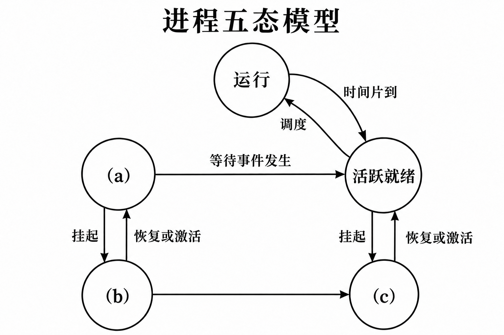
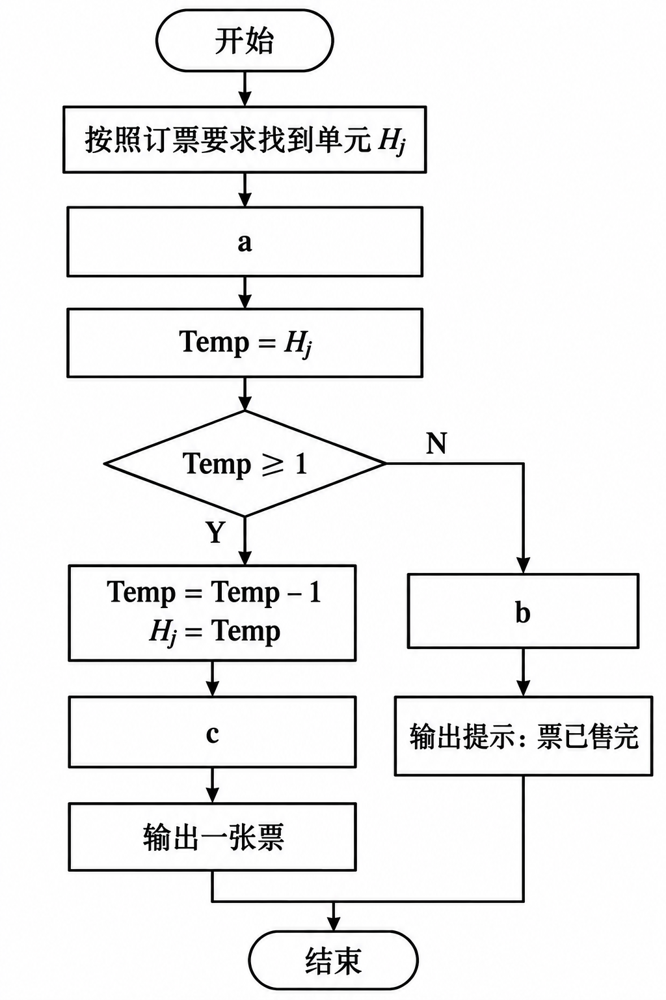
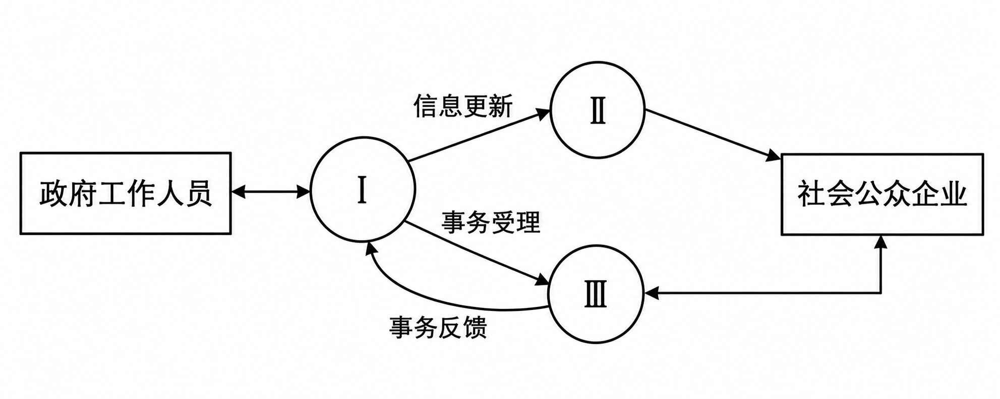
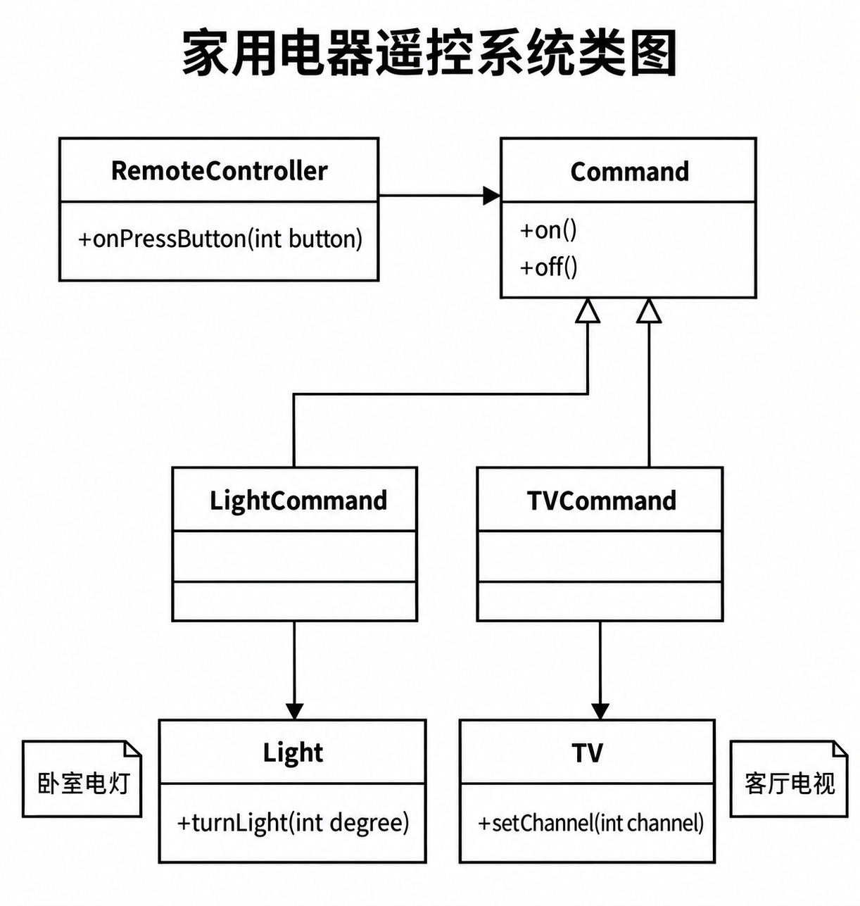
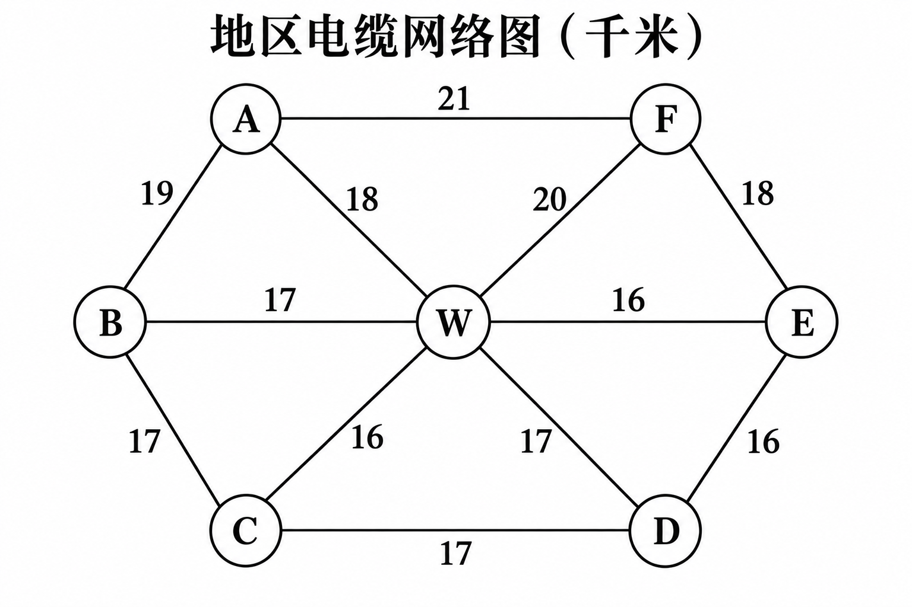

# 高级系统架构设计师上午押题密卷3

原件：[PDF](../../assets/2b6f10e5baeed076.pdf)。已勾选推荐正确选项并在每题后附带冲刺速记解析；卷末保留参考答案与原完整解析。

排印修订和原卷歧义见 转换记录。

## 题目

### 第 1 题

进程的五态模型包括运行状态、活跃就绪状态、静止就绪状态、活跃阻塞状态和静止阻塞状态。针对如下图所示的进程五态模型，为了确保进程调度的正常工作， (a)、(b) 和 (c) 的状态分别为

（　）



进程的五态模型图

- A. 静止就绪、静止阻塞和活跃阻塞
- B. 静止就绪、活跃阻塞和静止阻塞
- C. 活跃阻塞、静止就绪和静止阻塞
- D. 活跃阻塞、静止阻塞和静止就绪

> **【答案】** D
> **【速记解析】**
> - **为什么选 D**：**(a)活跃阻塞、(b)静止阻塞、(c)静止就绪**。进程在内存运行中等待事件发生进入**(a)活跃阻塞**；活跃阻塞进程被挂起（对换至辅存）变为**(b)静止阻塞**；静止阻塞等待的事件发生后转为辅存中的**(c)静止就绪**，激活调入内存后即可转为活跃就绪等待 CPU 调度。
> - **为什么不选其他**：A、B、C 状态顺序全错：(a) 处于主存且由运行态直接转换而来，必须是**阻塞态**而非就绪态；(b) 是辅存中等待事件的**静止阻塞**；(c) 是辅存中已就绪的**静止就绪**，只有激活才能进入活跃就绪。
### 第 2 题

Cache 容量为64块，采用组相联方式映像，字块大小为128个字，每4块为一组。若主存容量为4096块，且以字编址，则主存区号应为 （　） 位。

- A. 5
- B. 6
- C. 7
- D. 8

> **【答案】** B
> **【速记解析】**
> - **为什么选 B**：组相联映像将主存划分为与 Cache 等大的区。Cache 容量为 64 块，主存容量为 4096 块，则主存区数 = 4096 / 64 = 64 个区，因此**主存区号**占 log2(64) = **6** 位。
> - **为什么不选其他**：A（5位）为错误推算；C（7位）为**块内地址**位数（128 = 2^7 字）；D（8位）混淆了主存块号与区号的关系。
### 第 3 题

设指令由取指、分析和执行3个子部件完成；并且每个子部件的时间均为△t。 若采用度为4的超标量流水线处理机，连续执行12条指令，共需花费（　） △t。

- A. 3
- B. 5
- C. 9
- D. 14

> **【答案】** B
> **【速记解析】**
> - **为什么选 B**：度为 4 的超标量流水线每个时钟周期可并发处理 4 条指令。12 条指令分 12 / 4 = 3 批发射。流水线级数 k = 3，首批指令耗时 3Δt，后续 2 批每批间隔 1Δt 流出，总耗时为 **(3 + 3 - 1)Δt = 5Δt**。
> - **为什么不选其他**：A（3）仅为单个批次执行时间，忽视了后续指令；C（9）为完全串行发射各批次的耗时；D（14）为度为 1 的**常规单流水线**执行时间（(3 + 12 - 1)Δt），漏掉了超标量的并发度。
### 第 4 题

若某航空公司的飞机订票系统有 n 个订票终端，系统为每个订票终端创建一个售票终端的进程。假设 Pi(i=1,2,..,n) 表示售票终端的进程， Hj(j=1,2,..,m) 表示公共数据区，分别存放各个航班的现存票数， Temp 为工作单元。 Pi 进程的工作流程如下图所示， a、b 和 c 处将执行 P 操作和 V 操作，则图中 a、b 和 c 应分别填入（　）



售票终端进程工作流程图

- A. P(S)、V(S) 和 V(S)
- B. P(S)、P(S) 和 V(S)
- C. V(S)、P(S) 和 P(S)
- D. V(S)、V(S) 和 P(S)

> **【答案】** A
> **【速记解析】**
> - **为什么选 A**：航班现存票数公共区 Hj 为互斥访问的**临界资源**。进入前执行 **a: P(S)** 申请互斥锁；查询后若无余票，走分支退出前必须执行 **b: V(S)** 释放锁；若有余票并完成扣减写回后，正常退出前同样需执行 **c: V(S)** 释放锁，保证任何分支均对称释放锁以防死锁。
> - **为什么不选其他**：B 选项在 b 处重复执行 P(S) 会导致进程自身阻塞死锁；C、D 选项在 a 处进入临界区前使用 V 操作，违背了进入临界区前必须 P 申请锁的基本互斥原则。
### 第 5～6 题共同题干

某数据库中有员工关系 E、产品关系 P、仓库关系 W 和库存关系 I, 其中各个关系的属性如下。

- 员工关系 E(employeeID,name,department) 中的属性为：员工编号、姓名和部门。

- 产品关系 P(productID,name,model,size,color) 中的属性为：产品编号、产品名称、型号、尺寸和颜色。

- 仓库关系 W(warehouseID,name,address,employeeID) 中的属性为：仓库编号、仓库名称、地址和负责人编号。

- 库存关系 I(warehouseID,productID,quantity) 中的属性为：仓库编号、产品编号和产品数量。

若要求仓库关系的负责人引用员工关系 E 的员工编号、仓库关系 w 的仓库编号和产品关系 P 的产品编号不能为空且唯一标识一个记录，并且仓库的地址不能为空，则依次要满足的完整性约束是

若需得到每种产品的名称和该产品的总库存量，则对应的查询语句为：

```sql
SELECT name, SUM(quantity)
FROM P, I
WHERE （6）;
```

### 第 5 题

- A. 实体完整性、参照完整性、用户定义完整性
- B. 用户定义完整性、实体完整性、参照完整性
- C. 实体完整性、用户定义完整性、参照完整性
- D. 参照完整性、实体完整性、用户定义完整性

> **【答案】** D
> **【速记解析】**
> - **为什么选 D**：仓库负责人引用员工编号为外键约束，对应**参照完整性**；仓库编号和产品编号为主键，要求非空且唯一，对应**实体完整性**；仓库地址非空为具体业务语义限制，对应**用户定义完整性**。因此依次为**参照完整性、实体完整性、用户定义完整性**。
> - **为什么不选其他**：A、B、C 顺序错乱：实体完整性特指基本关系的主键非空唯一；参照完整性特指外键引用；用户定义完整性针对具体业务字段取值规则，三者概念边界清晰不可倒置。
### 第 6 题

- A. `P.productID = I.productID`
- B. `P.productID = I.productID ORDER BY name`
- C. `P.productID = I.productID GROUP BY name`
- D. `P.productID = I.productID GROUP BY name, quantity`

> **【答案】** C
> **【速记解析】**
> - **为什么选 C**：统计“每种产品”的库存需要按产品名称分组，SELECT 包含普通列 name 与聚合函数 SUM(quantity)，SQL 必须使用 **GROUP BY name**，且表连接条件为主外键相等的 **P.productID = I.productID**。
> - **为什么不选其他**：A 缺少 GROUP BY，语法错误且无法汇总；B 中 ORDER BY 仅能排序，不能聚合；D 按 name, quantity 同时分组会把不同库存量的记录拆开，无法得到每种产品的总库存。
### 第 7 题

设有职工实体 Employee (职工号，姓名，性别，年龄，通信地址，家庭成员),其中通信地址记录了邮编、省、市和街道信息；家庭成员记录了职工亲属的姓名。

为了将数据库模式设计的更合理，对于家庭成员属性 （　）

- A. 可以不做任何处理，直接记录亲属的姓名
- B. 只允许记录一个亲属的姓名
- C. 需要对职工实体设置若干个亲属姓名字段
- D. 应该将职工亲属的姓名加上职工号，设计成为一个独立的实体

> **【答案】** D
> **【速记解析】**
> - **为什么选 D**：“家庭成员”为**多值属性**（一个职工可对应多位亲属，1:N 联系）。为满足第一范式（1NF 字段原子性）并保持结构扩展性，应将亲属**独立设计为一个实体**，以“职工号 + 亲属姓名”作为标识与职工实体关联。
> - **为什么不选其他**：A 直接记录多个姓名会导致单字段存多值，破坏 1NF；B 人为限制亲属数量不符合业务实际；C 预留多个亲属字段（亲属1、亲属2）违反规范化设计，造成大量冗余 NULL 且数量固定死板。
### 第 8 题

某公司开发基于 Web 的招聘系统，采用 Java EE 系统架构。该系统实现时，对用户的登录判断所使用的动态 SQL 语句如下（字符串拼接表达式）：

```java
"SELECT * FROM Users WHERE User_Name='" + strUserName + "' AND Password='" + strPassword + "';"
```

以下关于该 SQL 语句的讨论中，正确的观点是（　）。

- A. 这是一条安全的 SQL 语句，能够防止 SQL 注入。
- B. 该 SQL 语句不安全，若执行测试用例 `strUserName: Guo' OR 'a'='a`、`strPassword: Zhu' OR 'a'='a`，则系统就允许以第一行的身份进行登录。
- C. 该 SQL 语句容易造成 SQL 注入，若执行测试用例 `strUserName: 'Guo'--`、`strPassword: Zhu`，则系统就允许以 Guo 身份登录，并对用户表中的所有行做任何操作。
- D. 该 SQL 语句容易造成 SQL 注入，若执行测试用例 `strUserName: 'Guo'; DROP table`、`strPassword: Zhu`，则系统将造成数据库中的所有表被永久删除。

排印校注：原卷用户名列及引号不一致，本版按解析统一为 `User_Name` 并恢复拼接边界，未改为参数化查询。

> **【答案】** B
> **【速记解析】**
> - **为什么选 B**：字符串拼接 SQL 存在典型 **SQL 注入**漏洞。当输入包含 `' OR 'a'='a` 时，生成的 WHERE 子句恒为真，`SELECT` 查询将返回 Users 表中所有记录，系统默认取结果集**第一行记录**完成身份认证并成功登录。
> - **为什么不选其他**：A 显然错误，字符拼接未做参数化转义极不安全；C 中 `SELECT` 查询仅有读权限，不可能“对表中所有行做任何操作”；D 中 `DROP table` 语法残缺且标准查询接口通常禁止多语句执行（无法直接删库）。
### 第 9 题

某系统集成项目组需要在 Windows 2008 Server 操作系统平台上应用 C++语言编写相应的应用构件。该项目组宜选用 （　） 作为构件标准。

- A. EJB
- B. COM+
- C. CORBA
- D. ODBC

> **【答案】** B
> **【速记解析】**
> - **为什么选 B**：在 **Windows 操作系统平台**且使用 **C++ 语言**编写构件，微软自家的 **COM+** 是原生无缝支持的构件标准，深度集成于 OS 事务、安全和进程管理中。
> - **为什么不选其他**：A（EJB）专属于 Java EE 平台；C（CORBA）为跨语言跨平台的分布式中间件，技术复杂且在纯 Windows 环境下非最优选；D（ODBC）是**数据库访问接口**规范，并非应用构件标准。
### 第 10 题

以下关于嵌入式系统的软件设计的描述中，说法错误的是 （　）

- A. 把应用程序转换成可以在目标机上运行的二进制代码，通常需要经过编译、链接和定址等3个步骤
- B. 编译过程生成的文件就是可以在嵌入式平台上执行的二进制文件
- C. 定址过程会把物理存储器地址指定给目标文件的每个相对偏移处
- D. 编译过程产生的所有目标文件被链接成一个目标文件

> **【答案】** B
> **【速记解析】**
> - **为什么选 B**：编译阶段生成的是**可重定位的目标文件（.o / .obj）**，使用的是相对逻辑地址且外部符号未解析，必须经过**链接**合并与**定址**（赋予目标硬件实际物理内存地址）后，才能在嵌入式平台上运行。
> - **为什么不选其他**：A 准确概述了交叉开发工具链从源码到镜像的三个标准阶段（编译、链接、定址）；C 正确阐述了定址（Locating）的定义；D 正确描述了链接器合并多个目标模块和库的职能。
### 第 11 题

嵌入式系统硬件初始化过程分为3个主要环节，按照自下而上、从硬件到软件的次序依次是。

- A. 板级→系统级→片级
- B. 系统级→板级→片级
- C. 片级→板级→系统级
- D. 系统级→片级→板级

> **【答案】** C
> **【速记解析】**
> - **为什么选 C**：嵌入式硬件初始化严格遵循**自底向上**原则：**片级**（微处理器核心内部寄存器、看门狗、时钟） → **板级**（主板外围设备、内存控制器、接口扩展芯片） → **系统级**（操作系统内核引导、驱动挂载与任务环境配置）。
> - **为什么不选其他**：A、B、D 颠倒了软硬件依赖层级：CPU 内部核心未就绪则外围总线无法通信，板级内存未初始化则操作系统内核无法加载，必须由底至顶初始化。
### 第 12 题

在嵌入式系统结构的组成中，板级支持包(BSP) 也称为硬件抽象层(HAL), 其特点是 （　）

- A. 硬件无关性，操作系统无关性
- B. 硬件相关性，操作系统无关性
- C. 硬件无关性，操作系统相关性
- D. 硬件相关性，操作系统相关性

> **【答案】** D
> **【速记解析】**
> - **为什么选 D**：板级支持包（BSP）介于底层硬件与操作系统之间，既需要向下控制和配置具体单板硬件（**硬件相关性**），又必须向上适配特定操作系统内核提供的标准化驱动接口（**操作系统相关性**）。
> - **为什么不选其他**：A、B、C 均遗漏了单一维度的强依赖特性：BSP 既非通用硬件驱动，也非与 OS 解耦的独立软件，更换芯片板卡或更换操作系统都必须对 BSP 进行针对性改写。
### 第 13 题

TCP 采用滑动窗口机制传输数据，在数据传输过程中可能会出现“愚笨窗口综合症”,发生这一症状的最可能原因是 （　）

- A. 接收方发送0窗口的应答报文后，所发送的非0窗口应答报文丢失
- B. 在某个时刻发送了小 TCP 分组
- C. 一个连接还未释放，又请求新的连接
- D. 定义 RTT 值为2倍的测量值不恰当

> **【答案】** B
> **【速记解析】**
> - **为什么选 B**：愚笨窗口综合症（SWS）指由于通信双方在某个时刻发送或通告了**微小尺寸的 TCP 分组**（如几个字节），导致 40 字节报头开销占比极大，网络利用率与吞吐量严重劣化的现象。
> - **为什么不选其他**：A 属于零窗口更新丢失导致的死锁问题，由持续定时器（Persistence Timer）探测解决；C 是连接释放与 TIME_WAIT 状态机制；D 中 RTT 影响重传超时计时器（RTO），与小窗口综合症无关。
### 第 14 题

如果本地域名服务器无缓存，当采用递归方法解析另一个网络某主机域名时，用户主机和本地域名服务器发送的域名请求条数分别为 （　） 中。

- A. 1 条，1条
- B. 1 条，多条
- C. 多条，1条
- D. 多条，多条

> **【答案】** A
> **【速记解析】**
> - **为什么选 A**：题目明确指定采用**递归方法**解析。在递归解析模式下，责任层层转移：用户主机只向本地域名服务器发 **1 条**请求；本地域名服务器同样只向上级（根/顶级）域名服务器发 **1 条**递归请求，最终由上级直接返回结果。
> - **为什么不选其他**：B（1条，多条）混淆了**迭代（反复）解析**。若本地域名服务器采用迭代解析，才需依次向根域、顶级域、权威域分别发多条请求；C、D 中用户主机绝不会发送多条请求。
### 第 15 题

以下关于各种 RAID 级别的描述中，错误的是 （　）

- A. RAID6 的磁盘利用率随着 RAID 组内成员盘个数的增加而增大
- B. 当 RAID 组内成员盘的个数为3时，RAID5的磁盘利用率最低
- C. 当镜像组内成员盘的个数为4时，RAID10 的磁盘利用率最高
- D. RAID1 具有磁盘镜像和磁盘双工功能，其磁盘利用率固定为50%

> **【答案】** C
> **【速记解析】**
> - **为什么选 C**：RAID10 采用先做 RAID1 镜像再做 RAID0 条带。不论阵列中有 4 块、6 块还是 8 块成员盘，由于镜像机制，有效存储容量恒为总盘数的一半，**磁盘利用率始终固定为 50%**，不存在“4 块时最高”的说法。
> - **为什么不选其他**：A 正确，RAID6 利用率为 (N-2)/N，盘数越大利用率越高；B 正确，RAID5 最小配置为 3 块盘，利用率为 (3-1)/3 = 66.7%，为其最低利用率；D 正确，RAID1 纯镜像利用率固定为 50%。
### 第 16 题

某公司开发基于 Web 的招聘系统，采用 Java EE 系统架构。该系统要求在50个用户并发时，主要功能的处理能力至少要达到5个请求/秒，平均数据量为12KB/ 请求，则该招聘系统的通信吞吐量至少为 （　）

- A. 2.4576Mbps
- B. 1.8286Kpps
- C. 2.4MB/s
- D. 3000KB/s

> **【答案】** D
> **【速记解析】**
> - **为什么选 D**：通信吞吐量 = **并发用户数 × 处理请求速率 × 单请求数据量**。代入数据：50 × 5 请求/s × 12 KB/请求 = **3000 KB/s**。
> - **为什么不选其他**：A（2.4576Mbps）、B（1.8286Kpps）、C（2.4MB/s）均为单位换算陷阱或漏乘并发用户数算出的干扰项。
### 第 17 题

当用排队论模型分析信息系统软件性能时，对结果影响最大的参数是 （　）。

- A. 事务平均丢失率
- B. 事务平均到达率
- C. 事务平均长度
- D. 事务平均重传次数

> **【答案】** B
> **【速记解析】**
> - **为什么选 B**：在 M/M/1 排队论模型中，系统服务强度 ρ = λ / μ。**事务平均到达率 λ** 是对性能影响最大的参数，当 λ 接近服务率 μ 时，队列长度和等待时间呈双曲线爆炸式非线性剧增。
> - **为什么不选其他**：A、D 属于网络传输层差错与重传指标，非排队模型核心参数；C（事务长度）影响单次服务时间，但其波动对系统瓶颈的影响远不如到达率 λ 敏感。
### 第 18 题

通常情况下， 电子政务业务分为 3 个领域。 在如下图所示的电子政务业务模型中，(I)、(Ⅱ)、( Ⅲ ) 空缺处的内容分别为 （　）。



电子政务业务模型

- A. 政务业务办理系统、办公自动化系统、政务信息发布系统
- B. 政务信息发布系统、政务业务办理系统、办公自动化系统
- C. 政务业务办理系统、政务信息发布系统、办公自动化系统
- D. 办公自动化系统、政务信息发布系统、政务业务办理系统

> **【答案】** D
> **【速记解析】**
> - **为什么选 D**：电子政务业务三领域划分清晰：**(I) 办公自动化系统（OA）**服务于政府内部日常政务协同；**(II) 政务信息发布系统**面向公众公开政策法规；**(III) 政务业务办理系统**面向企业市民提供双向线上申报与审批。
> - **为什么不选其他**：A、B、C 均颠倒混淆了内部协同（OA）、单向信息公开（发布）、双向交互受理（办理）的对应领域。
### 第 19 题

在下列应用场景中，属于 SaaS (软件即服务)模式的是 （　）。

- A. 消费者从供应商处购买软件的 License
- B. 消费者从互联网下载和使用免费软件
- C. 供应商开拓新的 IT 基础设施业务，消费者通过 Internet 从该 IT 基础设施获得服务
- D. 供应商通过 Internet 提供软件，消费者从供应商处租用基于 Web 的软件来管理企业经营活动

> **【答案】** D
> **【速记解析】**
> - **为什么选 D**：**SaaS（软件即服务）**的本质是软件提供商部署维护应用，用户通过 Internet 以 **Web 方式租用软件**来开展企业业务，无需本地部署和运维。
> - **为什么不选其他**：A 为传统软件许可证（License）买断交付；B 为普通单机免费软件；C 租用硬件基础设施属于 **IaaS（基础设施即服务）**。
### 第 20 题

客户关系管理(CRM)系统是基于方法学、软件和因特网的，以有组织的方式帮助企业管理客户关系的信息系统。 （　） 准确地说明了 CRM 的定位。

- A. CRM 在注重提高客户满意度的同时，一定要把帮助企业提高获取利润的能力作为重要指标
- B. CRM 有一个统一的以客户为中心的数据库，以方便对客户信息进行全方位的统一管理
- C. CRM 能够提供销售、客户服务和营销3个业务的自动化工具，具有整合各种客户联系渠道的能力
- D. CRM 系统应该具有良好的可扩展性和可复用性，并把客户数据分为描述性、促销性和交易性数据3大类

> **【答案】** A
> **【速记解析】**
> - **为什么选 A**：CRM 是一项商业管理策略。其根本**战略定位**是：在以客户为中心、提高客户满意度的同时，**核心目标是帮助企业提高获取利润的能力**。
> - **为什么不选其他**：B 描述的是客户数据统一存储的**技术架构**；C 描述的是 CRM 销售自动化（SFA）、营销与服务的**功能模块**；D 描述的是软件质量属性与**数据模型分类**，均非战略定位。
### 第 21 题

企业信息化的最终目标是实现各种不同业务信息系统间跨地区、跨行业、跨部门的 （　）

- A. 数据标准化
- B. 信息管理标准化
- C. 信息共享和业务协同
- D. 技术提升

> **【答案】** C
> **【速记解析】**
> - **为什么选 C**：企业信息化建设打破“信息孤岛”的最终诉求，是打通跨地区、跨行业、跨部门的数据与流程隔阂，全面实现**信息共享和业务协同**。
> - **为什么不选其他**：A、B（数据与管理标准化）是实现信息化共享的**技术支撑与手段**；D（技术提升）仅是副产品，信息化的落脚点必须在业务价值。
### 第 22 题

以下不属于敏捷供应链特点的是 （　）

- A. 支持供应链中跨企业的生产方式的快速重组，实现对市场变化的快速响应
- B. 支持供应链中跨企业信息系统的集成、调整、重构和信息共享
- C. 供应链中各个企业能根据要求方便地进行组织、管理的调整和企业生产模式的转变
- D. 可以辅助销售人员展开推销，增加客户在生命周期中的价值

> **【答案】** D
> **【速记解析】**
> - **为什么选 D**：“辅助销售人员推销，增加客户生命周期价值”属于**客户关系管理（CRM）**的典型职能，不属于供应链管理（SCM）的特点。敏捷供应链核心在于**快速响应市场、跨企业生产重组与信息集成**。
> - **为什么不选其他**：A、B、C 分别准确描述了敏捷供应链在生产模式动态重组、信息系统快速调整与跨企业管理敏捷适应方面的核心特征。
### 第 23 题

信息资源管理(IRM) 是对整个组织信息资源开发利用的全面管理。那么,信息资源管理最核心的基础问题是 （　）

- A. 人才队伍建设
- B. 信息化运营的体系架构
- C. 信息资源的标准和规范
- D. 信息资源管理规划

> **【答案】** C
> **【速记解析】**
> - **为什么选 C**：信息资源管理（IRM）中，没有统一的**标准和规范**，数据就无法流通、交换和共享，必然沦为数据孤岛。因此**信息资源的标准和规范**是整个管理体系最核心的基础问题。
> - **为什么不选其他**：A（人才队伍）是保障实施的**关键力量**；B（体系架构）是运作骨架；D（管理规划）是顶层设计，三者均必须依托于底层统一的标准规范。
### 第 24 题

信息工程的基础是信息战略规划，规划的起点是将企业战略目标和企业的信息需求转换成信息系统目标，实施信息系统工程是要为企业建立起具有稳定数据型的数据处理中心，以满足各级管理人员关于信息的需求，它坚持以 （　） 为信息处理的中心。

- A. 数据
- B. 过程
- C. 应用
- D. 功能

> **【答案】** A
> **【速记解析】**
> - **为什么选 A**：James Martin 信息工程（IE）方法论强调“企业的业务过程是多变的，而数据类是相对稳定的”，主张摆脱传统面向过程的局限，坚持**以数据为中心**构建企业稳定的数据处理中心。
> - **为什么不选其他**：B（过程）、D（功能）是传统生命周期法（如结构化分析）的关注点，易受业务流程变动冲击；C（应用）变化频繁，不可作为稳定中枢。
### 第 25 题

某软件开发团队欲开发一套管理信息系统，在项目初期，虽然用户提出了软件的一些基本功能，但开发人员对实现这套软件功能的算法效率、操作系统的兼容性和人机交互的形式等情况还是比较模糊。在这种情况下，该团队在开发过程中应采用 （　）

- A. 瀑布模型
- B. 增量模型
- C. 原型开发模型
- D. 快速应用程序开发(RAD)

> **【答案】** C
> **【速记解析】**
> - **为什么选 C**：当项目初期**用户需求模糊、算法效率未知、平台兼容性与交互形式不明确**时，采用**原型开发模型**能通过低成本快速构建可运行界面，帮助用户明确需求并验证关键技术可行性。
> - **为什么不选其他**：A（瀑布模型）要求需求明确固定；B（增量模型）要求总体架构与核心需求清晰；D（RAD 快速应用开发）基于成熟构件快速组装，同样要求需求清晰严格。
### 第 26 题

以下不属于软件工程需求分析阶段任务的是 （　）

- A. 分析软件系统的数据要求
- B. 确定软件系统的功能需求
- C. 确定软件系统的性能要求
- D. 确定软件系统的运行平台

> **【答案】** D
> **【速记解析】**
> - **为什么选 D**：需求分析阶段的核心关注点是**“系统必须做什么”**（What），包括功能、性能、数据与逻辑约束；而“确定软件系统的运行平台”涉及底层硬件架构选型与物理部署，属于**系统设计/架构设计阶段**的任务。
> - **为什么不选其他**：A、B、C 分别属于数据需求、功能需求与非功能性能需求分析，均为需求规格说明书（SRS）不可或缺的组成部分。
### 第 27 题

在结构化分析方法中，数据字典是重要的文档。对加工的描述是数据字典的组成内容之一，常用的加工描述方法有 （　）

- A. 结构化语言、数据流图和 PAD 图
- B. 结构化语言、 IPO 图和 HIPO 图
- C. 结构化语言、判定树和判定表
- D. 数据流图、判定树和判定表

> **【答案】** C
> **【速记解析】**
> - **为什么选 C**：结构化分析中，对数据字典中加工逻辑说明（小说明）的标准表达方法有三种：**结构化语言（伪代码）、判定树、判定表**。
> - **为什么不选其他**：A、D 包含“数据流图”，DFD 是系统整体的逻辑模型，不能用来描述单个加工的内部算法逻辑；B 包含“IPO/HIPO 图”，属于软件设计阶段的模块描述工具。
### 第 28 题

软件需求分析产生软件操作特征的规格说明，指明软件和其他系统元素的接口，建立软件必须满足的约束。以下对于软件需求分析的描述中，错误的是 （　）

- A. 软件工程师研究系统规约和软件项目计划，并在系统语境内理解软件和复审，从而生成计划软件范围的估算
- B. 需求分析使得系统工程师能够刻画出软件的功能和性能，指明软件和其他系统元素的接口，并建立软件必须满足的约束
- C. 经过仔细的需求分析活动，软件工程师能够得到详细的系统规约
- D. 需求分析能够为软件设计者提供可被翻译成数据、体系结构、界面和过程设计的模型

> **【答案】** C
> **【速记解析】**
> - **为什么选 C**：需求分析活动产生的是**软件需求规格说明书（SRS）**；而**系统规约（System Specification）**是上位系统工程在软硬件分配阶段制定的系统总体要求，属于需求分析的输入依据，而非产物。
> - **为什么不选其他**：A 正确描述了工程师依据系统规约界定软件范围；B 正确刻画了需求分析的功能、非功能与接口约束定义；D 正确阐述了需求模型向数据、架构与过程设计的转换映射。
### 第 29 题

软件设计阶段的度量考虑了架构层次、构件层次和界面设计层次等问题。其中， （　） 的设计度量集中于软件构件的内部特性。

- A. 架构层次
- B. 界面设计层次
- C. 构件层次
- D. 功能层次

> **【答案】** C
> **【速记解析】**
> - **为什么选 C**：**构件层次**的设计度量聚焦于模块内部特性，最典型的就是“3C”测度：**内聚性（Cohesion）、耦合性（Coupling）和复杂度（Complexity）**。
> - **为什么不选其他**：A（架构层次）度量宏观体系结构（如层次深度、扇入扇出）；B（界面设计层次）度量 GUI 布局与可用性交互负担；D（功能层次）非设计度量的三层标准术语。
### 第 30 题

“置用户于控制之下”是用户界面设计“黄金规则”之一。以下针对这一规则的理解中，错误的是

（　）。

- A. 设计应允许用户与出现在屏幕上的对象直接交互
- B. 使用户与内部技术细节隔离开来
- C. 尽量避免用户交互被中断或撤销
- D. 不强迫用户进入不必要的或不希望的动作方式来定义交互模式

> **【答案】** C
> **【速记解析】**
> - **为什么选 C**：“置用户于控制之下”要求赋予用户充分的安全感与控制权，系统必须**允许并支持用户交互的中断与撤销（Undo）**。选项 C 提出“避免中断或撤销”恰恰违反了这一原则。
> - **为什么不选其他**：A（直接对象交互）、B（屏蔽底层技术细节）、D（不强迫进入不必要动作模式）均为“置用户于控制之下”的标准设计细则。
### 第 31 题

黑盒测试注重于测试软件的功能性需求，主要用于软件的后期测试。 （　） 不能用黑盒测试检查出来。

- A. 功能不对或遗漏错误
- B. 界面错误
- C. 外部数据库访问错误
- D. 程序控制结构错误

> **【答案】** D
> **【速记解析】**
> - **为什么选 D**：**程序控制结构错误**（如死循环、不可达分支、判定条件组合错误）属于代码内部的控制流路径缺陷，黑盒测试无法窥视内部逻辑，必须通过**白盒测试**（逻辑覆盖、路径覆盖）发现。
> - **为什么不选其他**：A（功能错误/遗漏）、B（界面错误）、C（外部数据库访问错误）均为黑盒测试从外部功能表现上能够直接检验出来的典型错误。
### 第 32 题

以下关于维护软件所需的成本叙述中，说法正确的是 （　）

- A. 纠正外部和内部设计错误比纠正源代码错误需要更大的成本
- B. 需求定义纠错的成本小于源代码纠错的成本
- C. 用户文档需要经常更新，其维护成本超过了纠正设计错误的成本
- D. 与需求定义相比，源代码的文字量大得多，所以源代码的维护成本更高

> **【答案】** A
> **【速记解析】**
> - **为什么选 A**：软件工程生命周期规律表明：**缺陷引入阶段越早，后期修复的代价越高**。设计错误波及全局架构和多个下游构件，导致大规模返工，其纠错成本显著高于局部源代码错误的修正。
> - **为什么不选其他**：B 错误，需求定义错误遗留到后期的纠正成本百倍于代码错误；C 错误，用户文档更新成本远低于核心架构重构；D 错误，维护成本取决于错误影响的架构层次与波及面，而非代码文本字数。
### 第 33 题

在 UML 中，系统的 （　） 包含了类、接口和协作，它们形成了问题及其对问题的解决方案的术语词汇。

- A. 实现视图(Implementation View)
- B. 设计视图(Design View)
- C. 部署视图(Deployment View)
- D. 用例视图(Use Case Viewr)

> **【答案】** B
> **【速记解析】**
> - **为什么选 B**：UML 的**设计视图（Design View）**包含了**类、接口和协作**，构成了系统问题空间与解决空间的术语词汇表，主要支撑系统的功能性需求。
> - **为什么不选其他**：A（实现视图）关注源码模块、二进制构件与库文件的物理组织；C（部署视图）关注计算节点与硬件拓扑；D（用例视图）从外部角色视角描述系统行为需求。
### 第 34 题

利用 UML 建立业务模型是理解企业业务过程的第1步。使用活动图(Activity Diagram)可显示业务工作流的步骤和决策点，以及完成每一个步骤的角色和对象，它强调 （　）

- A. 上下层次关系
- B. 时间和顺序
- C. 对象间的迁移
- D. 对象间的控制流

> **【答案】** D
> **【速记解析】**
> - **为什么选 D**：活动图是一种特殊的状态图，主要用于描述业务工作流中的步骤、决策和并发路径，其核心强调的是**对象间的控制流**（以及伴随的数据流）。
> - **为什么不选其他**：A（上下层次关系）通常由结构图、包图表示；B（时间和顺序）是**序列图（时序图）**的核心强调点；C（对象间的状态迁移）是**状态图**的核心关注点。
### 第 35 题

通常情况下，在软件生存周期中，将某种形式表示的软件转换成更高抽象形式表示的软件的活动称为逆向工程。逆向工程导出的信息可以分为4个抽象层次，其中 （　） 抽象出的信息，要求人参与判断和推理的工作最多，恢复的难度最大。

- A. 领域级
- B. 结构级
- C. 功能级
- D. 实现级

> **【答案】** A
> **【速记解析】**
> - **为什么选 A**：逆向工程抽象层级按“实现级 → 结构级 → 功能级 → **领域级**”自低向高递进。**领域级**抽象反映系统与现实应用领域概念的映射，距离底层语法最远，最依赖人工的理解、判断与推理，恢复难度最高。
> - **为什么不选其他**：D（实现级）为语法树、符号表等机器可直接解析的底层信息；B（结构级）为静态依赖调用图；C（功能级）抽象程度低于领域级。
### 第 36 题

极限编程(extreme Programming)是一种轻量级软件开发方法，它以 （　） 为规则。

- A. 文档驱动
- B. 数据驱动
- C. 模型驱动
- D. 代码驱动

> **【答案】** D
> **【速记解析】**
> - **为什么选 D**：作为轻量级敏捷开发范式的代表，极限编程（XP）摒弃繁重的文档束缚，强调以**代码驱动**（Code-driven），将高质量可运行代码及单元测试视为系统最真实的核心文档。
> - **为什么不选其他**：A（文档驱动）是传统重型瀑布模型的典型标志；B（数据驱动）、C（模型驱动）分别属于数据中台与 MDA 体系，非极限编程的核心哲学。
### 第 37 题

软件产品线代表了一种强劲的软件开发范例，能够有效地提高软件生产率和质量，缩短开发时间，以及降低总开发成本。软件产品线主要由 （　） 和产品集合两部分组成。

- A. 构件库
- B. 核心资源
- C. 体系结构
- D. 开发组织

> **【答案】** B
> **【速记解析】**
> - **为什么选 B**：SEI 对软件产品线的标准定义：软件产品线主要由**核心资源（Core Assets）**与**产品集合（Product Set）**两大部分组成。核心资源涵盖共享架构、通用构件、设计资产等。
> - **为什么不选其他**：A（构件库）、C（体系结构）仅是核心资源的局部子集；D（开发组织）是组织架构管理角色，非产品线标准二元构成。
### 第 38 题

软件系统的文档可分为用户文档和系统文档两类。其中， （　） 详尽描述了用户可以使用的所有系统设施及它们的使用方法，并解释系统可能产生的各种出错信息的含义。

- A. 系统文档
- B. 使用手册
- C. 功能描述文档
- D. 参考手册

> **【答案】** D
> **【速记解析】**
> - **为什么选 D**：用户文档中的**参考手册（Reference Manual）**充当字典式查阅工具，**详尽罗列系统提供的所有设施及其用法，并系统解释各类出错信息的具体含义**与处理办法。
> - **为什么不选其他**：A（系统文档）面向开发与维护人员描述内部实现；B（使用手册）注重端到端的操作步骤向导，不以穷尽设施和错误码为目的；C（功能描述文档）仅提供宏观系统能力概述。
### 第 39 题

软件架构以规范的形式装配若干结构元素，从而描述出系统的主要功能、性能要求和其他非功能性需求。各个软件架构视图涉及的组件(元素)包括任务、步骤、模块和节点等。场景组件元素是（　）

- A. 步骤
- B. 任务
- C. 模块
- D. 节点

> **【答案】** A
> **【速记解析】**
> - **为什么选 A**：4+1架构视图模型中，**场景视图（+1视图）**用来说明重要系统活动和用例驱动的综合，其核心组件元素是**步骤（Steps）**，风险承担者为最终用户和开发人员。
> - **为什么不选其他**：B（任务）属于**进程视图**的组件元素；C（模块）属于**开发视图**的组件元素；D（节点）属于**物理/部署视图**的组件元素。
### 第 40 题

软件架构设计的主要目标是：确保体系架构能够为设计人员和实现人员所承担的工作提供可靠的框架。以下活动中，不属于软件体系结构设计过程范畴的是 （　）

- A. 架构需求评审
- B. 映射已标识的构件
- C. 分析构件之间的相互作用
- D. 选择体系结构风格

> **【答案】** A
> **【速记解析】**
> - **为什么选 A**：**架构需求评审**属于**软件架构需求**阶段的活动，用于验证需求的完整性与合理性，不属于体系结构设计过程本身。
> - **为什么不选其他**：B（映射已标识构件）、C（分析构件相互作用）、D（选择体系结构风格）与提出架构模型、设计评审等均属于**体系结构设计过程**的核心迭代活动。
### 第 41 题

在软件架构中，基于 （　） 的系统具有某种意义上的递归性，形成了“部分-整体”的层次结构，用户可以组合多个简单的子系统以形成一些较大的子系统，这些较大的子系统又可以组合成更大的子系统。

- A. 解释器模式
- B. 分层模式
- C. 知识库模式
- D. 事件驱动模式

> **【答案】** D
> **【速记解析】**
> - **为什么选 D**：**事件驱动模式**下每个子系统均具备完整性、相对独立性及事件收集/处理机制，通过消息机制协调，系统具备**递归性**和“部分-整体”层次结构，小系统可自由组合为大子系统。
> - **为什么不选其他**：A（解释器模式）核心是构建虚拟机以解释执行代码；B（分层模式）强调单向分层调用服务（上层是下层的客户）；C（知识库模式）围绕中央共享数据与独立构件交互，均不体现自底向上事件消息组合的递归“部分-整体”结构。
### 第 42 题

某软件开发公司承接了一个语音和模式识别方面的嵌入式应用软件的开发工作。该公司的架构师决定采用成熟的架构风格指导整个软件的设计，以下 （　） 架构风格，最适合该嵌入式应用软件。

- A. 事件驱动
- B. 管道/过滤器
- C. 黑板结构
- D. 分层结构

> **【答案】** C
> **【速记解析】**
> - **为什么选 C**：**黑板结构（Blackboard）**属于知识库风格，由知识源、黑板数据结构和控制组件组成，通过中央状态触发知识源协同试探，是**语音识别、模式识别、图像理解**等非确定性问题求解的标准经典架构。
> - **为什么不选其他**：A（事件驱动）侧重离散事件通知解耦，缺乏共享黑板的协同推理机制；B（管道/过滤器）适合数据流顺序线性变换，构件不共享全局状态；D（分层结构）强调纵向服务封装，难以支持多专家知识源对同一假设数据的动态协作修改。
### 第 43 题

特定领域软件架构(Domain Specific Software Architecture,DSSA.是一种有效实现特定领域软件重用的手段。在其基本活动中， （　） 的主要目标是依据领域模型和 DSSA 开发并组织可重用信息。

- A. 领域实现
- B. 领域设计
- C. 领域分析
- D. 领域运维

> **【答案】** A
> **【速记解析】**
> - **为什么选 A**：DSSA（特定领域软件架构）三大基本活动中，**领域实现**的主要目标正是依据已建立的领域模型和DSSA（参考架构），具体开发、收集并组织**可重用信息与构件资产**。
> - **为什么不选其他**：B（领域设计）的主要目标是获得**DSSA（参考架构）**；C（领域分析）的主要目标是获得**领域模型**；D（领域运维）不属于DSSA的三大经典基本活动（分析、设计、实现）。
### 第 44 题

软件架构设计是降低成本、改进质量、按时和按需交付产品的关键活动。以下关于软件架构重要性的叙述中，错误的是 （　）

- A. 架构设计能够有效地管理复杂性，为系统开发提供指导
- B. 架构设计能够为复用奠定基础，并支持项目计划编制过程
- C. 架构设计能够解决冲突，并降低维护费用
- D. 架构设计能够满足系统的性能、安全性和可维护性等品质

> **【答案】** C
> **【速记解析】**
> - **为什么选 C**：软件架构设计能够促使不同利益相关方达成共识并**支持冲突分析与权衡**，但架构本身**不能直接自动“解决冲突”**（冲突需通过利益相关者沟通与权衡决策解决）。
> - **为什么不选其他**：A、B、D均为正确叙述：架构设计通过高层抽象有效管理复杂性，为开发与复用提供基础，且直接决定了系统的性能、安全性、可修改性等非功能质量属性。
### 第 45 题

面向服务架构体系结构(Service-Oriented Architecture,SOA.作为一种架构模型，使得所构建的服务可以以一种统一的、通用的方式进行交互。相对于面向对象架构模型，SOA 是根据需求通过网络对 （　） 的应用组件进行分布式部署、组合和使用。

- A. 紧耦合、细粒度
- B. 松耦合、粗粒度
- C. 松耦合、细粒度
- D. 紧耦合、粗粒度

> **【答案】** A
> **【速记解析】**
> - **为什么选 A**：面向对象（OO）模型中对象之间通过方法调用与接口强绑定，属于**紧耦合、细粒度**；而SOA强调跨平台通用契约和粗粒度消息交互，属于**松耦合、粗粒度**。
> - **为什么不选其他**：B、C属于混淆项；D（松耦合、粗粒度）是**SOA（面向服务架构）**本身的特征，正好与面向对象特征相反。
### 第 46 题

在构件开发过程中，用户的需求可能会随时变化；在软件系统开发完毕、正常运行后，由一个单位移植到另一个单位，需求也会发生变化。在这两种情况下，就必须相应地修改软件体系结构，以适应新的变化了的软件需求。以下不属于体系结构演化过程范畴的是 （　）

- A. 体系结构需求获取
- B. 需求变化归类
- C. 更新构件的相互作用
- D. 技术评审

> **【答案】** A
> **【速记解析】**
> - **为什么选 A**：**体系结构需求获取**属于系统开发早期的需求工程阶段；而**体系结构演化**的标准6步流程是从**需求变化归类**开始的，不包含初始需求获取。
> - **为什么不选其他**：B（需求变化归类，第1步）、C（更新构件相互作用，第4步）、D（技术评审，第6步）均属于体系结构演化的标准步骤（流程还包括制订演化计划、修改/增删构件、构件组装与测试）。
### 第 47 题

REST(REpresentational State Transfer)是目前因特网的核心架构风格之一。与传统的 Web 服务相比，REST 服务的主要优势不包括 （　）

- A. 基于 URI 和超链接技术，无须通过集中式的服务信息仓库即可发现服务资源
- B. 支持缓存，具有状态相关特性，所构建的应用系统具有较强的伸缩性
- C. 基于轻量级的 Web 框架，仅需要基本的开发工具支持，构建过程简单且成本较低
- D. 基于 W3C/ IETF 的标准与规范，其实现技术简单且成熟

> **【答案】** B
> **【速记解析】**
> - **为什么选 B**：REST的核心约束之一是**无状态（Stateless）**，每个请求必须包含全部上下文，服务端不保存客户端会话状态，这是其具备极强可伸缩性的前提；选项B称其“具有状态相关特性”属于**偷换概念**。
> - **为什么不选其他**：A、C、D均为REST真实优势：利用URI与超链接自发现无需UDDI注册中心，基于轻量HTTP框架开发成本低，且完全遵循成熟开放的W3C/IETF标准。
### 第 48 题

基于架构的软件设计(ABSD) 强调由商业、质量和功能需求的组合驱动软件架构设计。以下关于ABSD 方法的描述中，错误的是 （　）

- A. ABSD 方法是一个自下向上、递归细化的过程，有助于降低架构设计的随意性
- B. ABSD 方法是递归的，且迭代的每一个步骤都是清晰定义的
- C. 强调从不同的视角(Perspective) 来检查和考虑体系结构的不同属性
- D. 在使用用例捕获功能需求的同时，可以通过质量场景捕获变更、性能和交互性

> **【答案】** A
> **【速记解析】**
> - **为什么选 A**：基于架构的软件设计（ABSD）是一个**自顶向下（Top-Down）**、递归细化的过程（由商业、质量与功能需求驱动，从高层视图逐步细化到构件与类），选项A错在说成“**自下向上**”。
> - **为什么不选其他**：B、C、D均符合ABSD特征：ABSD步骤清晰定义具有递归性，强调从静态/动态等不同视角审查属性，并使用用例捕获功能需求、使用质量场景捕获性能/可靠性/可变性等非功能需求。
### 第 49 题

以下关于状态(State) 模式和策略(Strategy) 模式的叙述中，错误的是 （　）。

- A. 对于客户程序而言， State 模式比 Strategy 模式更透明
- B. Strategy 模式用来处理算法变化， State 模式用来处理状态变化
- C. State 模式的对象变化频率比 Strategy 模式的对象高
- D. State 模式的“状态”是在对象外部，Strategy 模式的“策略”是在对象内部

> **【答案】** D
> **【速记解析】**
> - **为什么选 D**：选项D叙述颠倒：**State模式的“状态”封装在对象内部**（根据内部条件自发转换，对客户透明）；而**Strategy模式的“策略”通常在对象外部**由客户端指定或配置注入。
> - **为什么不选其他**：A（State模式状态变迁封装在内部，对客户更透明）、B（Strategy处理算法替换，State处理状态变迁）、C（State对象生命周期内状态变迁频繁，Strategy往往配置一次后稳定）均为正确叙述。
### 第 50～52 题共同题干

某企业欲开发一款家用电器遥控系统，让用户只需使用一个遥控器即可控制某些家用电器的开与关。由于遥控系统需要支持形式多样的电器，因此，该系统的设计要求具有较高的扩展性。现假设需要控制客厅电视和卧室电灯， 对该遥控系统进行设计所得 UML 类图如下图所示。图中的类图所采用的设计模式是 （　） ,该模式的设计意图是 （　）。应用该设计模式能够有效地让 （　） 之间的耦合性降至最低。



某遥控器系统类图

### 第 50 题

- A. Adapter 模式
- B. Command 模式
- C. Observer 模式
- D. Strategy 模式

> **【答案】** B
> **【速记解析】**
> - **为什么选 B**：类图中 `RemoteController` 关联抽象 `Command` 接口，具体子类 `LightCommand`、`TVCommand` 将操作委托给具体的接收者（`Light`、`TV`），是标准的 **Command（命令）模式**。
> - **为什么不选其他**：A（Adapter）用于不兼容接口转换；C（Observer）用于一对多状态联动通知；D（Strategy）用于算法族的可替换封装，无法实现请求调用与执行者的解耦排队与撤销。
### 第 51 题

- A. 将一个请求封装为一个对象，从而可用不同的请求对客户进行参数化，将请求排队或记录请求日志，支持可撤销的操作
- B. 使算法可独立于使用它的客户而变化
- C. 使原本由于接口不兼容而不能一起工作的那些类可以一起工作
- D. 定义对象间的一种一对多的依赖关系，当一个对象的状态发生改变时，所有依赖于它的对象都得到通知并被自动更新

> **【答案】** A
> **【速记解析】**
> - **为什么选 A**：GoF定义中 **Command（命令）模式** 的核心意图为：**将一个请求封装为一个对象**，从而使可用不同的请求对客户进行参数化，对请求排队或记录请求日志，以及支持可撤销的操作。
> - **为什么不选其他**：B是 **Strategy（策略）模式** 的意图；C是 **Adapter（适配器）模式** 的意图；D是 **Observer（观察者）模式** 的意图。
### 第 52 题

- A. 类 LightCommand 和类 Light
- B. 类 TVCommand 和类 TV
- C. 类 RemoteController、 类 LightCommand 和类 TVCommand
- D. 类 RemoteController、 类 Light 和类 TV

> **【答案】** D
> **【速记解析】**
> - **为什么选 D**：Command模式通过引入命令抽象，将**请求发起者（RemoteController 遥控器）**与具体的**业务接收者（Light 电灯、TV 电视）**彻底解耦，遥控器无需直接知晓任何具体家电细节。
> - **为什么不选其他**：A、B中具体命令类持有对应接收者属于正常的委托绑定；C中遥控器直接使用命令接口，解耦的核心目标是发送者与真实家电（执行者），而非命令对象本身。
### 第 53 题

在设计模式演化时，必须定义一组设计类。其中， （　） 代表将在软件执行之外持续存在的数据存储(例如，数据库)。

- A. 持久类
- B. 业务域类
- C. 过程类
- D. 系统类

> **【答案】** A
> **【速记解析】**
> - **为什么选 A**：在软件架构与面向对象设计中，**持久类（Persistent Classes）**专门用于代表在软件执行周期之外仍需**持续存在的数据存储**（如关系数据库表、持久化文件实体等）。
> - **为什么不选其他**：B（业务域类）封装具体业务领域的属性与业务逻辑；C（过程类）实现管理业务域对象所需的工作流与低层控制抽象；D（系统类）实现系统运行管理控制及与外部环境交互。
### 第 54～56 题共同题干

PH 系统集成开发公司决定采用基于架构的软件开发方法，以架构为核心对近期所承接的某电子商务企业的在线交易平台进行设计与实现。该电子商务企业要求在线交易平台必须保证客户个人信息和交易信息的安全；当发生故障时，该平台的平均故障恢复时间（MTTR）必须小于5分钟。该电子商务企业所提的两个要求分别对应于 （　） 软件质量属性：实现并提高前一个软件质量属性的架构设计策略是 （　） _;实现并提高后一个软件质量属性的架构设计策略不包括 （　）

### 第 54 题

- A. 健壮性、可测试性
- B. 安全性、可用性
- C. 可靠性、可变性
- D. 功能性、性能

> **【答案】** B
> **【速记解析】**
> - **为什么选 B**：“保证客户个人信息和交易信息的安全”直击**安全性（Security）**；“平均故障恢复时间MTBF小于5分钟（通过快速恢复保证在线时长）”直击**可用性（Availability）**。
> - **为什么不选其他**：A、C、D中健壮性、可测试性、可靠性（侧重MTTF无故障时间）、可变性及性能均不符合题干对信息防窃密（安全）与停机快速自愈（可用）的针对性指标定义。
### 第 55 题

- A. 设置检查点或回滚
- B. 限制模块之间的通信
- C. 采用身份认证和数字签名策略
- D. 将接口与实现分离

> **【答案】** C
> **【速记解析】**
> - **为什么选 C**：**身份认证和数字签名**是实现与提升**安全性（Security）**的经典防御策略，分别解决合法主体鉴别与防篡改/不可否认性问题。
> - **为什么不选其他**：A（检查点或回滚）属于**可用性**的故障恢复策略；B（限制模块间通信）、D（接口与实现分离）属于**可修改性**的隔离变更策略。
### 第 56 题

- A. 添加适配器
- B. 心跳
- C. 备用件
- D. 热重启

> **【答案】** A
> **【速记解析】**
> - **为什么选 A**：**添加适配器（Adapter）**是用于跨模块接口兼容、降低耦合度以提升**可修改性/互操作性**的设计策略，**不属于**可用性设计策略。
> - **为什么不选其他**：B（心跳：故障检测）、C（备用件：主动/被动冗余容错）、D（热重启：缩短停机恢复时间）三者均属于提升**可用性（Availability）**的标准架构策略。
### 第 57～58 题共同题干

某电子商务企业为支持客户完成网上购物活动中的在线交易，委托 PH 系统集成开发公司开发一个在线交易平台。考虑到该商务企业业务发展较快，今后需要经常为在线交易平台添加新功能或进行硬件升级，且要求添加新功能或进行硬件升级必须在3小时内完成。PH 公司决定采用基于架构的软件开发方式，以架构为核心进行在线交易平台的设计与实现。该电子商务企业所提要求主要对应于 （　）这一软件质量属性，实现并提高该质量属性的架构设计策略不包含 （　）

### 第 57 题

- A. 可用性
- B. 安全性
- C. 可测试性
- D. 可修改性

> **【答案】** D
> **【速记解析】**
> - **为什么选 D**：“经常为平台添加新功能或进行硬件升级，且升级必须在3小时内完成”衡量的是系统以高性价比快速响应变更的能力，核心对应**可修改性（Modifiability）**。
> - **为什么不选其他**：A（可用性）侧重正常服务运行时长与故障自愈；B（安全性）侧重防御未授权访问与攻击；C（可测试性）侧重发现软件缺陷的容易程度。
### 第 58 题

- A. 限制模块之间的通信
- B. 延迟绑定
- C. 主动冗余
- D. 软件模块泛化

> **【答案】** C
> **【速记解析】**
> - **为什么选 C**：**主动冗余（Active Redundancy）**是通过多副本并行工作保障连续运行的**可用性（Availability）**策略，**不包含**在可修改性架构设计策略中。
> - **为什么不选其他**：A（限制模块间通信：局部化修改影响）、B（延迟绑定：在部署/运行时灵活挂接新功能）、D（模块泛化：提取公共抽象便于扩展）均属于提升**可修改性**的核心策略。
### 第 59 题

以下关于体系结构风格和体系结构模式的描述中，错误的是 （　）

- A. 与体系结构模式一样，体系结构风格也对体系结构设计施加一种变换
- B. 相对于体系结构风格，模式涉及的范围要大一些，它更关注体系结构的整体
- C. 体系结构模式在体系结构上施加规则，描述了软件是如何在基础设施层次上处理某些功能性方面的问题
- D. 体系结构模式倾向于在系统结构的环境中处理特定的行为问题

> **【答案】** B
> **【速记解析】**
> - **为什么选 B**：选项B叙述完全颠倒：**体系结构风格**作用于系统全局，关注的是体系结构的**整体**；而**体系结构模式**涉及范围更**小**，更多集中在体系结构的**某一局部**，针对特定上下文中的特定行为问题施加规则。
> - **为什么不选其他**：A（两者本质上均是对设计施加规范性变换）、C（模式在基础设施层次施加规则处理功能性问题）、D（模式倾向于在系统结构上下文中解决特定行为模式）均为教材权威正确叙述。
### 第 60 题

架构设计、文档化和复审是一个迭代的过程。架构复审是基于架构开发中一个重要的环节。以下不属于架构复审的目标是 （　）

- A. 评估和测试架构是否满足需求，是否存在可识别的技术和协作风险
- B. 质量需求是否在设计中得到体现，层次是否清晰
- C. 构件的划分是否合理，构件的设计是否满足功能与性能的要求
- D. 文档表达是否简练，能否使用系统演化步骤去修改应用以满足新的需求

> **【答案】** D
> **【速记解析】**
> - **为什么选 D**：“使用系统演化步骤去修改应用以满足新的需求”属于**架构演化（Evolution）**阶段的实际操作，**不属于**架构复审阶段的目标（复审重在标识潜在风险与设计缺陷）。
> - **为什么不选其他**：A（评估需求满足度与识别技术/协作风险）、B（质量需求是否体现及层次是否清晰）、C（构件划分合理性与功能性能指标达标）均是架构复审不可或缺的核心评估目标。
### 第 61 题

某公司欲开发一个车辆定速巡航控制系统，以确保车辆在不断变化的地形中以固定的速度行驶。公司的架构师经过分析与讨论，给出了该定速巡航控制系统的两种候选架构方案：面向对象和闭环控制。以下是对于这两种候选架构的选择理由，其中错误的是 （　） D

- A. 应该采用面向对象架构，因为当发生突发事件(如某些部件失灵)时，系统会同时产生数据和事件，这种情况用对象建模较为恰当
- B. 应该采用闭环控制架构，因为当用户设定期望速度值后，系统需要在不断获取当前速度和外界条件的情况下对系统状态持续调整
- C. 应该采用面向对象架构，因为抽象层的存在，满足了处理不确定性的需要，在较低层次不确定的实现细节在较高层次会变得确定
- D. 应该采用闭环控制架构，因为闭环控制架构中系统的主要构件(监控器、传感器、发动机等)是彼此分开的，并能够独立替换

> **【答案】** C
> **【速记解析】**
> - **为什么选 C**：选项C中“抽象层的存在，使得在较低层次不确定的实现细节在较高层次变得确定”是**分层架构风格（Layered Architecture）**的典型特征与理由，**张冠李戴**安插在面向对象架构上，属于错误论述。
> - **为什么不选其他**：A（突发事件产生离散数据与事件，适合对象封装建模）、B（闭环控制适合根据期望速度进行连续负反馈调节）、D（闭环控制中传感器、控制器、执行器解耦分立支持独立替换）均为正确架构选择理由。
### 第 62 题

Scenarios-based Architecture Analysis Method(SAAM)是一种软件架构的评估方法，以下关于该方法的叙述中，错误的是 （　）

- A. SAAM 的目标是对描述应用程序属性的文档，验证基本的体系结构假设和原则
- B. SAAM 把任何形式的质量属性都具体化为场景，可修改性是 SAAM 分析的主要质量属性
- C. SAAM 用于体系结构的最后版本，但早于详细设计
- D. SAAM 是一种功能质量属性的体系结构分析方法，评估使用场景技术

> **【答案】** D
> **【速记解析】**
> - **为什么选 D**：SAAM（基于场景的架构分析方法）是经典的**非功能质量属性（Non-functional Quality Attributes）**评估方法，分析的核心是**可修改性**，选项D错在将其定性为“功能质量属性”。
> - **为什么不选其他**：A（验证体系结构假设和基本原则）、B（将质量属性具象化为场景，以可修改性为核心）、C（在体系结构确定后、详细设计之前开展）均为关于SAAM的准确描述。
### 第 63 题

Architecture Tradeoff Analysis Method(ATAM)是一种软件架构的评估方法。从不同的体系结构角度，该方法使用了多种不同类型的场景技术。其中， （　） 用于涵盖那些可能会对系统造成压迫的极端修改。

- A. 用例场景
- B. 原子场景
- C. 增长场景
- D. 探测场景

> **【答案】** D
> **【速记解析】**
> - **为什么选 D**：ATAM方法中定义了三类典型场景：用例场景（常规使用）、增长场景（预期演化）和**探测场景（Exploratory Scenarios）**，其中**探测场景**专门用于涵盖**对系统造成巨大压迫的极端修改与边界压力**。
> - **为什么不选其他**：A（用例场景）用于涵盖系统典型的预期日常使用；B（原子场景）是场景细化的不可分割最小活动单位，非ATAM三大宏观分类；C（增长场景）用于涵盖系统预期的未来变更与正常演化。
### 第 64 题

某企业单位根据应用需求需要在会议室部署无线 AP。为了保证只允许处于该会议室内的笔记本电脑接入此无线 AP, 规划师提出的系统安全解决方案最有可能是 （　）

- A. 在该无线 AP 上允许 SSID 广播，并对客户端的 MAC 地址进行过滤
- B. 在该无线 AP 上设置不广播 SSID, 并对客户端的 IP 地址进行过滤
- C. 在该无线 AP 上允许 SSID 广播，并对客户端的 IP 地址进行过滤
- D. 在该无线 AP 上设置不广播 SSID, 并对客户端的 MAC 地址进行过滤

> **【答案】** D
> **【速记解析】**
> - **为什么选 D**：会议室专用无线网络安全方案应兼顾隐蔽与物理准入：**不广播SSID（隐藏网络名）**避免外部随意见网攻击；**MAC地址过滤（数据链路层物理地址白名单）**精准限定只有会议室内指定物理笔记本方可接入。
> - **为什么不选其他**：A、C允许广播SSID会向外界完全暴露无线网络存在，引来蹭网或撞库风险；B、C中IP地址处于网络层且尚未连入AP前无法生效，且IP极易伪造变动，无法充当无线接入控制手段。
### 第 65 题

用户甲要发给乙一封信，他希望信的内容不会被第三方了解和篡改，他应该 （　）。

- A. 先选取密钥并通过电话告诉乙，再传输利用该密钥加密的信件
- B. 先加密信件，再对加密之后的信件生成消息认证码，将消息认证码和密文一起传输
- C. 对明文生成消息认证码，加密附有消息认证码的明文，将得到的密文传输
- D. 对明文生成消息认证码，将明文与消息认证码一起传输

> **【答案】** C
> **【速记解析】**
> - **为什么选 C**：要同时满足**保密性（防窃听）**与**完整性（防篡改）**，标准密码学流程为：**先对明文计算消息认证码（MAC）**绑定真实内容，再将**附有MAC的明文整体加密成密文传输**，接收端解密后重新计算MAC核对一致性。
> - **为什么不选其他**：A仅对信件加密但未生成MAC，无法检测密文是否被中间人篡改；B并非经典“认证并加密”标准组合流程；D中明文未经加密直接裸传，彻底丧失保密性。
### 第 66 题

根据我国《著作权法》规定，职务作品完成两年的期限，自 （　） 起算。

- A. 创作完成之日
- B. 向单位交付作品之日
- C. 单位规定之日
- D. 双方约定之日

> **【答案】** B
> **【速记解析】**
> - **为什么选 B**：我国《著作权法实施条例》第十四条明确规定：职务作品由作者享有著作权的，在作品完成两年内单位优先使用，两年的起算期限**自作者向单位交付作品之日起计算**。
> - **为什么不选其他**：A（创作完成之日）是个人著作权保护期的起算点，是常见考点干扰项；C、D起算点属于法定刚性期限，不能由单位单方规定或双方任意约定起算日期。
### 第 67 题

以下关于发明创造新颖性的描述中，正确的是 （　）

- A. 在规定的学术会议或者技术会议上首次发表的发明创造，在发表后6个月内申请专利的，不丧失新颖性
- B. 他人未经申请人同意而泄露发明创造内容的，申请人于任何时间内申请专利都可认为不丧失新颖性
- C. 在中国政府主办或者承认的国际展览会上首次展出的发明创造，自展出之日起12个月内申请专利的，可认为不丧失新颖性
- D. 在规定的核心学术期刊上发表的有关发明创造，在发表后3个月内申请专利的，不丧失新颖性

> **【答案】** A
> **【速记解析】**
> - **为什么选 A**：我国《专利法》第二十四条规定：申请专利的发明创造在申请日以前**6个月内**，在规定的学术会议或者技术会议上首次发表的，**不丧失新颖性**（享有法定宽限期）。
> - **为什么不选其他**：B（他人泄露内容的法定免责申请期同样严格限制在**6个月内**，而非任何时间）；C（国际展览会展出的宽限期同样为**6个月内**，而非12个月）；D（在公开学术期刊上刊发属于公开出版物公开，会丧失新颖性，不属于法定豁免情形）。
### 第 68 题

GB/T 19000-2000(IDT ISO9000-2000)表示 （　） 国际标准。

- A. 参考采用
- B. 非等效采用
- C. 等效采用
- D. 等同采用

> **【答案】** D
> **【速记解析】**
> - **为什么选 D**：国家标准采用国际标准的代号中，**IDT（Identical）**表示**等同采用**（技术内容与文本结构完全一致）。
> - **为什么不选其他**：A（参考采用）不属于我国法定的国际标准采标程度；B（非等效采用）缩写代号为 **NEQ**（Not Equivalent）；C（等效采用）缩写代号为 **EQV**（Equivalent）。
### 第 69 题

某工程埋设线缆，将中央控制室 W 与 A～F 共6个控制点相连通，各控制点的位置及距离(单位：千米 ) 如下图所示。 可使所埋设线缆总长最短的方案个数和最短距离分别是 （　）

。

某工程埋设电缆各控制点位置及距离图

- A. 1 个，102千米
- B. 2 个，101千米
- C. 3 个，102千米
- D. 3 个，100千米

> **【答案】** B
> **【速记解析】**
> - **为什么选 B**：本题求解**最小生成树（MST）**（7个节点需连接6条边）。依据Kruskal贪心算法：先选权重最小边，由于存在等长备选边，可构造出 **2个不同的方案**（方案1与方案2），两者线缆总长度均为 \(18+17+16+16+16+18 = \mathbf{101}\) 千米。
> - **为什么不选其他**：A（102千米）与C（102千米）未达到贪心最优解；D（100千米）低于保证全图7点连通的最小边权总和下限。
### 第 70 题

某网络公司为了扩大华北市场，希望在北京举行一个展销会，会址打算选择在北京市内的 A、B、C3个会场之一。获利情况与天气有关。通过天气预报了解到展销会当日天气为晴、多云、雨的概率，收益和会场租赁费用如下表所示，那么该公司所做的决策是（　）

**展销会各种收益和会场租赁费用表**

| 选址方案 | 晴(P1=0.25) | 多云(P2=0.5) | 雨(P3=0.25) | 租赁费用(万元) |
| --- | --- | --- | --- | --- |
| A | 4 | 6 | 1 | 3.6 |
| B | 5 | 4 | 1.6 | 3.2 |
| C | 6 | 2 | 1.2 | 3 |

- A. 选择 A 会场
- B. 选择 B 会场
- C. 选择 C 会场
- D. 难以选择会场

> **【答案】** A
> **【速记解析】**
> - **为什么选 A**：采用**货币期望值决策法**（净期望收益 = 收益数学期望 - 租赁费）：
- A会场：\(4\times0.25 + 6\times0.5 + 1\times0.25 - 3.6 = \mathbf{0.65}\) 万元；
- B会场：\(5\times0.25 + 4\times0.5 + 1.6\times0.25 - 3.2 = 0.45\) 万元；
- C会场：\(6\times0.25 + 2\times0.5 + 1.2\times0.25 - 3 = -0.20\) 万元。
A会场净期望收益最高，应决策**选择A会场**。
> - **为什么不选其他**：B会场净期望收益仅0.45万元低于A会场；C会场净收益为-0.20万元（预期亏损）；D在收益与概率完全量化已知的情况下结论明确，不属于难以抉择。
### 第 71～75 题共同题干

The software architecture of a program or computing system is the structure or structures of the system,which comprise software （　） ,the externally

（　） properties of those components,and the relationships between them. The architecture is not the operational Software.Rather,it is a that enables a software engineer to:analyze the （　）f the design in meeting its stated requirements,consider architectural alternatives at a stage when making design changes is still relatively easy,and reduce the （　）associated with the construction of the software.

### 第 71 题

- A. pattern
- B. models
- C. metadata
- D. components

> **【答案】** D
> **【速记解析】**
> - **为什么选 D**：SEI关于软件架构经典定义原文：“which comprise software **components**（包含软件构件）... and the relationships between them”。架构的实体组成元素即为**components（构件）**。
> - **为什么不选其他**：A（pattern 模式）、B（models 模型）、C（metadata 元数据）均不是构成软件系统的实体元素；后续定语从句明确使用 those components 进行限定。
### 第 72 题

- A. visible
- B. reliable
- C. secure
- D. robust

> **【答案】** A
> **【速记解析】**
> - **为什么选 A**：经典定义原文：“the externally **visible** properties of those components（构件的**外部可见**属性）”，强调架构关注的是构件对外暴露的接口和服务（黑盒特性），隐藏内部实现细节。
> - **为什么不选其他**：B（reliable 可靠的）、C（secure 安全的）、D（robust 健壮的）均为具体的非功能质量属性，不能与 externally 搭配表达架构黑盒封装、对外提供可见服务的本质语义。
### 第 73 题

- A. framework
- B. deliverables
- C. representation
- D. semantic models

> **【答案】** C
> **【速记解析】**
> - **为什么选 C**：原文：“Rather, it is a **representation** that enables a software engineer to...”。架构本身不是实际运行的软件代码，而是一种概念级的**表现形式/表示（representation）**，使工程师能够对设计进行早期评估。
> - **为什么不选其他**：A（framework 框架）通常包含半成品代码，与前句“不是运行中软件”相违背；B（deliverables 交付物）、D（semantic models 语义模型）不符合原句关于架构作为系统设计高层表示的定义。
### 第 74 题

- A. changeability
- B. effectiveness
- C. testability
- D. functionality

> **【答案】** B
> **【速记解析】**
> - **为什么选 B**：原文：“analyze the **effectiveness** of the design in meeting its stated requirements（分析设计在满足既定需求方面的**有效性**）”，考查设计方案与需求的整体契合达标程度。
> - **为什么不选其他**：A（changeability 可变性）、C（testability 可测试性）、D（functionality 功能性）仅指单一质量维度，而原文综合评估的是设计满足所有需求目标的整体有效性（effectiveness）。
### 第 75 题

- A. quality
- B. budget
- C. schedules
- D. risks

> **【答案】** D
> **【速记解析】**
> - **为什么选 D**：原文：“and reduce the **risks** associated with the construction of the software（降低与软件构建相关的**风险**）”。早期评估架构方案、在变更成本低时做决策的核心收益就是降低软件构建的技术与工程**risks（风险）**。
> - **为什么不选其他**：A（quality 质量）与 reduce 搭配成“降低质量”，语义完全相反；B（budget 预算）、C（schedules 进度）虽受架构影响，但架构设计和早期评审最直接消除和控制的是技术**risks（风险）**。

## 参考答案与解析

### 第 1 题

**参考答案：第 1 题 D**

**解析** 在多道程序系统中，进程在处理器上交替运行，在运行、就绪和阻塞3种基本状态之间不断地发生变化。由于进程的不断创建，系统资源(特别是主存资源)已不能满足进程运行的要求。此时就必须将某些进程挂起，对换到磁盘镜像区，暂时不参与进程调度，以平衡系统负载的目的。如果系统出现故障，或者是用户调试程序，则可能需要将进程挂起检查问题。

在如图所示的具有挂起状态的进程状态及其转换图中，活跃就绪是指进程在主存并且可被调度的状态。在空缺处的各选项中，静止就绪是指进程被对换到辅存时的就绪状态，是不能被直接调度的状态，只有当主存中没有活跃就绪态进程，或者是挂起态进程具有更高的优先级，系统才把挂起就绪态进程调回主存并转换为活跃就绪态。因此，图的(C) 空缺处应填入“静止就绪”这一状态。

活跃阻塞是指进程在主存中， 一旦等待的事件产生，便进入活跃就绪状态。因此，图的(a) 空缺处应填入“活跃阻塞”。

静止阻塞是指进程对换到辅存时的阻塞状态， 一旦等待的事件产生，便进入静止就绪状态。故图的(b) 空缺处应填入“静止阻塞”。

由以上分析可知，正确答案是选项 D。

另外，对于一张完整的进程五态模型图，则需在如图所示的模型图中增加一条从“运行”态到"活跃阻塞”态的边，其状态转换原因是“等待”事件(如 I/O 请求)发生，以及增加一条从“运行”态到静止就绪”态的边，其状态转换原因是“挂起”。

### 第 2 题

**参考答案：第 2 题 B**

**解析**  Cache 主要用于解决 CPU 处理器与主存之间存取速度不匹配的问题。由于主存容量为212=4096块，而每块为2⁷=128个字，因此，以字编址的主存总容量为4096×128=2¹²×2⁷=21⁹=2⁹×21⁰=512K 字，故主存地址应为19位。

Cache 采用组相联方式映像，其主存地址应分为区号、组号、组内块号和块内地址号等4个部分。依题意可知，块内地址号应为7位，用以表示27=128个字；每2²=4块为一组，则组内块号用2位表示。

Cache 容量为64块，每4块为一组，共分为64/4=16=24组，故组号需要用4位地址表示。

最后，主存地址19位中所剩余的即为区号，应为19-4-2-7 =6位。

### 第 3 题

**参考答案：第 3 题 B**

**解析** 指令由取指、分析和执行3个子部件完成， n=3, 且每个子部件的时间均为△t。

若采用常规标量单流水线处理机(即该处理机的度 m=1), 连续执行12条(k=12) 指令的时空图如下图所示。执行这12条指令所需的总时间为：Tk=(k+3-1)△t=(12+3-1)△t=14△t。

| 阶段 / 时间（Δt） | 0～1 | 1～2 | 2～3 | 3～4 | 4～5 | 5～6 | 6～7 | 7～8 | 8～9 | 9～10 | 10～11 | 11～12 | 12～13 | 13～14 |
| --- | --- | --- | --- | --- | --- | --- | --- | --- | --- | --- | --- | --- | --- | --- |
| 取指 | 1 | 2 | 3 | 4 | 5 | 6 | 7 | 8 | 9 | 10 | 11 | 12 | — | — |
| 分析 | — | 1 | 2 | 3 | 4 | 5 | 6 | 7 | 8 | 9 | 10 | 11 | 12 | — |
| 执行 | — | — | 1 | 2 | 3 | 4 | 5 | 6 | 7 | 8 | 9 | 10 | 11 | 12 |

常规标量单流水线处理机时序表

若采用度为4(m=4) 的超标量流水线处理机，连续执行上述12条(k=12) 指令的时空图如下图所示。

| 阶段 / 时间（Δt） | 0～1 | 1～2 | 2～3 | 3～4 | 4～5 |
| --- | --- | --- | --- | --- | --- |
| 取指 | 1～4 | 5～8 | 9～12 | — | — |
| 分析 | — | 1～4 | 5～8 | 9～12 | — |
| 执行 | — | — | 1～4 | 5～8 | 9～12 |

超标量流水线处理机时序表

由上图可知，执行这12条指令所需的总时间只需要5△t。

### 第 4 题

**参考答案：第 4 题 A**

**解析** 这是一道考查利用 P、V 操作实现进程间的同步和互斥工作的综合理解题。

由于“系统为每个订票终端创建一个售票终端的进程”,"Hj(j=1, 2,.…,m) 表示公共数据区，分别存放各个航班的现存票数”,可见公共数据区 H₃是一个工临界资源，最多允许一个终端进程使用，因此需要设置一个互斥的信号量 S, 初值为1。

售票终端进程 Pi 先按照定票要求找到对应的公共数据区 H, 接着执行 P(S) 操作，用于检查是否有其他的售票终端进程正在使用公共数据区 Hj。若有，即执行该操作前 s 值等于0,则本售票终端进程进入等待状态。若没有，即执行该操作前 s 值等于1,则将 S 值减1后将公共数据区 H;值复制给工作单元 Temp。若 Temp 值大于等于1,即表示该公共数据区 H;中相应航班有剩余票数，则将 Temp 值减1后复制给相应的公共数据区 H, 然后执行 V(S) 操作，表明该售票终端进程交出公共数据区 H;的使用权，并唤醒其他进入等待状态的售票终端进程。最后售票终端进程输出一张相应航班的飞机票。

若 Temp 值小于1,即表示该公共数据区 H₃中已没有相应航班的飞机票，则该售票终端进程执行V(S) 操作，交出公共数据区 H;的使用权，并唤醒其他进入等待状态的售票终端进程。最后售票终端进程输出“票已售完”的提示信息。因此，正确答案为选项 A。

### 第 5 题

**参考答案：第 5 题 D；第 6 题 C**

**解析** 关系模型的完整性规则是对关系的某种约束条件，关系模型中主要有3类完整性约束，分别为参照完整性、实体完整性和用户定义的完整性。

参照完整性规定实体间引用的完整性，本表中外码的值必须取空值或者在被引用的表中存在的相对应的主码值。由于仓库关系的负责人引用了员工关系的员工编号，因此应满足参照完整性约束。

实体完整性规定基本关系，即主属性不能取空值。由于员工关系 E 中的员工编号、仓库关系 w 中的仓库编号和产品关系 P 中的产品编号都不能为空且唯一标识一个记录，因此应满足实体完整性约束。

实体完整性和参照完整性是所有数据库系统都要支持的完整性约束。而用户定义的完整性是针对某一具体关系数据库的约束条件，它反映某一具体应用所涉及的数据必须满足的语义要求。根据题目要求“仓库的地址不能为空”,所以应满足用户定义完整性约束。

由以上完整性约束分析可知，正确答案是选项 D。

SQL 查询是数据库中非常重要的内容。该 SQL 查询要求对查询结果进行分组，即具有相同名称的产品的元组为一组，然后计算每组的库存数量。由此可排除选项 A、B 和 D,空缺处的正确答案是选项C。

### 第 7 题

**参考答案：第 7 题 D**

**解析** 如果用户希望在某些时候访问整个属性，而在另一些时候访问属性的一个成分，那么在设计模式中使用复合属性是一个很好的选择。

由于职工实体 Employee 的“通信地址”属性包含了邮编、省、市和街道信息等成分属性，因此“通信地址”是一个复合属性。通过复合属性可将相关属性聚集起来，使模型更清晰。由于职工实体 Employee 的“家庭成员”属性记录了职工亲属的姓名，而一个职工可能有0个、1个或多个亲属。该实体集中不同的职工实体在“家庭成员”属性上可能有不同数值，即该属性为一个多值属性。为了将数据库模式设计得更合理，应该将职工的亲属姓名加上职工号设计成为一个独立的实体。

### 第 8 题

**参考答案：第 8 题 B**

**解析** 依题意，对于该动态 SQL 语句若采用拼接字符串方式，则无法防止 SQL 注入。例如，若执行测试用例“strUserName:Guo'or'a='a',strPassword:Zhu'or'a='a”, 则该 SQL 语句变为：

SELECT *FROM Users WHERE User Name='Guo'or 'a='a'AND Password='Zhu' or'a'='a'; 由于'a'='a '条件总是成立，因此 SQL 的执行结果包括用户表中的所有行，系统就允许以第一仃的身份进行登录。

再例如，若执行测试用例“strUserName:'Guo'--,strPassword:Zhu”, 则该 SQL 语句变为：

SELECT *FROM Users WHERE User_Name='Guo'--AND Password='Zhu';

由于“--,是 SQL 中的注释符号，其后的内容为注释，因此上述语句中“--”之后的内容变为注释，只要用户表中存在用户名为 Guo, 系统就允许用户以 Guo 的身份登录，并以 Guo 的身份进行任何可进行的操作。

更为严重的情况下，若用户输入"strUserName:'Guo';DROP table users_details;'--!”, 以及任何字符串作为 strPassword, 该 SQL 就变为：

SELECT *FROM Users WHERE User_Name='Guo';DROPtable users_details;

'--'AND Password='Zhu';

这就造成数据库中 users details 表被永久删除。

防止 SQL 注入的方法主要有：拼接 SQL 之前对特殊符号进行转义，使其不作为 SQL 语句的功能符号。

### 第 9 题

**参考答案：第 9 题 B**

**解析** 组件对象模型(COM)是个开放的组件标准，具有很强的扩充和扩展能力。 COM 将组件的概念融入到 Windows 应用中。COM+ 可以将它理解为 COM 的新发展，或者为 COM 更高层次上的应用。它的底层结构仍然以 COM 为基础，几乎包容了 COM 的所有内容。COM+ 倡导了一种新的概念，它将 COM 组件软件提升到应用层而不再是底层的软件结构，通过操作系统的各种支持，使组件对象模型建立在应用层上，把所有组件的底层细节留给操作系统。依题意，若某项目组需要在 Windows 操作系统平台上用 C++ 语言编写应用构件，则该项目组宜选用 COM+作为构件标准。

### 第 10 题

**参考答案：第 10 题 B**

**解析** 在嵌入式开发过程中有主机和目标机的角色之分。主机是执行编译、链接和定址过程的计算机：目标机是指运行嵌入式软件的硬件平台。首先把应用程序转换成可以在目标机上运行的二进制代码。这一过程包含3个步骤，分别为编译、链接和定址。

- ①编译过程由交叉编译器实现。所谓交叉编译器就是运行在一个计算机平台上并为另一个平台产生代码的编译器。

- ②编译过程产生的所有目标文件被链接成一个目标文件，称为链接过程。

- ③定址过程会把物理存储器地址指定给目标文件的每个相对偏移处。该过程生成的文件就是可以在嵌入式平台上执行的二进制文件。

### 第 11 题

**参考答案：第 11 题 C**

**解析** 嵌入式系统硬件初始化是设计一个完整的板级支持包(BSP) 需要完成的工作之一，它可以分为3个主要环节，按照自底向上、从硬件到软件的次序依次为：①片级初始化；②板级初始化；③系统级初始化，详细描述如下表所示。嵌入式系统硬件初始化过程

| 初始化环节 | ____ | 任务 | 描述 |
| --- | --- | --- | --- |
| 系统级初始化 | 个上下 | 以软件初始化为主，主要进行操作系统的初始化 | BSP 将对嵌入式微处理器的控制权转交给嵌入式操作系统，由操作系统完成余下的初始化操作，包含加载和初始化与硬件无关的设备驱动程序，建立系统内存区，加载并初始化其他系统软件模块(如网络系统、文件系统等)。最后，操作系统创建应用程序环境，并将控制权交给应用程序的入口 |
| 板级初始化 | ____ | 主要完成嵌入式微处理器以外的其他硬件设备的初始化，还需设置某些软件的数据结构和参数 | 是一个同时包含软硬件两部分在内的初始化过程。其中，设置某些软件的数据结构和参数是为随后的系统级初始化和应用程序的运行建立硬件和软件环境 |
| 片级初始化 | ____ | 主要完成嵌入式微处理器的初始化 | 是一个纯硬件的初始化过程，它把嵌入式微处理器从上电时的默认状态逐步设置成系统所要求的工作状态 |

### 第 12 题

**参考答案：第 12 题 D**

**解析** 板级支持包(BSP, 也称为硬件抽象层 HAL)一般包含相关底层硬件的初始化、数据的输入/输出操作和硬件设备的配置等功能，它主要具有以下两个特点。

- ①硬件相关性，因为嵌入式实时系统的硬件环境具有应用相关性，而作为上层软件与硬件平台之间的接口，BSP 需为操作系统提供操作和控制具体硬件的方法。

- ②操作系统相关性，不同的操作系统具有各自的软件层次结构，因此不同操作系统具有特定的硬件接口形式。

### 第 13 题

**参考答案：第 13 题 B**

**解析**  TCP 采用滑动窗口机制传输数据，在数据传输过程中可能会出现“愚笨窗口综合症(也称为傻瓜窗口综合症)”,发生这一症状的原因是：在某个时刻发送了小 TCP 分组，导致以后不得不将数据分割成具有该尺寸的多个分组。解决这一症状的方法之一是：在窗口更新尺寸变得大于某一合理值之前不通知对方进行窗口更新。例如，采用 Clark 算法，禁止接收方发送1字节窗口确认报文。

### 第 14 题

**参考答案：第 14 题 A**

**解析** 通常情况下，域名解析有递归解析与反复解析两种方式。递归解析要求名字服务器系统一次性完成全部名字的地址变换，而反复解析则是每次请求一个服务器，不行的话再请求其他的服务器。

### 第 15 题

**参考答案：第 15 题 C**

**解析** 廉价磁盘冗余阵列(RAID) 是利用一台磁盘阵列控制器来管理和控制一组磁盘驱动器，组成一个高度可靠的、快速的大容量磁盘系统。RAID 级别是指磁盘阵列中硬盘的组合方式，不同级别的RAID 为用户提供的磁盘阵列在性能上和安全性的表现上也有所不同。RAIDO 也称为 Stripe (条带化),它把连续的数据分散到多个磁盘上存取，代表了所有 RAID 级别中最高的存储性能。其磁盘利用率是100%,但它不提供数据冗余。

RAID1具有磁盘镜像和磁盘双工功能，可利用并行读/写特性，将数据块同时写入主盘和镜像盘，故比传统的镜像盘速度快，但其磁盘利用率只固定为50%。

RAID10 将数据分散存储到 RAID 组的成员盘上，同时为每个成员盘提供镜像盘，实现数据全冗余保存。它利用了 RAID0 较高的读写效率和 RAID1 较高的数据保护和恢复能力，其磁盘利用率为1/m(m 为镜像组内的成员盘个数)。当 m=2时，RAID10 的磁盘利用率最大，即50%。

RAID5 为了保障存储数据的可靠性，采用循环冗余校验方式，并将校验数据以螺旋方式分散存储在 RAID 组的各成员盘上，即没有专用的校验盘。RAID5允许 RAID 组内的一个成员盘发生故障，即当 RAID 组的某个成员盘出现故障时，通过其他成员盘上的数据可以重新构建故障磁盘上的数据。若RAID 组内的成员盘个数为 n(n≥3), 则 RAID5磁盘利用率为(n-1)/n。 当 n=3 时，RAID5的磁盘利用率最低，即66.67%。

RAID6是在 RAID5的基础上把校验信息由一位增加到两位的 RAID 级别。它实际上是一种扩展RAID5等级。它与 RAID5的不同之处在于，除了每个硬盘上都有同级数据异或校验区外，还有一个针对每个数据块的异或校验区。RAID6 允许 RAID 组内同时有两个成员盘发生故障。故障盘上的数据可以通过其他成员盘上的数据重构。若 RAID 组内的成员盘个数为 n(n≥4), 则 RAID6磁盘的利用率为(n-2)/n。 当 n=4 时，RAID6 的磁盘利用率最低，即50%。

由以上分析可知， RAID5、RAID6 的磁盘利用率都随着 RAID 组内成员盘个数的增加而增大。

### 第 16 题

**参考答案：第 16 题 D**

**解析** 依题意，该招聘系统的并发用户数 N=50 个，每单位时间的在线事务数量 T=5 个请求/s, 事务服务器每次处理的数据量 D=12KB/ 请求，则系统的通信吞吐量 P=N×T×D=50×5 请求 /s×12KB/ 请求=3000KB/s。

### 第 17 题

**参考答案：第 17 题 B**

 [ 解析 ] 当使用 M/M/1 排队论模型分析信息系统软件性能时，每个资源的利用率 ,其中λ表示单

平均系统时间每个处理的平均等待时间。从这些计算各性能指标的公式可知，对结果影响最大的参数是事务平均到达率。

### 第 18 题

**参考答案：第 18 题 D**

**解析** 所谓电子政务，是指国家机关在政务活动中全面应用现代信息技术进行管理和办公，并向社会公众提供服务。根据政府机构的业务构成，通常情况下，电子政务主要包括3个应用领域：①政务信息查询，面向社会公众和企业组织，为其提供政策、法规、条例和流程的查询服务；②公共政务办公，借助因特网实现政府机构的对外办公(如申请、申报等),提高政府的运作效率，增加透明度；

- ③政府办公自动化，以信息化手段提高政府机构内部办公的效率(如公文报送、信息通知和信息查询等)。在如图所示的电子政务业务模型中， (I)、(Ⅱ)、(Ⅲ) 空缺处的内容分别为办公自动化系统、政务信息发布系统和政务业务办理系统。

### 第 19 题

**参考答案：第 19 题 D**

 [ 解析 ] 云计算有 SaaS、PaaS 和 IIaas 三大服务模式。其中， SaaS (软件即服务)是一种通过互联网提供软件服务的模式，在该模式中企业用户不用再购买软件，而采用向软件服务商提供租用软件的方式来完成本企业的经营活动。在这种模式下，企业(或其他消费者)无须建设机房、购买软硬件、雇用 IT 运维人员，只需向软件服务提供商支付项目实施费和定期的软件租赁服务费，软件服务提供商负责管理和维护软件。据此，选项 D 中供应商提供的是运行在云计算基础设施上的应用程序，消费者可以在各种设备上通过瘦客户端界面(如浏览器)访问，消费者不需要管理(或控制)任何云计算基础设施(包括网络、服务器、操作系统、存储等),因此它属于 Saas 模式。

PaaS (平台即服务)是指将软件研发的平台作为一种服务，以 Saas 的模式提交给用户。它提供给消费者的服务是将客户采用的开发语言和工具(如 Java、C++、python、.Net 等)开发的(或收购的)应用程序部署到供应商的云计算基础设施上去。消费者不需要管理(或控制)底层的云基础设施，包括网络、服务器、操作系统、存储等，但是客户能控制部署的应用程序，也能控制运行应用程序的托管环境配置。

Iaas (基础设施即服务)提供给消费者的服务是对所有基础设施的利用，包括处理器、存储、网络和其他基本的计算资源，用户能够部署和运行任意软件，包括操作系统和应用程序。消费者不用管理(或控制)任何云计算的基础设施，但能控制操作系统的选择、存储空间、部署的应用，也有可能获得有限制的网络组件(如防火墙、负载均衡器等)的控制。

### 第 20 题

**参考答案：第 20 题 A**

**解析**  CRM 是一个集成化的信息管理系统，它存储了企业现有和潜在客户的信息，并且对这些信息进行自动的处理，从而产生更人性化的市场管理策略。选项 A 是 CRM 的定位，选项 B、选项 c 和选项 D都是 CRM 系统应具备的主要功能。

### 第 21 题

**参考答案：第 21 题 C**

**解析** 企业信息化建设是企业适应信息技术快速发展的客观要求，企业信息化建设涉及方方面面，既有硬件建设，也有软件建设；既包括组织建设，也需要员工个人素质的全面提高；它不仅仅是部门内部的建设，更是部门间的资源共享和业务协同。因此企业信息化的最终目标是实现各种不同业务信息系统间跨地区、跨行业、跨部门的信息共享和业务协同。

### 第 22 题

**参考答案：第 22 题 D**

**解析** 选项 A、选项 B、选项 C 都是敏捷供应链区别于一般供应链系统的特点。而选项 D 是数据挖掘在客户关系管理(CRM)中的作用。

### 第 23 题

**参考答案：第 23 题 C**

**解析** 企业信息资源管理(IRM) 不是把资源整合起来就行了，而是需要一个有效的信息资源管理体系，其中最为关键的是从事信息资源管理的人才队伍建设；其次是架构问题；第三是环境要素，主要是标准和规范，信息资源管理最核心的基础问题就是信息资源的标准和规范。

### 第 24 题

**参考答案：第 24 题 A**

**解析** 信息战略规划是信息工程实施的起点，也是信息工程的基础。信息战略规划的起点是将企业战略目标和企业的信息需求转换成信息系统目标。实施信息系统工程是要为企业建立起具有稳定的数据处理中心，以满足各级管理人员关于信息的需求，它坚持以数据为信息处理的中心。

### 第 25 题

**参考答案：第 25 题 C**

**解析** 某软件开发团队欲开发一套管理信息系统，在项目初期，用户提出了软件的一些基本功能，但是没有详细定义输入、处理和输出需求。同时，开发人员可能对算法的效率、操作系统的兼容性和人机交互的形式等情况不确定。在这些情况或类似情况下，原型开发模型是该团队在开发过程应采用的较好解决办法。

### 第 26 题

**参考答案：第 26 题 D**

**解析** 需求分析阶段的主要任务是为一个新系统定义业务需求，该阶段的关键是描述一个系统必须做什么(或者一个系统是什么),而不是系统应该如何实现。它通常被划分为5个工作阶段：问题分析、问题评估和方案综合、建模、规约和复审。

具体来说，需求分析阶段需完成以下要求：①确定软件系统的功能需求和非功能需求；②分析软件系统的数据要求；③导出系统的逻辑模型；④修正项目开发计划；⑤如有必要，可以开发一个原型系统。

对于本题的选项 D, 确定软件系统的运行平台是系统设计阶段的工作任务之一。

### 第 27 题

**参考答案：第 27 题 C**

**解析** 在结构化分析中，数据流图以图形的形式描述了系统的逻辑模型，而数据字典是以文字的形式描述系统的逻辑模型。数据流图没有对图中各成分进行说明，利用数据字典为数据流图中的每个数据流、数据存储、加工、外部实体及组成数据流或文件的数据项做出说明。

其中对加工的描述称为“小说明”,或称为“加工逻辑说明”,它描述了输入数据流、输入文件与输出数据流、输出文件之间的逻辑关系。常用的加工逻辑描述方法主要有结构化语言、判定树和判定表。

### 第 28 题

**参考答案：第 28 题 C**

**解析** 需求分析是一种软件工程活动，它在系统级软件分配和软件设计间起到桥梁的作用。需求分析使得系统工程师能够刻画出软件的功能和性能，指明软件和其他系统元素的接口，并建立软件必须满足的约束。

需求分析允许软件工程师(在这种角色中经常称为软件工程师)精化软件分解模块，并建造将被软件处理的数据、功能和行为模型。需求分析为软件设计者提供了可被翻译成数据、体系结构、界面和过程设计的模型，最后，需求规约为开发者和客户提供了软件建造完后质量评估的依据。

软件需求分析可被划分成：①问题分析；②问题评估和方案综合；③建模；④规约；⑤复审等工作阶段。

初始时，软件工程师研究系统规约(如果存在的话)和软件项目计划，并在系统语境内理解软件和复审，从而生成计划软件范围的估算。接着，必须建立针对分析的相互通信方式，以使得问题分析得到保证。软件工程师的目标是对用户或客户认识到的基本问题要素进行识别。

问题评估和方案综合是分析工作的下一个主要关注点，软件工程师必须定义所有外部可观察到的数据对象，评估信息流和内容；定义并详细阐述所有软件功能；在影响系统事件的语境内理解软件行为；建立系统界面特征；以及揭示其他设计约束。这些任务中的每一个都旨在描述问题，以便可以综合出全面的方法或解决方案。

通过对当前问题和希望的信息(输入和输出)进行的评估，软件工程师开始综合一个或多个解决方案。为了便于开始，必须详细地定义系统的数据、处理功能和行为。一旦已经建立这些信息，就该考虑针对实现的基本体系结构。客户/服务器方法似乎是合适的，但是，它确实属于在软件计划中概括的范围吗?似乎需要一个数据库管理系统，但是，该数据库系统真的是用户/客户需要的吗?继续评估和综合的过程，直至软件工程师和客户均确信针对后面的开发步骤软件确实已被适当地刻画了。

贯穿整个评估和综合过程，软件工程师的主要焦点是“什么(what)”, 而不是“怎么做(how)”、"系统会产生和使用什么数据?系统必须完成什么功能?将定义什么界面?会应用什么约束?"等。

在问题评估和综合解决方案的活动中，软件工程师创建系统模型，以便可以更好地理解数据和控制流，处理功能和操作行为，以及信息内容。模型是软件设计的基础，也是创建软件规约的基础。

### 第 29 题

**参考答案：第 29 题 C**

**解析** 软件设计阶段的度量考虑了架构层次、构件层次和界面设计层次的问题。其中，架构层次设计度量考虑了设计模型的体系结构和结构方面；构件层次设计度量通过建立内聚、耦合和复杂度的间接度量提供了模块质量的指示；界面设计度量给 GUI 的布局恰当地提供了指示。

构件层次的设计度量集中于软件构件的内部特性且包括模块的“三个 C”的测度，即模块内聚性、耦合性和复杂度的测度。这些测度可以帮助软件工程师判定一个构件级设计的质量。

### 第 30 题

**参考答案：第 30 题 C**

**解析**  Theo Mandel 在关于界面设计的著作中，提出了3条“黄金规则”,即①置用户于控制之下；

- ②减少用户的记忆负担；③保持界面一致性。这些黄金规则实际上形成了用于指导人机界面设计活动的一组设计原则的基础。与“置用户于控制之下”相关的一组设计原则如下。

- ①以不强迫用户进入不必要的或不希望的动作的方式来定义交互模式。

- ②提供灵活的交互。

- ③允许用户交互被中断和撤销。

- ④当技能级别增长时可以使交互流线化并允许定制交互。

- ⑤使用户与内部技术细节隔离开来。

- ⑥设计应允许用户与出现在屏幕上的对象直接交互。

### 第 31 题

**参考答案：第 31 题 D**

**解析** 黑盒测试注重于测试软件的功能性需求，即黑盒测试使软件工程师能设计出将测试程序所有功能需求的输入条件集。

黑盒测试试图发现以下类型的错误：①功能不正确或遗漏；②接口错误；③数据结构或外部数据库访问错误；④行为或性能错误；⑤初始化和终止错误。

与白盒测试不同，白盒测试在测试过程的早期执行，而黑盒测试倾向于应用在测试的后期阶段。

### 第 32 题

**参考答案：第 32 题 A**

**解析** 根据系统开发的生命周期可知，系统设计阶段在前，软件编码阶段在后，纠正开发阶段早期的错误要比纠正后期的错误代价大，因此，纠正外部和内部设计错误比纠正源代码错误需要更大的成本。

### 第 33 题

**参考答案：第 33 题 B**

**解析** 在 UML 中，系统的设计视图(Design View)包含了类、接口和协作，它们形成了问题及其对问题的解决方案的术语词汇。它主要支持系统的功能需求，即系统提供给最终用户的服务。在 UML中该视图的静态方面由类图和对象图表现；动态方面由交互图、状态图和活动图表现。由于开发人员利用该视图来完成所有的用户功能需求，而用户所关心的恰恰就是所建立的系统是否能满足用户的所有功能需求，因此，评价建模水平的标准归根结底主要是由设计视图体现的。

选项 A 的实现视图(Implementation View), 包含用于装配与发布物理系统的构件和文件。在 UML 中该视图的静态方面由构件图表现，动态方面由交互图、状态图和活动图表现。

选项 c 的部署视图(Deployment View)包含了形成系统拓扑结构的节点。它主要描述对组成整个物理系统的部件的分布、交付和安装。在 UML 中该视图的静态方面由部署图表现，动态方面由交互图、状态图和活动图表现。

选项 D 的用例视图(Use Case View)包含用例。实质是描述形成系统体系结构的动力，而非描述软件系统的组织。在 UML 中该视图的静态方面由用况图表现，动态方面由交互图、状态图和活动图表现。

另外，进程视图(Process View)包含形成系统并发与同步机制的线程和进程，主要针对系统的性能、可伸缩性和系统的吞吐量。在 UML 中该视图的静态和动态方面的表现与设计视图基本相同，但进程视图注重于描述线程和进程的主动类。

### 第 34 题

**参考答案：第 34 题 D**

**解析** 用 UML 建立业务模型是理解业务过程的第1步。使用活动图可表示企业业务的工作流。这种UML 图显示工作流中的步骤和决策点，以及完成每一步骤的角色和对象。它强调对象间的控制流，是一种特殊的状态图(Statechart Diagram)。

在 UML 模型图中，协作图(Collaboration Diagram)按组织结构对控制流建模，它强调上下层次关系。序列图(Sequence Diagram)用于按时间顺序对控制流建模，它强调的是时间和顺序。

### 第 35 题

**参考答案：第 35 题 A**

**解析** 逆向工程导出的信息按抽象级别由低到高依次是：实现级、结构级、功能级、领域级。其中，实现级可以抽象出程序的抽象语法树、符号表等信息；结构级可以抽象出反映程序分量之间相互依赖关系的信息(例如调用图、结构图等);功能级可以抽象出反映程序段功能及程序段之间关系的信息；领域级可以抽象出反映程序分量或程序与应用领域概念之间对应关系的信息。这些信息的抽象级别越高，则与代码的距离越远，通过逆向工程恢复的难度越大，而自动化工具支持的可能性相对变小，要求人参与判断和推理的工作增多。

### 第 36 题

**参考答案：第 36 题 D**

**解析** 极限编程 XP 是敏捷开发的典型代表，是一种轻量级软件开发方法。敏捷方法和重量级方法最大的不同是，以代码驱动的规则，其重要的文档是源代码。注意，敏捷方法不是文档驱动的，通常一件给定的工作只需要很少的文档。

### 第 37 题

**参考答案：第 37 题 B**

**解析** 软件产品线代表了一种强劲的软件开发范例，它可使软件生产在时间、成本和质量方面获得显著改善。它是一个十分适合专业的软件开发组织的软件开发方法，能够有效地提高软件生产率和质量、缩短开发时间，以及降低总的开发成本。

卡耐基梅隆大学软件工程研究所(CMU/SEI) 对产品线和软件产品线的定义是：产品线是一个产品集合，这些产品共享一个公共的、可管理的特征集，该特征集能满足选定的市场或任务领域的特定需求。这些系统遵循一个预描述的方式，是在公共的核心资源(Core Assets)基础上开发的。这一定义体现了软件产品线的特征。

### 第 38 题

**参考答案：第 38 题 D**

**解析** 用户文档主要描述所交付系统的功能和使用方法，并不关心这些功能是怎样实现的。用户文档是了解系统的第一步，它可以让用户获得对系统准确的初步印象。用户文档至少应该包括如下表所示5个方面的内容。

**用户文档**

| 文档 | 说明 |
| --- | --- |
| 功能描述 | 说明系统能做什么 |
| 安装文档 | 说明怎样安装这个系统及怎样使系统适应特定的硬件配置 |
| 使用手册 | 简要说明如何着手使用这个系统(通过丰富的例子说明怎样使用常用的系统功能，并说明用户操作错误是怎样恢复和重新启动的) |
| 参考手册 | 详尽描述用户可以使用的所有系统设施及它们的使用方法，并解释系统可能产生的各种出错信息的含义(对参考手册最主要的要求是完整，因此通常使用形式化的描述技术) |
| 操作员指南 | 说明操作员应如何处理使用中出现的各种情况 |

### 第 39 题

**参考答案：第 39 题 A**

**解析** 软件架构以规范的形式装配若干结构元素，从而描述出系统的主要功能和性能要求，同时表述其他非功能性需求(如可靠性、可扩展性、可移植性和可用性等)。

场景用来说明重要的系统活动，是其他4个视图在用例(Use Case)驱动下的综合。在某种意义上场景是最重要的需求抽象。该视图是其他视图的冗余(即“+1”所体现的含义),但它起到了两个作用：①是可用来发现架构设计过程中的架构元素；②是可作为架构设计结束后的功能验证。它可作为架构原型测试的出发点，其风险承担者是最终用户和开发人员，组件元素是步骤。

### 第 40 题

**参考答案：第 40 题 A**

**解析** 体系结构需求用来激发和调整设计决策，不同的视图被用来表达与质量目标相关的信息。体系结构设计是一个迭代过程，包括提出体系结构模型(或选择体系结构风格)、把已标识的构件映射到软件体系结构中、分析构件之间的相互作用、产生软件体系结构，以及设计评审等过程。

架构需求评审属于软件架构需求范畴的过程之一。

### 第 41 题

**参考答案：第 41 题 D**

**解析** 在软件架构中，事件驱动系统的基本观点是： 一个系统对外部的表现可以从它对事件的处理表现出来。其特点表现在：①系统是由若干个子系统或元素所组成的一个整体；②系统有一定的目标，各子系统在某一种消息机制的控制下，为了这个目标而协调行动；③在某一种消息机制的控制下，系统作为一个整体与环境相适应和协调；④在一个系统的若干子系统中，必定有一个子系统起着主导作用，而其他子系统处于从属地位；⑤任意一个系统和系统内的任意一个元素，都有一个事件收集机制和一个事件处理机制，通过这种机制与周围环境发生作用和联系。

在基于事件驱动模式的系统设计中，系统的每个子系统在设计过程中都要考虑其完整性和相对独立性，不绝对依赖于某一子系统，系统之间的协调和管理都是通过消息传递和收集来进行的。

由以上分析可知，基于事件驱动模式的系统具有某种意义上的递归性，形成了“部分-整体”的层次结构(可以用属性结构加以表示),用户可以组合多个简单的子系统以形成一些较大的子系统，这些较大的子系统又可以组合成更大的子系统。

基于解释器模式的系统核心在于虚拟机。一个基于解释器模式的系统通常包括正在被解释执行的伪码和解释引擎。其中，伪码由需要被解释执行的源代码和解释引擎分析所得的中间代码组成：解释引擎包括语法解释器和解释器当前的运行状态。

分层模式的特征表现在：一个分层系统采用层次化的组织方式构建，系统中的每一层都要承担两个角色。首先，它要为结构中的上层提供服务；其次，它要作为结构中下面层次的客户，调用下层提供的功能函数。除了最高层和最底层之外，整个系统中的任意层次都同时要满足这两点要求。

采用知识库模式构建的系统通常有两个功能截然不同的构件：①中央数据单元构件，用于代表系统当前的各种状态；②一些相对独立的组件的集合，用于对中央数据单元进行操作。

基于知识库模式的系统被分成以下两个子类：如果系统由输入数据流中的事务信息来驱动，即输入数据流中的事务指令可以触发系统相应进程的执行，则该系统可以称为基于传统数据库知识库模式的应用系统：如果系统由知识库的当前状态来驱动，即系统根据中央数据单元当前的各种不同状态启动不同的进程来响应知识库的状态变化，则该系统可称为基于黑板型知识库模式的应用系统。

### 第 42 题

**参考答案：第 42 题 C**

**解析** 知识库架构风格采用两种不同的构件：中央数据结构构件说明当前状态，独立构件在中央数据存储上执行，中央数据构件与独立的外部构件间的相互作用是系统中的主要问题。知识库模式有两种不同的控制策略：如果输入流触发进程执行的选择，则为基于传统数据库的知识库模式；如果是中央数据结构的当前状态触发进程执行的选择，则为基于黑板结构的知识库模式。黑板结构主要由知识源、黑板数据结构和控制等3部分组成。黑板结构架构风格的典型应用是信号处理领域，例如语音和模式识别。

事件驱动架构风格的基本思想是：构件并不直接调用过程，而是触发一个或多个事件。系统中的其他构件可以注册相关的事件，触发一个事件时，系统会自动调用注册了该事件的构件过程，即触发事件会导致另一构件中的过程调用。

在管道/过滤器架构风格中，每个构件(即过滤器)都有一组输入/输出，构件读取输入的数据流，经过内部处理后，产生输出数据流，该过程主要完成输入流的变换及增量计算。

分层结构架构风格采用层次化的组织方式，每一层都是为上一层提供服务，并使用下一层提供的功能。层次模式中的每一层最多只影响两层，只要给相邻层提供相同的接口，就允许每层用不同的方法实现，可以充分支持软件复用。分层模式的典型应用是分层通信协议，例如 ISO/OSI 参考模型、TCP/IP 协议簇等。

### 第 43 题

**参考答案：第 43 题 A**

**解析** 按照 Tracz 的说法，特定领域软件架构(DSSA) 是一个特定的问题领域中由领域模型、参考需求及参考架构等组成的开发基础架构，其目标就是支持一个特定领域中多个应用的生成。

DSSA 的基本活动包括领域分析、领域设计和领域实现。领域分析的主要目的是获得领域模型，领域模型描述领域中系统之间共同的需求，即领域需求；领域设计的主要目标是获得 DSSA,DSSA 描述领域模型中表示需求的解决方案；领域实现的主要目标是依据领域模型和 DSSA 开发并组织可重用信息。

### 第 44 题

**参考答案：第 44 题 C**

**解析** 软件架构设计是降低成本、改进质量、按时和按需交付产品的关键因素。其重要性表现在：

- ①能够满足系统的性能、安全性和可维护性等品质；②能够使得不同的利益相关人达成一致的目标；

- ③能够支持项目计划和项目管理等活动；④能够为系统开发提供指导；⑤能够有效地管理复杂性；⑥能够为复用奠定基础；⑦能够降低维护费用；⑧能够支持冲突分析，而不是解决冲突。

### 第 45 题

**参考答案：第 45 题 B**

**解析** 面向服务架构体系结构(Service-Or iented Architecture,SOA)作为一种架构模型，它将应用程序的不同功能单元(称为服务)通过服务之间的接口(和契约)联系起来。这使得构建的服务可以以一种统一的和通用的方式进行交互。SOA 的几个关键特性是：它是一种粗粒度、松耦合的服务架构，服务之间通过简单、精确的定义接口进行通信，不涉及底层编程接口和通信模型。

相比较而言，面向对象的模型是紧耦合、细粒度的，而 SOA 是松耦合、粗粒度的。“松耦合”是指服务使用者看到的是服务的接口，其位置、实现技术和当前状态等对使用者而言是不可见的，服务私有数据对服务使用者是不可见的。“粗粒度”是指服务数量不应该太大，依靠消息交互而不是远程过程调用(RPC) 交互，通常情况下，消息量比较大，但服务之间的交互频度较低。

### 第 46 题

**参考答案：第 46 题 A**

**解析** 体系结构演化使用系统演化步骤去修改应用，以满足新的需求。主要包括以下6个步骤：需求变化归类→制订体系结构演化计划→修改、增加或删除构件→更新构件的相互作用→构件组装与测试→技术评审。

### 第 47 题

**参考答案：第 47 题 B**

**解析** 表述性状态转移(REpresentational State Transfer,REST)是指从几种基于网络的架构风格中衍生出来的一种混合架构风格。其特点是客户端/服务器、无状态、缓存、统一接口、分层系统和按需代码。REST 组件通过以一种数据格式转移资源的表述进行通信，可以基于接收者的能力和期待的内容，以及资源的性质，动态地选择不同的表述。与传统的 Web 服务相比，REST 服务主要有以下几种优势。

- ①REST 服务基于 W3C/IETF 的标准与规范(包括 HTTP、XML、URI 和 MIME 等),其实现技术简单、成熟。

- ②REST 服务基于 URI 和超链接技术，不需要通过集中式的服务信息仓库即可发现服务资源。

- ③REST 服务支持缓存，具有无状态的特性，这些使得 REST 服务能够支持大量客户端，构建的应用系统具有较强的伸缩性。

- ④REST 服务基于轻量级的 Web 框架，仅需要基本的开发工具支持，构建过程简单且成本较低；

- ⑤REST 服务的测试相对简单，采用浏览器即可完成服务功能测试。

### 第 48 题

**参考答案：第 48 题 A**

**解析** 基于架构的软件设计(ABSD)方法是一个自顶向下、递归细化的过程。软件系统的体系结构通过该方法得到细化，直到能产生软件构件和类。据此，选项 A 的说法有误。

ABSD 方法是递归的，且迭代的每一个步骤都是清晰定义的。因此，不管设计是否完成，体系结构总是清晰的，这有助于降低架构设计的随意性。

考虑到体系结构时，重要的是从不同的视角(Perspective) 来检查，这促使架构师考虑体系结构的不同属性。例如，展示功能组织的静态视角能判断质量特性，展示并发行为的动态视角能判断系统的行为特性。

在使用用例捕获功能需求的同时，可以通过定义质量场景来捕获质量需求。使用质量场景捕获变更、性能、交互性和可靠性，分别称之为变更场景、性能场景、交互性场景和可靠性场景。

### 第 49 题

**参考答案：第 49 题 D**

**解析**  State (状态)模式的设计意图是：允许一个对象在其内部状态改变时变更它的行为。而strategy (策略)模式的设计意图是：定义一系列的算法，把它们一个一个地封装起来，并且使它们可相互替换。可见，Strategy 模式用来处理算法变化，而 State 模式则是处理状态变化。

Strategy 模式在概念结构上与 State 模式非常相似，但它们各自的目的不同。区分这两个模式的关键是看行为是由状态驱动还是由一组算法驱动。通常情况下，State 模式的“状态”是在对象内部的，Strategy 模式的“策略”可以在对象外部。在 Strategy 模式中，算法是否变化完全是由客户程序开始决定的，而且往往一次只能选择一种算法，不存在算法中途发生变化的情况。而 State 模式如其定义中所言，在它的生命周期中随时存在着状态的转变和行为的更改，而且状态变化是一个线形的整体。对于客户程序而言，这种状态变化往往是透明的。

### 第 50 题

**参考答案：第 50 题 B；第 51 题 A；第 52 题 D**

**解析** 如图所示的 UML 类图所描绘的设计模式是 Command (命令)模式。该模式的设计意图就是“将一个请求封装为一个对象，从而使用户可用不同的请求对客户进行参数化，对请求排队或记录请求日志，以及支持可撤销的操作”。其中一种应用场合就是抽象出待执行的动作以参数化某种对象，可用过程语言中的回调(Callback) 函数表达这种参数化机制。Command 模式是回调机制的一个面向对象的替代品。本试题中，设计该家用电器遥控系统时，为了保证遥控器和家用电器之间的独立性，定义了 Command 类，当用户按下遥控器上的按钮时，触发 Command 上的 On 或者 Off 方法，因此，一对按钮分别对应一个 Command 对象。题目中的 LightCommand 及 TVCommand 分别为 Command 的子类，该子类用于控制实际的 Light 及 TV 对象，将 on 与 Off 方法委托给 Light 及 TV 实现。本题中应用命令模式的目的是：使类 RemoteController (遥控器)、类 Light 及类 TV 之间的耦合性降至最低。

Strategy (策略)模式的设计意图是：使得算法可独立于使用它的客户而变化。

Adapter (适配器)模式是一种类对象结构型模式。通过将一个类的接口转换成客户希望的另外一个接口。Adapter 模式使原本由于接口不兼容而不能一起工作的那些类可以一起工作。

Observer (观察者)模式的设计意图是：定义对象间的一种一对多的依赖关系，当一个对象的状态发生改变时，所有依赖于它的对象都将得到通知并被自动更新。

### 第 53 题

**参考答案：第 53 题 A**

**解析** 在设计模式演化时，必须定义一组设计类。建议定义以下5种用于反映设计体系结构各个层次不同类型的设计类。

- ①用户接口类：定义人机交互所必需的所有抽象。

- ②业务域类：识别实现某些业务域元素所必需的属性和服务(方法)。通常是早期定义的分析类的精细化。

- ③过程类：实现完整管理业务域类所必需的低层业务抽象。

- ④持久类：代表将在软件执行之外持续存在的数据存储(例如，数据库)。

- ⑤系统类：实现软件管理和控制功能，使得系统能够运行并在其计算环境内与外界通信。

### 第 54 题

**参考答案：第 54 题 B；第 55 题 C；第 56 题 A**

**解析** 安全性(Security) 是指系统向合法用户提供服务的同时能够阻止非授权用户使用的企图或拒绝服务的能力。根据系统可能受到的安全威胁可分为机密性、完整性、不可否认性和可控性等特性。

可用性(Availability) 是指系统能够正常运行的时间比例。经常用两次故障之间的时间长度或在出现故障时系统能够恢复正常的速度来表示。

依题意，该电子商务企业所提的两个要求分别对应于“安全性”、“可用性”软件质量属性。实现并提高“安全性”软件质量属性的架构设计策略有：①抵御攻击(授权、身份认证和限制访问等);②攻击检测(入侵检测等);③从攻击中恢复(部分可用性策略、电子盘技术等);④信息审计(审计追踪)等。

实现并提高“可用性”软件质量属性的架构设计策略有：①Ping/Echo;② 心跳；③异常；④主动冗余；⑤检查点或回滚；⑥进程监视器等。

### 第 57 题

**参考答案：第 57 题 D；第 58 题 C**

**解析** 可修改性(Modification) 是指能够快速地以较高的性能价格比对系统进行变更的能力。依题意，该电子商务企业所提要求主要对应于“可修改性”这一软件质量属性，可以采用的架构设计策略有软件模块泛化、限制模块之间通信、使用中介(仲裁者)和延迟绑定等。

主动冗余是实现“可用性”质量属性的一种架构设计策略。

### 第 59 题

**参考答案：第 59 题 B**

**解析** 一种体系结构风格就是一种施加在整个系统设计上的变换。其目的是为系统的所有构件建立一个结构。

与体系结构风格一样，体系结构模式也对体系结构设计施加一种变换。然而，两者在许多基本方面存在不同：①体系结构模式涉及的范围要小一些，它更多集中在体系结构的某一局部而不是体系结构的整体：②体系结构模式在体系结构上施加规则，描述了软件是如何在基础设施层次上处理某些功能性方面的问题：③体系结构模式倾向于在系统结构的环境中处理特定的行为问题。

### 第 60 题

**参考答案：第 60 题 D**

**解析** 鉴于架构文档标准化，以及风险识别的现实情况，在架构复审过程中，通常会搭建一个可运行的最小化系统用于评估和测试架构是否满足需求，是否存在可识别的技术和协作风险。具体而言，架构复审的目标是标识潜在的风险，及早发现架构设计的缺陷和错误，包括架构是否满足需求、质量需求是否在设计中得到体现、层次是否清晰、构件的划分是否合理、文档表达是否明确，以及构件的设计是否满足功能与性能的要求等。

### 第 61 题

**参考答案：第 61 题 C**

**解析** 面向对象架构风格的特征是将数据表示和基本操作封装在对象中。这种模式的构件是对象，对象维护自身表示的完整性，对象之间通过消息机制进行通信，对象交互时需要知道彼此的标识，通过对象之间的协作完成计算过程。面向对象架构风格比较适用于事件驱动的场景，特别是对离散突发事件的处理。例如，当系统发生突发事件(如某些部件失灵等)时，系统会同时产生数据和事件，这种情况用对象建模较为恰当。当采用面向对象架构风格设计时，首先会定义司机、油门、时钟、速度计和车轮等构件。

控制环路架构风格是将过程输出的指定属性维护在一个特定的参考值(设定点)。控制环路风格包括过程变量、被控变量、输入变量、操纵变量和设定点等构件，通过收集实际和理想的过程状态信息，并能调整过程变量使得实际状态趋于理想状态。该架构风格则适用于连续事件的处理场景，例如维持恒定车速等场景，即当用户设定期望速度值后，系统需要在不断获取当前速度和外界条件的情况下对系统状态持续调整，使得系统状态尽可能接近这个新的期望状态。采用控制环路的架构风格设计时，应以控制器为核心，期望速度、车轮脉冲、时钟和油门等作为构件。整个计算过程通过反馈机制实现对系统的持续控制。

分层结构架构风格的特点是通过引入抽象层，在较低层次不确定的实现细节在较高层次会变得确定，并能够组织层间构件的协作，系统结构更加清晰。据此，选项 c 的说法有误。

### 第 62 题

**参考答案：第 62 题 D**

**解析**  SAAM 是 Kazman 等人于1983年提出的一种非功能质量属性的体系结构分析方法，是最早形成文档并得到广泛使用的软件体系结构分析方法。据此，选项 D 的说法有误。

SAAM 的目标是对描述应用程序属性的文档，验证基本的体系结构假设和原则。此外，该分析方法有利于评估体系结构固有的风险。SAAM 指导对体系结构的检查，使其主要关注潜在的问题点，例如需求冲突，或仅从某一参与者的观点出发的不全面的系统设计。SAAM 不仅能够评估体系结构对于特定系统需求的使用能力，也能被用来比较不同的体系结构。

SAAM 所使用的评估技术是场景技术。场景代表了描述体系结构属性的基础，描述了各种系统必须支持的活动和将要发生的变化。

SAAM 的基本特点是把任何形式的质量属性都具体化为场景，但可修改性是 SAAM 分析的主要质量属性。

SAAM 用于体系结构的最后版本，但早于详细设计。体系结构的描述形式应当被所有参与者理解。功能、结构和分配被定义为描述体系结构的3个主要方面。

### 第 63 题

**参考答案：第 63 题 D**

**解析** 在本质上，场景是从用户的角度描述系统的运行行为，反映系统的期望运行方式。场景是分级组织的，是由一系列相关的活动组成的。而且场景中的活动还可以由最小单位的原子场景构成。一个原子场景代表了系统的一个最小功能点，具有不可分割和独立可测的特性。

可以将 ATAM 方法视为一个框架，该框架依赖于质量属性，可以使用不同的分析技术。从不同的体系结构角度讲，该方法使用了3种不同类型的场景技术，分别是用例(包括对系统典型的使用，还用于引出信息)、增长场景(用于涵盖与它的系统修改)和探测场景(用于涵盖那些可能会对系统造成压迫的极端修改)。

### 第 64 题

**参考答案：第 64 题 D**

**解析** 某企业单位根据应用需求需要在会议室部署无线 AP。为了保证只允许处于该会议室内的笔记本电脑接入此无线 AP, 可以在该无线 AP 上设置不广播服务集标识符(SSID), 并对客户端的 MAC 地址进行过滤。该会议室的笔记本电脑安装无线网卡后，需要在“关联”选项卡的“网络名(SSID)” 文本框中手工输入该会议室无线 AP 的 SSID 值。

### 第 65 题

**参考答案：第 65 题 C**

**解析** 甲要发给乙一封信，如果不希望信的内容被第三方了解和篡改，则应该对明文生成消息认证码，加密附有消息认证码的明文，最后将得到的密文发送给乙。

### 第 66 题

**参考答案：第 66 题 B**

**解析** 我国《著作权法实施条例》第十四条规定：“职务作品由作者享有著作权的，在作品完成两年内，如单位在其业务范围内不使用，作者可以要求单位同意由第三人以与单位使用的相同方式使用，单位没有正当理由不得拒绝。在作品完成两年内，经单位同意，作者许可第三人以与单位使用的相同方式使用作品所获报酬，由作者与单位按约定的比例分配。作品完成两年后，单位可以在其业务范围内继续使用。作品完成两年的期限，自作者向单位交付作品之日起计算。”。

### 第 67 题

**参考答案：第 67 题 A**

**解析** 根据我国《专利法》规定，申请专利的发明创造在申请日以前6个月内，有下列情形之一的，不丧失新颖性：①在我国政府主办或者承认的国际展览会上首次展出的；②在规定的学术会议或者技术会议上首次发表的；③他人未经申请人同意而泄露其内容的。

### 第 68 题

**参考答案：第 68 题 D**

**解析** 我国国家技术监督局制定了“采用国际标准和国外先进标准管理办法”,其第十一条规定“我国标准采用国际标准或国外先进标准的程度，分为等同采用(identica1, 简记为 idt)、 等效采用(equivalent, 简记为 eqv)、修改采用(modifled, 简记为 mod) 和非等效采用(not equivalent,简记为 neq)。”

GB/T 19000-2000是中华人民共和国国家标准质量管理体系，它是一种国家推荐标准。它等同采用(identical, 简记为 idt)ISO 9000:2000 Fundamentals And Vocabulary,并代替GB/T 6583-1994、GB/T19000.1-1994标准。

### 第 69 题

**参考答案：第 69 题 B**

**解析** 要使如图所示埋设的电缆总长最短，可以有以下两个方案。

- 方案1: (WA、WB、WC、WED、EF), 本方案所埋设线缆总长度为18+17+16+16+16+18=101千米。

- 方案2: (WA、WCB、WED、EF),本方案所埋设线缆总长度为18+16+17+16+16+18=101千米。

### 第 70 题

**参考答案：第 70 题 A**

**解析** 选择 A 会场的货币期望值：4×0.25+6×0.5+1×0.25-3.6=0.65(万元)。

选择 B 会场的货币期望值：5×0.25+4×0.5+1.6×0.25-3.2=0.45(万元)。

选择 C 会场的货币期望值：6×0.25+2×0.5+1.2×0.25-3=-0.20(万元)。

由于0.65>0.45>-0.20,因此从货币期望值最大决策考虑，建议把会场设在 A 处。

### 第 71 题

**参考答案：第 71 题 D；第 72 题 A；第 73 题 C；第 74 题 B；第 75 题 D**

## 本卷校订说明

- 第 5～6 题：原页已存在 `SELELCT` 和逗号缺失；修为 `SELECT name, SUM(quantity)`。关系名统一为大写 `I`，填空仍留给第 6 题选择。
- 第 8 题：原页及解析中的用户名列、拼接引号与 `a` 的上标排版不一致；本版按解析恢复恒真条件 `'a'='a'`，将字段统一排为 `User_Name`。这是有依据的规范化，无法保证与作者底稿逐字一致。
- 第 54～56 题：“平均故障恢复时间（MTBF）”修为“平均故障恢复时间（MTTR）”。

- 第 4 题售票图：原图比较符号损坏为 `Temp=1`；依第 12 页解析恢复 `Temp≥1`，a、b、c 留空。
