# 23 种设计模式识图手册

[打开分类筛选阅读页](23种设计模式识图.html) · [返回押题卷目录](README.md)

这套图册用 23 张独立 UML 识图卡建立“类图结构—协作方式—模式目的”的对应关系。先看继承和持有关系，再看方法做什么；单靠类名或一条箭头不足以判断全部模式。

你截图中的 `Approver` 保存同类型的 `successor: Approver`，并有多个具体审批者子类。这正是职责链的重要识别线索，见 [13 职责链](#p13)。识别时要把“继承树”与“沿同类型后继转交请求”结合起来。

这些是常见的简化类图，省略了不影响识别的客户端或重复方法。抽象角色主要用抽象类展示；实际实现也可采用接口。不同模式可以组合使用，同一模式也可以有不同画法。

## 先认三类

创建型 5 种、结构型 7 种、行为型 11 种，按 [GoF 原书目录](https://www.informit.com/store/design-patterns-elements-of-reusable-object-oriented-9780321770462)分类。顺序按本图册的识图学习安排。

| 类别 | 重点 | 数量 |
| --- | --- | --- |
| 创建型 | 对象如何产生 | 5 |
| 结构型 | 类与对象怎样搭成更大的结构 | 7 |
| 行为型 | 职责和协作怎样安排 | 11 |

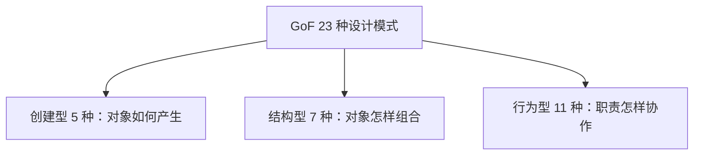

## UML 图例

| 符号 | 怎样读 | 识图时看什么 |
| --- | --- | --- |
| 实线＋空心三角形 | 子类指向父类 | 先找抽象角色及其具体实现。 |
| 虚线＋空心三角形 | 实现类指向接口 | 接口实现的常用画法；本图册主要用抽象类统一展示。 |
| 实线关联及引用箭头 | 持有者引用被指向的对象 | 看属性类型与箭头共同确认“谁持有谁”。 |
| 虚线依赖箭头 | 调用、创建或使用某类型 | 创建与调用标签表示依赖，不能看成继承。 |
| 空心菱形 | 共享聚合，菱形在整体端 | 不是父子继承；题图可能用普通关联表达持有。 |
| 实心菱形 | 组合所有权，菱形在整体端 | 本图册用文件夹拥有孩子作为组合的例子。 |
| 1 / 0..* | 一个 / 零到多个 | 装饰器包装一个组件，组合节点可含多个孩子。 |
| + / - / # / static | 公有 / 私有 / 受保护 / 静态 | 方法和属性也是识图线索。 |

符号可参考 [OMG UML 规范](https://www.omg.org/spec/UML/2.2/Superstructure/PDF/)。`{abstract}` 表示抽象角色；图中重复的抽象方法实现可以省略。菱形并不是每个“持有引用”都必须画，题图使用关联线也可能表达同一持有关系。

## 23 种模式索引

| 编号 | 模式 | 类别 |
| --- | --- | --- |
| 01 | [单例 / Singleton](#p01) | 创建型 |
| 02 | [工厂方法 / Factory Method](#p02) | 创建型 |
| 03 | [抽象工厂 / Abstract Factory](#p03) | 创建型 |
| 04 | [建造者 / Builder](#p04) | 创建型 |
| 05 | [原型 / Prototype](#p05) | 创建型 |
| 06 | [适配器 / Adapter](#p06) | 结构型 |
| 07 | [桥接 / Bridge](#p07) | 结构型 |
| 08 | [组合 / Composite](#p08) | 结构型 |
| 09 | [装饰器 / Decorator](#p09) | 结构型 |
| 10 | [外观 / Facade](#p10) | 结构型 |
| 11 | [享元 / Flyweight](#p11) | 结构型 |
| 12 | [代理 / Proxy](#p12) | 结构型 |
| 13 | [职责链 / Chain of Responsibility](#p13) | 行为型 |
| 14 | [命令 / Command](#p14) | 行为型 |
| 15 | [解释器 / Interpreter](#p15) | 行为型 |
| 16 | [迭代器 / Iterator](#p16) | 行为型 |
| 17 | [中介者 / Mediator](#p17) | 行为型 |
| 18 | [备忘录 / Memento](#p18) | 行为型 |
| 19 | [观察者 / Observer](#p19) | 行为型 |
| 20 | [状态 / State](#p20) | 行为型 |
| 21 | [策略 / Strategy](#p21) | 行为型 |
| 22 | [模板方法 / Template Method](#p22) | 行为型 |
| 23 | [访问者 / Visitor](#p23) | 行为型 |

## 创建型

### 01 单例 Singleton（也称单件）

**类别：创建型**

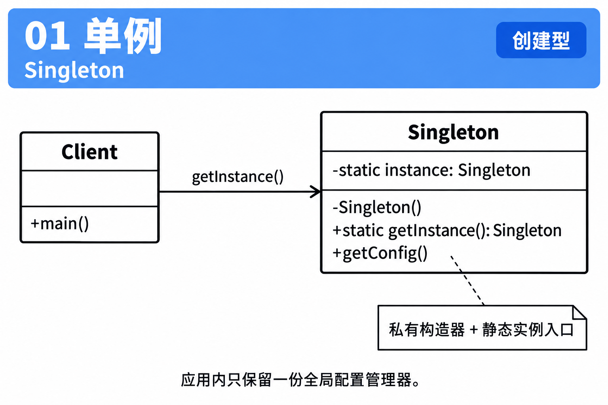

**先看哪里：** 一个类里同时出现私有构造器、静态自身引用和静态获取入口。

**例子与角色：** 应用内只保留一份全局配置管理器。 Singleton 对应 ConfigManager；Client 是读取配置的业务模块。

**怎样协作：** 业务模块调用 getInstance()，拿到同一管理器，再读取配置。

**主要优点：**

- 统一管理唯一实例与访问入口，避免调用者各自创建配置副本。
- 可以集中控制实例的创建时机。

**代价：** 会引入全局状态；并发创建与测试隔离仍需具体实现保证。

**容易混淆：** 只有一个工厂不等于单例；关键是受控的唯一实例。

[回到模式索引](#index)

### 02 工厂方法 Factory Method

**类别：创建型**

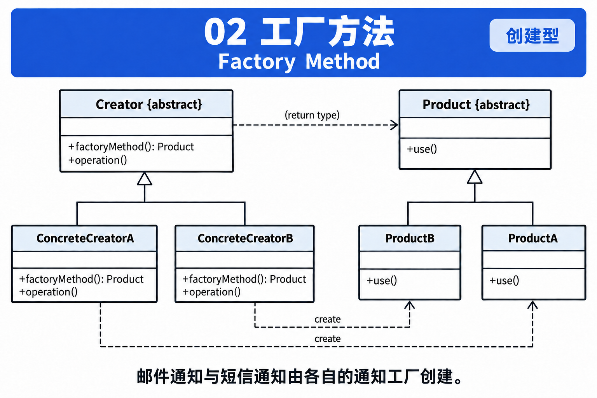

**先看哪里：** Creator 与 Product 各有继承层次；具体 Creator 覆盖一个返回 Product 的工厂方法。

**例子与角色：** 邮件通知与短信通知由各自的通知工厂创建。 Creator 是通知创建者；Product 是通知；CreatorA／ProductA 对应邮件，CreatorB／ProductB 对应短信。

**怎样协作：** 调用 Creator 的业务流程，由子类的 factoryMethod() 决定返回哪种 Product。

**主要优点：**

- 使用产品的代码依赖抽象产品，减少与具体构造过程的耦合。
- 新增具体产品时，可以增加相应创建者子类。

**代价：** 产品种类增加时，创建者子类通常也会增加。

**容易混淆：** 工厂方法侧重由子类决定一种产品的创建；抽象工厂侧重成套产品族。简单工厂不属于这 23 种 GoF 模式。

[回到模式索引](#index)

### 03 抽象工厂 Abstract Factory

**类别：创建型**

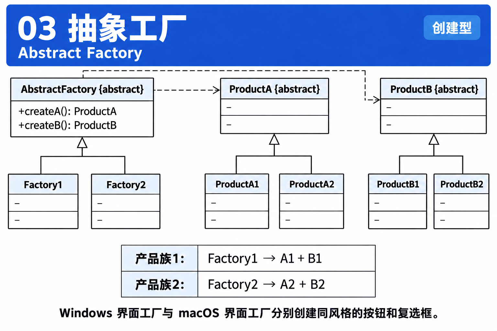

**先看哪里：** 工厂接口有 createA()、createB() 多个创建方法；多个产品等级分别有继承层次。

**例子与角色：** Windows 界面工厂与 macOS 界面工厂分别创建同风格的按钮和复选框。 Factory1 的 A1／B1 属于同一产品族；Factory2 的 A2／B2 属于另一产品族。A、B 是不同产品等级。

**怎样协作：** 先选定一个具体工厂，再由它创建相互配套的 A 和 B，客户端使用产品抽象。

**主要优点：**

- 使同一产品族保持一致，避免混用不同风格的配套对象。
- 替换具体工厂可以切换整套产品，而使用方仍依赖抽象。

**代价：** 新增一个产品等级时，通常需要修改抽象工厂及所有具体工厂。

**容易混淆：** 产品族是同一品牌／风格的一套 A+B；产品等级是所有 A 或所有 B，不能混为一谈。

[回到模式索引](#index)

### 04 建造者 Builder（也称生成器）

**类别：创建型**

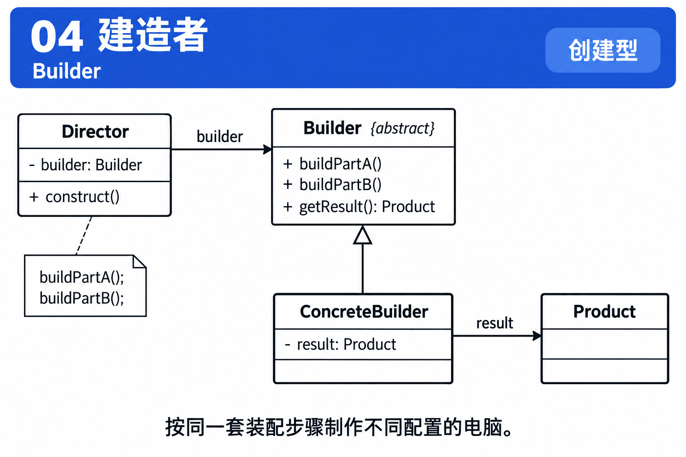

**先看哪里：** Director 持有 Builder；Builder 有多个 buildPart 步骤；ConcreteBuilder 产出 Product。

**例子与角色：** 按同一套装配步骤制作不同配置的电脑。 Director 是装配流程；Builder 是构造步骤；ConcreteBuilder 是某配置的装配器；Product 是成品电脑。

**怎样协作：** Director 按顺序调用 buildPartA()、buildPartB()，由具体建造者组装并返回结果。

**主要优点：**

- 复用稳定的构造流程，让不同建造者生成不同表示。
- 将复杂对象的分步构造与最终产品分离，便于逐步装配。

**代价：** 需要额外的步骤接口与建造者；简单对象不一定值得这样组织。

**容易混淆：** Builder 强调分步骤构造一个复杂结果；抽象工厂强调创建一套相关产品。Director 在实际实现中可以省略。

[回到模式索引](#index)

### 05 原型 Prototype

**类别：创建型**

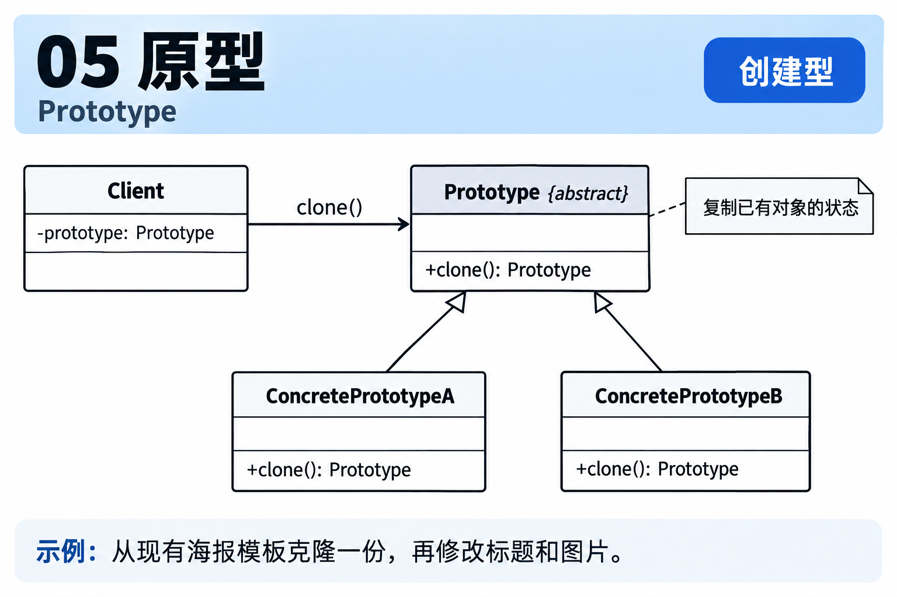

**先看哪里：** Prototype 定义 clone()，多个具体原型继承它；客户端面向原型复制。

**例子与角色：** 从现有海报模板克隆一份，再修改标题和图片。 Prototype 是模板抽象；ConcretePrototypeA／B 是不同模板；Client 是编辑器。

**怎样协作：** 客户端持有某个原型并调用 clone()，再调整复制对象的差异。

**主要优点：**

- 减少客户端对具体构造类与构造细节的依赖。
- 适合已有对象作为创建样板的场景，可复用其初始化状态。

**代价：** 复制共享引用还是复制完整对象图，需要明确浅拷贝与深拷贝边界。

**容易混淆：** 原型靠复制已有对象创建新对象；单例要求受控地保留唯一实例。

[回到模式索引](#index)

## 结构型

### 06 适配器 Adapter

**类别：结构型**

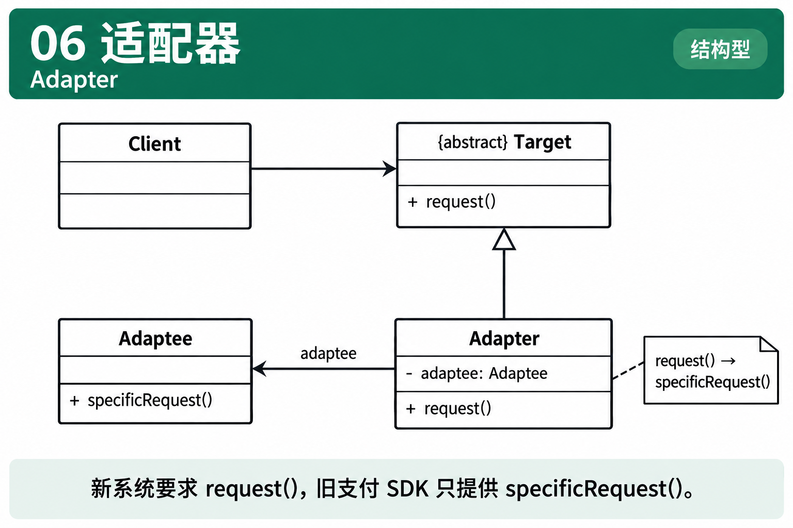

**先看哪里：** Adapter 继承 Target，却持有接口不同的 Adaptee；调用被转换后再转发。

**例子与角色：** 新系统要求 request()，旧支付 SDK 只提供 specificRequest()。 Target 是新系统接口；Adaptee 是旧 SDK；Adapter 是转换包装；Client 使用 Target。

**怎样协作：** Client 调用 Target.request()，Adapter 在内部转成 Adaptee.specificRequest()。

**主要优点：**

- 复用已有实现，减少对旧组件的修改。
- 让使用方继续依赖它熟悉的目标接口。

**代价：** 增加转换层；语义不兼容时，改方法名并不能解决问题。

**容易混淆：** 本图是对象适配器。适配器转换已有接口；桥接预先分离两个可独立变化的维度。

[回到模式索引](#index)

### 07 桥接 Bridge

**类别：结构型**

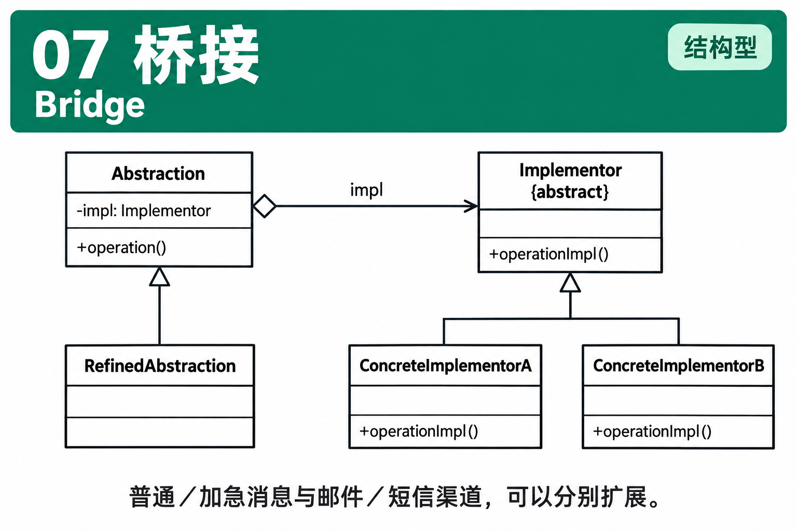

**先看哪里：** 两条独立继承层次横向相连：Abstraction 持有 Implementor。

**例子与角色：** 普通／加急消息与邮件／短信渠道，可以分别扩展。 Abstraction 是消息业务抽象；RefinedAbstraction 是加急消息；Implementor 是发送渠道；实现 A／B 是邮件与短信。

**怎样协作：** 业务抽象执行 operation()，再委托 impl.operationImpl() 完成渠道相关部分。

**主要优点：**

- 让业务种类与实现渠道独立扩展，减少两维组合导致的子类膨胀。
- 使用组合连接两端，便于替换底层实现。

**代价：** 需要提前识别真正独立的变化维度，并增加抽象层。

**容易混淆：** 左边的 Abstraction 持有右边实现，题图若使用空心菱形，菱形在 Abstraction 端。桥接不是命令队列。

[回到模式索引](#index)

### 08 组合 Composite

**类别：结构型**

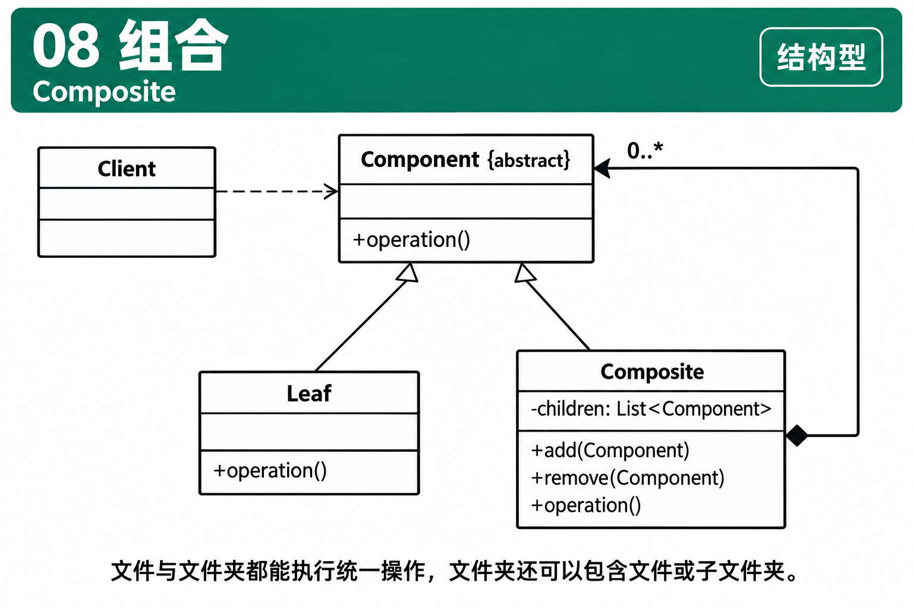

**先看哪里：** Leaf 与 Composite 都继承 Component；Composite 的 children 指回 Component。

**例子与角色：** 文件与文件夹都能执行统一操作，文件夹还可以包含文件或子文件夹。 Component 是文件系统节点；Leaf 是文件；Composite 是文件夹；Client 统一使用 Component。

**怎样协作：** 对叶子调用 operation() 直接工作；对容器调用相同操作，再递归访问孩子。

**主要优点：**

- 统一操作单个对象和对象集合。
- 自然表达整体—部分的树形结构，便于递归扩展。

**代价：** 统一接口可能包含叶子不适用的管理操作；约束孩子类型时需额外设计。

**容易混淆：** 组合是结构型。解释器也可能呈树形，但它关心语法规则和 interpret() 的求值。

[回到模式索引](#index)

### 09 装饰器 Decorator（也称装饰）

**类别：结构型**

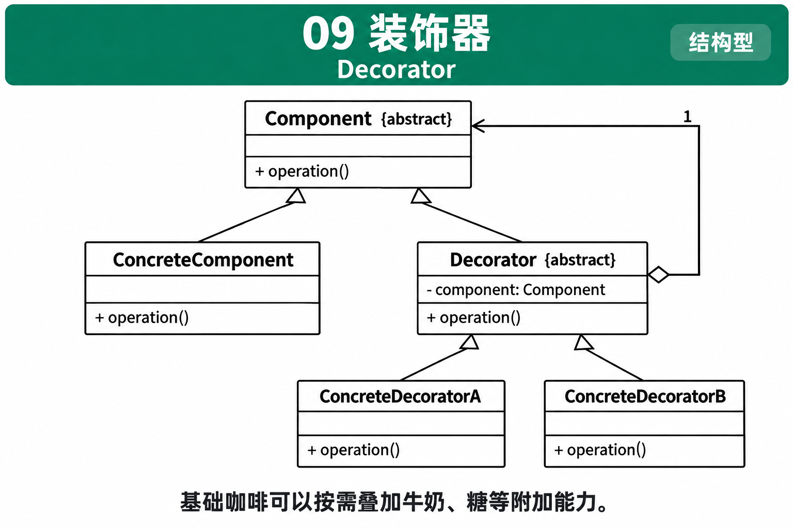

**先看哪里：** Decorator 与 ConcreteComponent 同属 Component；Decorator 又持有一个 Component。

**例子与角色：** 基础咖啡可以按需叠加牛奶、糖等附加能力。 Component 是饮品接口；ConcreteComponent 是基础咖啡；ConcreteDecoratorA／B 是加奶、加糖包装。

**怎样协作：** 外层装饰器先后执行自己的附加逻辑，并把统一接口调用委托给内部 component；可以再套一层。

**主要优点：**

- 在运行时按需组合职责，减少为每种组合建立子类。
- 包装前后仍保持同一抽象接口。

**代价：** 包装层多时，调试、对象身份及执行顺序更难追踪。

**容易混淆：** 动态添加职责仍属结构型。装饰器与代理的骨架可能相同，须看是叠加能力还是控制访问。

[回到模式索引](#index)

### 10 外观 Facade

**类别：结构型**

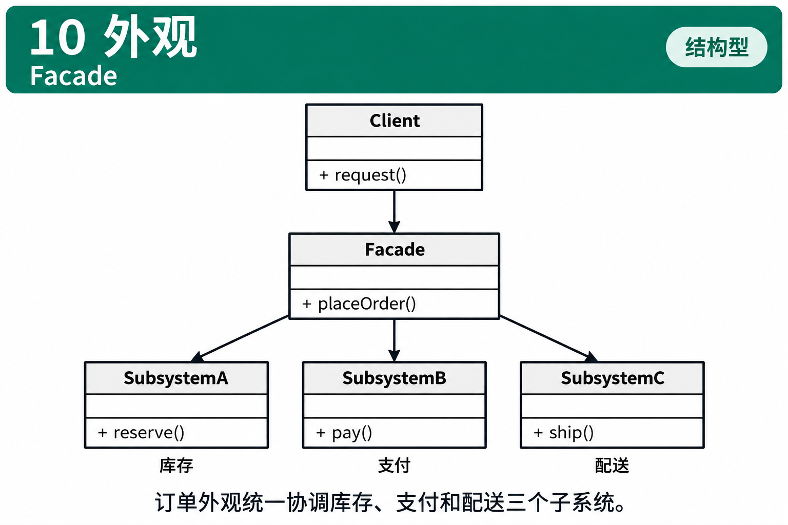

**先看哪里：** Client 只连接一个 Facade，Facade 再连接多个功能不同的子系统；不要求继承树。

**例子与角色：** 订单外观统一协调库存、支付和配送三个子系统。 Facade 是订单入口；SubsystemA／B／C 分别负责库存、支付和配送。

**怎样协作：** Client 调用 Facade.placeOrder()，由外观按业务顺序协调各子系统。

**主要优点：**

- 为复杂子系统提供较易使用的统一入口。
- 减少客户端直接依赖许多子系统细节的情况。

**代价：** 外观过大可能变成集中所有职责的庞大类。

**容易混淆：** 外观简化入口；适配器转换接口；中介者主要协调同事对象之间的交互。外观通常不禁止直接访问子系统。

[回到模式索引](#index)

### 11 享元 Flyweight

**类别：结构型**

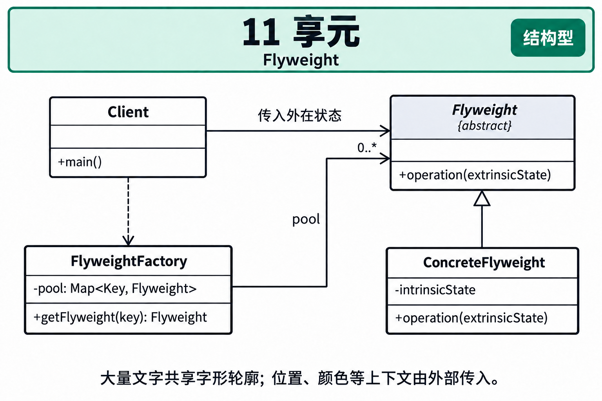

**先看哪里：** Factory 有按 key 索引的对象池；Flyweight.operation() 接受外在状态。

**例子与角色：** 大量文字共享字形轮廓；位置、颜色等上下文由外部传入。 FlyweightFactory 管理字形池；ConcreteFlyweight 保存字形等内在状态；Client 提供位置等外在状态。

**怎样协作：** 按 key 从池中取得共享对象，再把本次使用的 extrinsicState 传给 operation()。

**主要优点：**

- 多个相似对象共享内在状态，减少重复对象占用。
- 共享对象的取得与复用由工厂集中管理。

**代价：** 必须区分内在、外在状态，并承担池管理和查找的成本。

**容易混淆：** 享元属结构型，重心是共享对象结构；它不要求像单例那样全系统只有一个对象，也不要求所有对象都共享。

[回到模式索引](#index)

### 12 代理 Proxy

**类别：结构型**

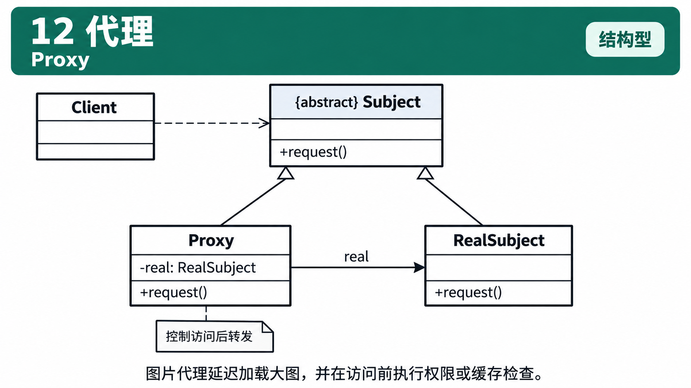

**先看哪里：** Proxy 与 RealSubject 继承同一个 Subject；Proxy 持有真实对象并代为响应相同接口。

**例子与角色：** 图片代理延迟加载大图，并在访问前执行权限或缓存检查。 Subject 是图片接口；RealSubject 真正加载、显示图片；Proxy 控制什么时候或是否转交请求。

**怎样协作：** Client 调用 Subject.request()，代理先控制访问，再按需要调用真实对象。

**主要优点：**

- 在统一接口后集中实现延迟加载、远程访问或访问控制。
- 使用方通常可以透明使用代理或真实对象。

**代价：** 增加间接调用；远程代理等情形还会引入额外失败与延迟语义。

**容易混淆：** 控制访问属于结构型。代理有时也持有 Subject，因此不能仅凭图形外观与装饰器区分。

[回到模式索引](#index)

## 行为型

### 13 职责链 Chain of Responsibility（也称责任链）

**类别：行为型**

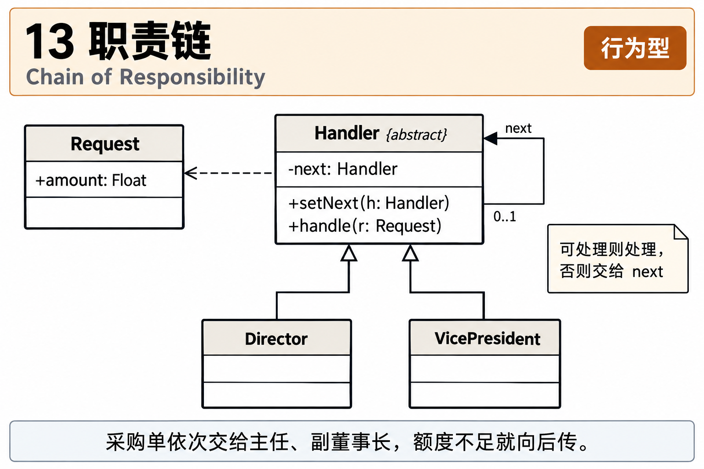

**先看哪里：** Handler 的 next 指回 Handler；具体处理者共同继承它。

**例子与角色：** 采购单依次交给主任、副董事长，额度不足就向后传。 Handler 是审批抽象；Director、VicePresident 是两级审批者；Request 是采购单。

**怎样协作：** 能审批就处理，否则交给 next；链尾也可能无人处理。

**主要优点：**

- 发送者不必指定最终审批者。
- 可调整处理者的次序与组合。

**代价：** 请求可能无人处理，排查需沿链追踪。

**容易混淆：** 职责链逐级寻找处理者；观察者通常通知多个订阅者。

[回到模式索引](#index)

### 14 命令 Command

**类别：行为型**

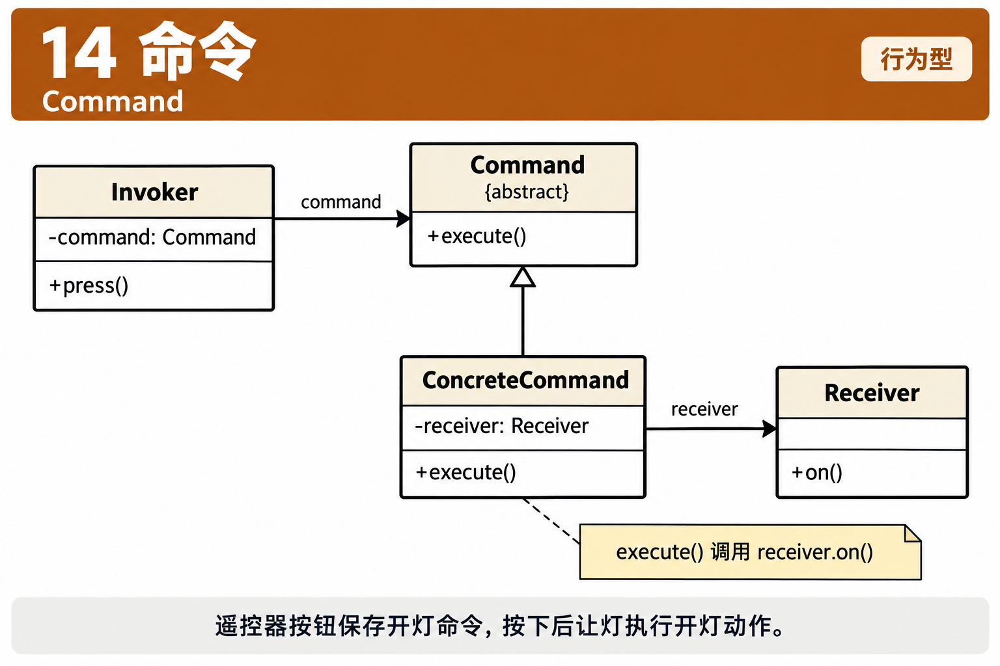

**先看哪里：** Invoker 持有 Command；具体命令另外持有 Receiver。

**例子与角色：** 遥控器按钮保存开灯命令，按下后让灯执行开灯动作。 Invoker 是按钮；Command 是命令抽象；ConcreteCommand 是开灯命令；Receiver 是灯。

**怎样协作：** 按钮调用 execute()，开灯命令再调用灯的 on()。

**主要优点：**

- 请求发起者与实际执行者分离。
- 请求对象化后便于排队与记录。

**代价：** 每类命令可能增加一个类；撤销需另行实现。

**容易混淆：** 命令封装请求；访问者通过 accept 和 visit 扩展元素操作。

[回到模式索引](#index)

### 15 解释器 Interpreter

**类别：行为型**

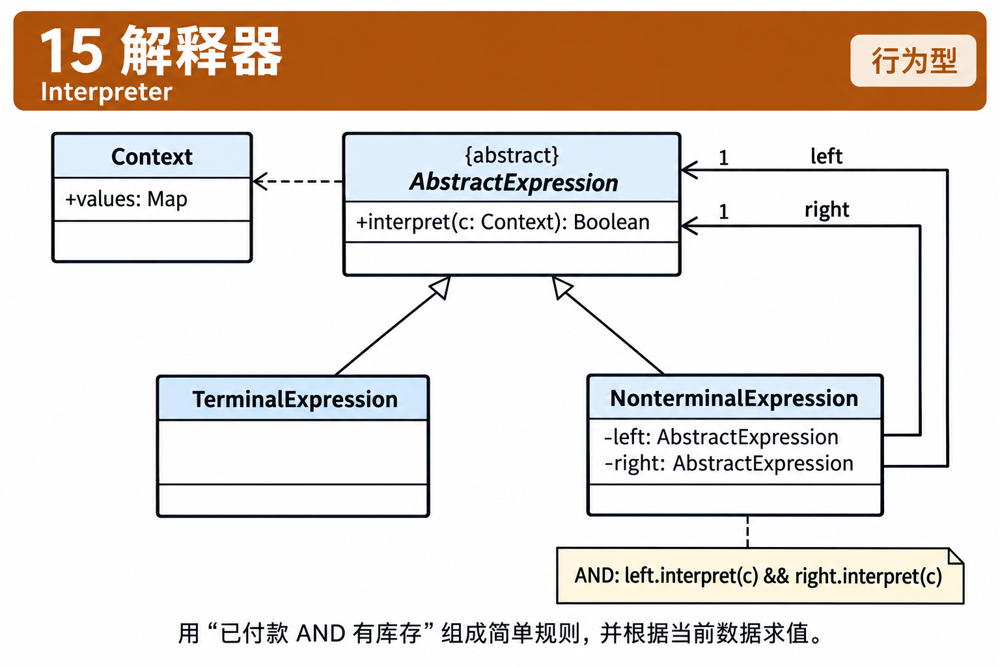

**先看哪里：** 表达式有 interpret(context)；非终结符保存子表达式。

**例子与角色：** 用“已付款 AND 有库存”组成简单规则，并根据当前数据求值。 AbstractExpression 是表达式抽象；TerminalExpression 判断条件；NonterminalExpression 表示二元 AND；Context 保存数据。

**怎样协作：** AND 分别解释左右表达式，再合并布尔结果。

**主要优点：**

- 用对象结构直接表达简单语法。
- 可递归组合已有表达式。

**代价：** 复杂语法会产生许多类，执行效率也可能受限。

**容易混淆：** 解释器属行为型；组合属结构型，二者都可能画成树。

[回到模式索引](#index)

### 16 迭代器 Iterator

**类别：行为型**

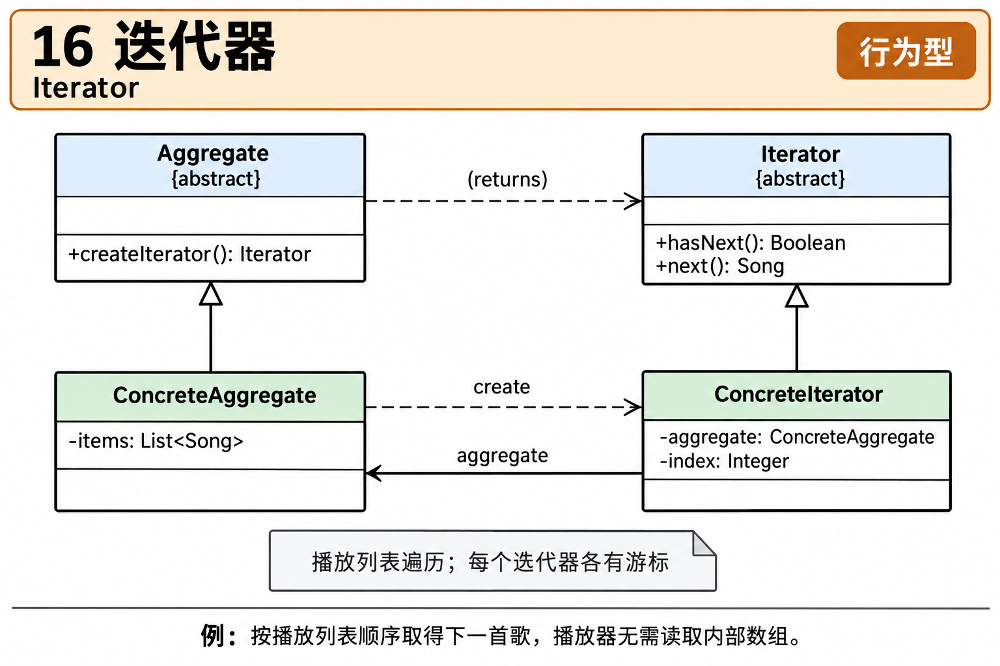

**先看哪里：** Aggregate 创建 Iterator；具体迭代器持有具体聚合并记录游标。

**例子与角色：** 按播放列表顺序取得下一首歌，播放器无需读取内部数组。 Aggregate 是列表抽象；ConcreteAggregate 保存歌曲；Iterator 是遍历抽象；ConcreteIterator 管理位置。

**怎样协作：** 先 createIterator()，再用 hasNext()、next() 逐项访问。

**主要优点：**

- 隐藏集合内部表示。
- 多个迭代器可分别维护遍历位置。

**代价：** 增加遍历对象；遍历时修改集合需约定行为。

**容易混淆：** 迭代器管理遍历过程；访问者封装施加于元素的操作。

[回到模式索引](#index)

### 17 中介者 Mediator（也称调停者）

**类别：行为型**

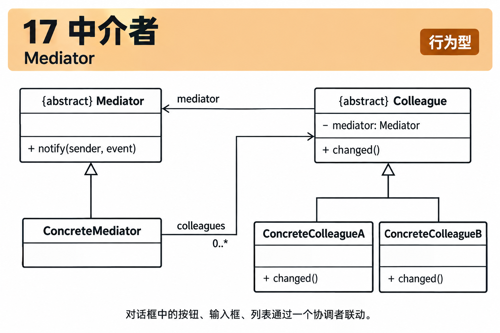

**先看哪里：** 同事对象指向 Mediator，具体中介者集中协调多个同事。

**例子与角色：** 对话框中的按钮、输入框、列表通过一个协调者联动。 Colleague 是控件抽象；ColleagueA／B 是不同控件；ConcreteMediator 是对话框协调逻辑。

**怎样协作：** 控件报告发生的事件，中介者决定通知哪个控件更新，控件之间减少直接引用。

**主要优点：**

- 将多对多交互集中到协调对象，减少同事之间的相互依赖。
- 同事类更便于复用，交互规则可以在中介者中调整。

**代价：** 中介者可能承担过多逻辑，成为复杂的协调中心。

**容易混淆：** 观察者偏向一对多通知；中介者还决定交互规则。同事对象不一定必须继承同一父类，本图采用常见抽象同事画法。

[回到模式索引](#index)

### 18 备忘录 Memento

**类别：行为型**

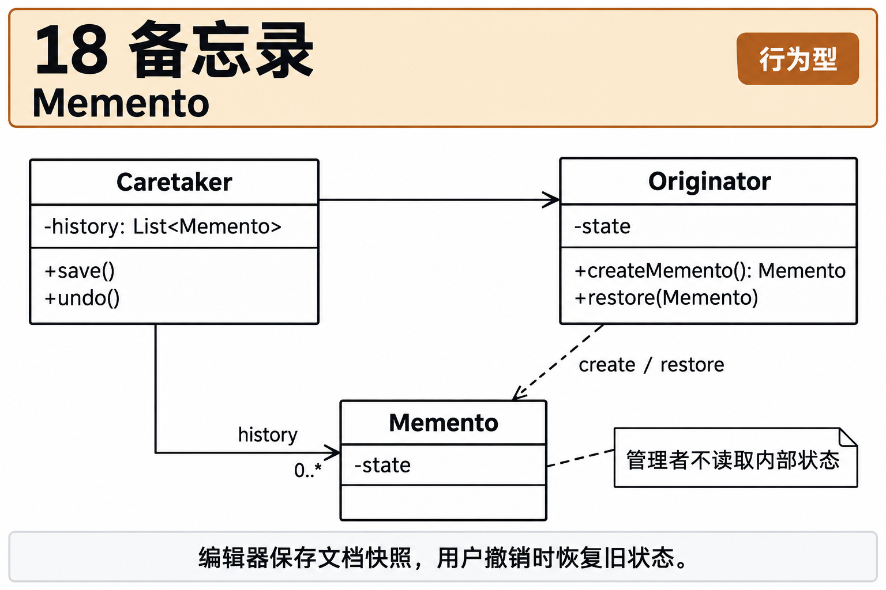

**先看哪里：** Originator 生成／恢复 Memento，Caretaker 保存快照但不解释其内部状态。

**例子与角色：** 编辑器保存文档快照，用户撤销时恢复旧状态。 Originator 是编辑器；Memento 是状态快照；Caretaker 是历史管理器。

**怎样协作：** 历史管理器保存由编辑器创建的快照；恢复时将快照交还编辑器。

**主要优点：**

- 在不向管理者公开内部状态细节的前提下保存与恢复状态。
- 将历史保存职责从业务对象中分离。

**代价：** 快照多或状态大时，会增加存储与复制成本。

**容易混淆：** 备忘录保存状态；命令保存请求。撤销功能可以同时使用两者，不能见到“撤销”就只选其中一个。

[回到模式索引](#index)

### 19 观察者 Observer

**类别：行为型**

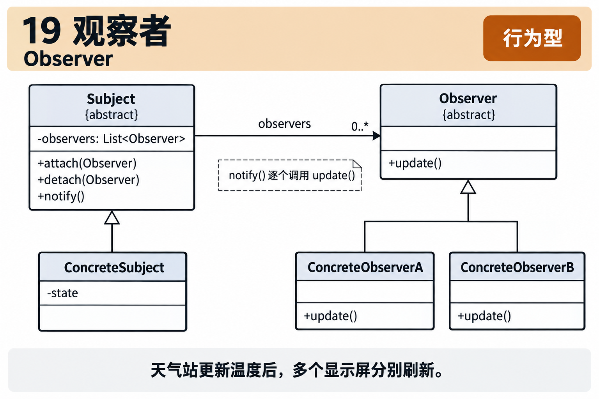

**先看哪里：** Subject 持有一组 Observer；通知方法逐个调用 update()。

**例子与角色：** 天气站更新温度后，多个显示屏分别刷新。 Subject 是被观察目标；ConcreteSubject 是天气站；ConcreteObserverA／B 是两个显示屏。

**怎样协作：** 显示屏先订阅；目标状态变化后执行 notify()，分别通知各个观察者。

**主要优点：**

- 发布者依赖观察者抽象，便于增加或移除订阅者。
- 用一对多依赖传播变化，避免目标直接耦合每种显示实现。

**代价：** 通知顺序、循环更新和订阅生命周期需要管理。

**容易混淆：** 观察者是多个接收者分别收到通知；职责链沿后继逐个尝试处理；中介者集中协调多方交互。

[回到模式索引](#index)

### 20 状态 State

**类别：行为型**

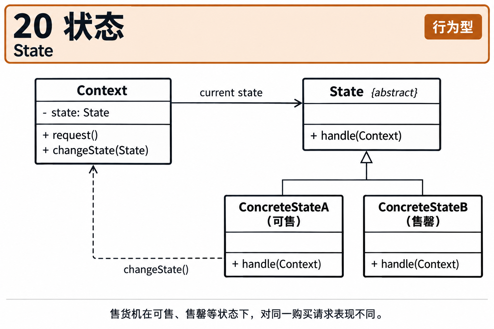

**先看哪里：** Context 持有 State，多种 ConcreteState 封装各自的状态相关行为。

**例子与角色：** 售货机在可售、售罄等状态下，对同一购买请求表现不同。 Context 是售货机；ConcreteStateA／B 分别表示可售、售罄；State 是状态行为抽象。

**怎样协作：** Context 将请求交给当前 state.handle(context)；状态变化时替换当前状态对象。

**主要优点：**

- 将某个状态下的行为集中到相应状态类，减少散落的状态条件分支。
- 状态行为与切换意图可以显式表达，便于扩展状态。

**代价：** 状态类可能增多，转换规则也需要保持清楚。

**容易混淆：** State 与 Strategy 的类图骨架可能相同。状态关心状态变化导致行为变化；策略关心同一任务的算法替换。

[回到模式索引](#index)

### 21 策略 Strategy

**类别：行为型**

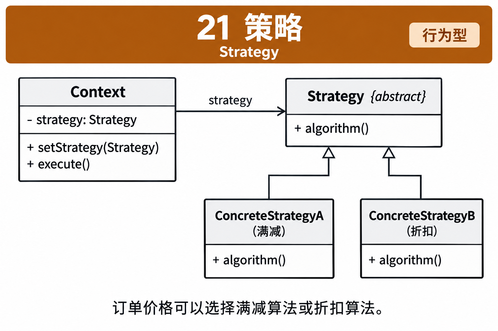

**先看哪里：** Context 持有 Strategy，并把同一项计算委托给可替换的算法子类。

**例子与角色：** 订单价格可以选择满减算法或折扣算法。 Context 是订单计价器；ConcreteStrategyA／B 是满减、折扣算法；Strategy 定义算法入口。

**怎样协作：** 选定策略后调用 Context.execute()，由当前 strategy.algorithm() 完成算法。

**主要优点：**

- 把不同算法封装为可替换对象，减少计价器内部的大段选择分支。
- 算法可以独立测试和扩展，并可在运行时替换。

**代价：** 使用方或配置需要知道策略差异；策略对象数量可能增加。

**容易混淆：** 策略不等于自动状态切换。模板方法依靠继承复用步骤骨架；策略通过持有另一个对象替换算法。

[回到模式索引](#index)

### 22 模板方法 Template Method

**类别：行为型**

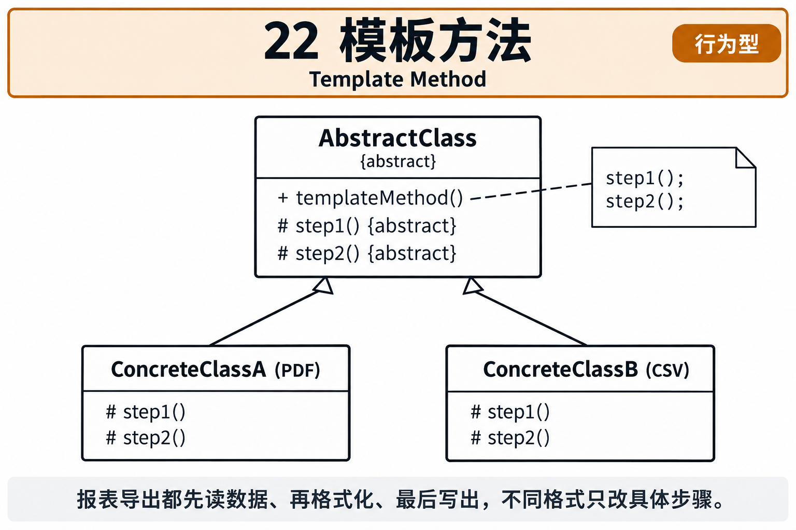

**先看哪里：** 同一父类中既有模板方法，又有待子类实现的基本步骤；图的核心是继承。

**例子与角色：** 报表导出都先读数据、再格式化、最后写出，不同格式只改具体步骤。 AbstractClass 固定导出流程；ConcreteClassA／B 分别实现 PDF、CSV 的步骤。

**怎样协作：** templateMethod() 按既定顺序调用 step1()、step2()，实际步骤执行子类实现。

**主要优点：**

- 复用稳定流程，减少重复的组织代码。
- 把允许变化的步骤明确留给子类。

**代价：** 对子类有继承耦合；流程骨架变化可能影响所有子类。

**容易混淆：** 模板方法的变化点在继承层次里；策略的变化点在 Context 持有的策略对象里。模板方法并不表示所有方法都抽象。

[回到模式索引](#index)

### 23 访问者 Visitor

**类别：行为型**

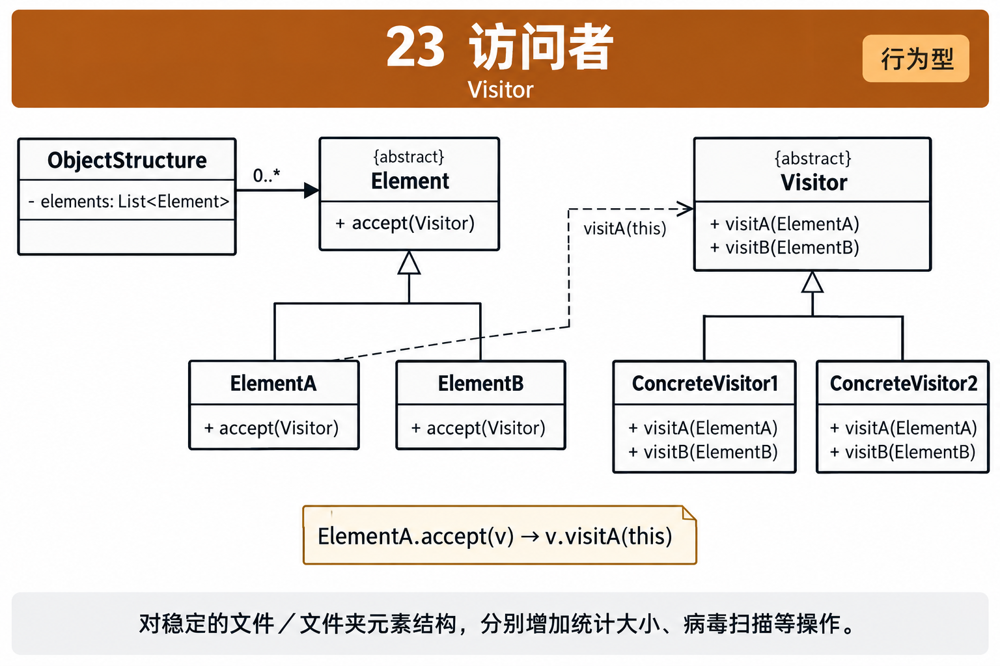

**先看哪里：** Element 与 Visitor 两套继承层次；元素有 accept(visitor)，访问者有按元素类型区分的 visitA／visitB。

**例子与角色：** 对稳定的文件／文件夹元素结构，分别增加统计大小、病毒扫描等操作。 ElementA／B 是不同元素；ConcreteVisitor1／2 是不同操作；ObjectStructure 保存元素集合。

**怎样协作：** ElementA.accept(v) 内调用 v.visitA(this)，再由具体访问者执行对应操作，体现双分派。

**主要优点：**

- 在元素类型较稳定时，便于增加新的跨元素操作。
- 同一种操作可以集中在一个具体访问者中。

**代价：** 增加元素类型往往要修改 Visitor 接口及所有具体访问者，也可能要求暴露访问所需信息。

**容易混淆：** 访问者把新操作放到访问者层次；命令把请求对象化。accept() 与按元素重载的 visit() 是关键。

[回到模式索引](#index)

## 易混模式对照

| 相近组合 | 判别主线 | 类别 |
| --- | --- | --- |
| 工厂方法／抽象工厂／建造者 | 一个产品的多态创建／一套产品族／分步骤组装复杂结果 | 都属创建型 |
| 适配器／桥接 | 转换已有的不兼容接口／分开两个可独立扩展的维度 | 都属结构型 |
| 装饰器／代理 | 叠加职责／控制访问；两者类图骨架可能相同 | 都属结构型 |
| 组合／解释器 | 统一操作部件树／按语法树求值；不能看到树就只选组合 | 结构型／行为型 |
| 策略／状态／模板方法 | 替换算法／随状态改变行为／父类固定步骤骨架 | 都属行为型 |
| 观察者／中介者／职责链 | 一对多通知／中心协调交互／沿后继尝试处理 | 都属行为型 |
| 命令／备忘录／访问者 | 请求对象化／状态快照／把新操作放在访问者层次 | 都属行为型 |

图看起来相近时，回到题干中的变化目标：是改变创建方式、改变组合结构，还是改变职责分配。尤其不要把“动态添加职责”的装饰器误归行为型，也不要把“请求封装为对象”的命令误归创建型。

## 资料与使用

- 分类依据：[GoF 原书目录](https://www.informit.com/store/design-patterns-elements-of-reusable-object-oriented-9780321770462)。
- 通用 UML 符号：[OMG UML 规范](https://www.omg.org/spec/UML/2.2/Superstructure/PDF/)。
- 本地对应章节：[第五章软件工程基础知识](https://github.com/Goodyzhang/ruankao.skill/blob/main/materials/%E7%B3%BB%E7%BB%9F%E6%9E%B6%E6%9E%84%E8%AE%BE%E8%AE%A1%E5%B8%88/%E7%AC%94%E8%AE%B0/%E7%9F%A5%E8%AF%86%E7%82%B9/05-%E8%BD%AF%E4%BB%B6%E5%B7%A5%E7%A8%8B%E5%9F%BA%E7%A1%80%E7%9F%A5%E8%AF%86.md)。
- 图片为本次内置图像生成的识图示意；23 张图片均位于 `graphs/`，移动手册时请一并保留。
- 制作与验收：设计模式识图制作记录。
